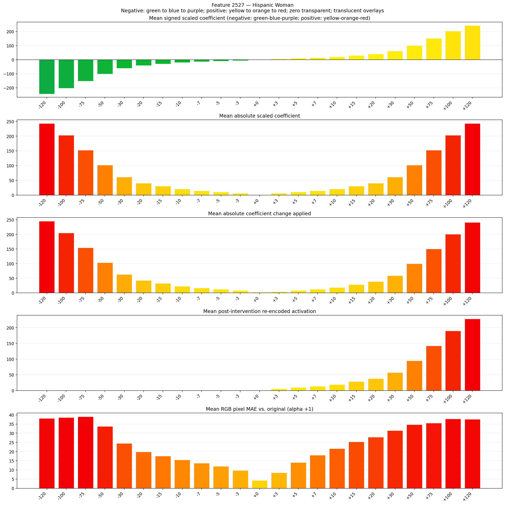
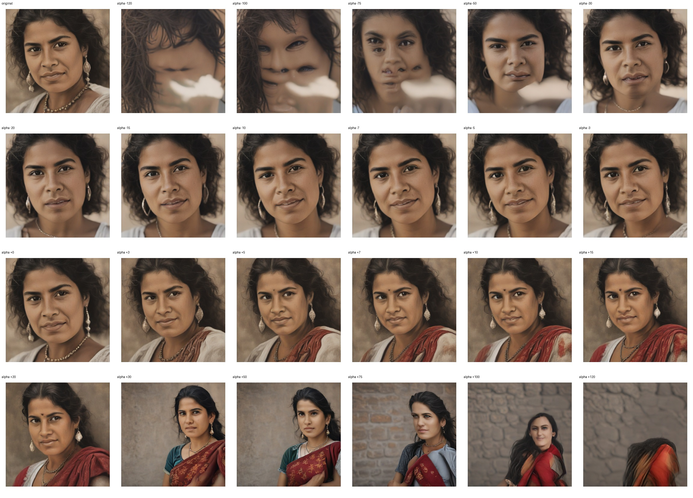
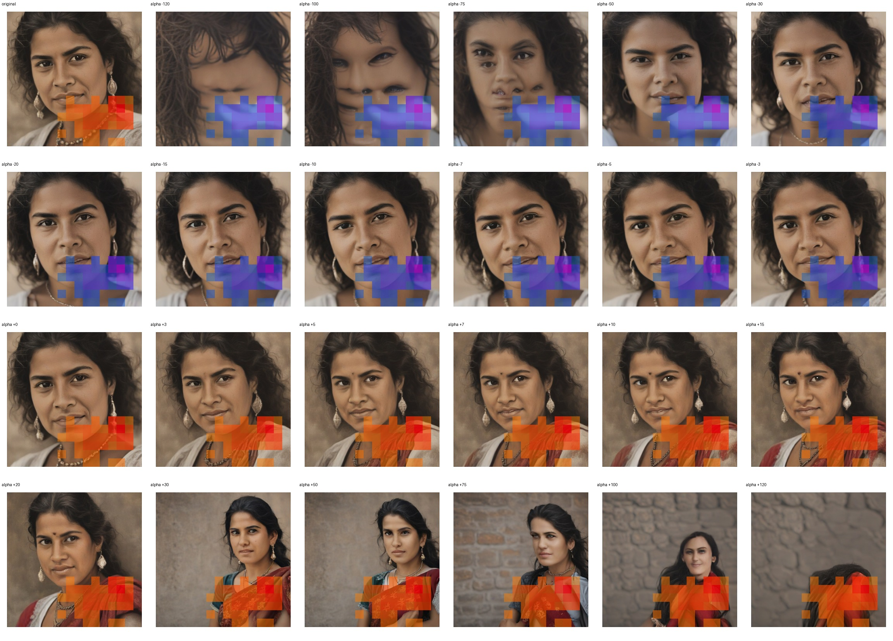
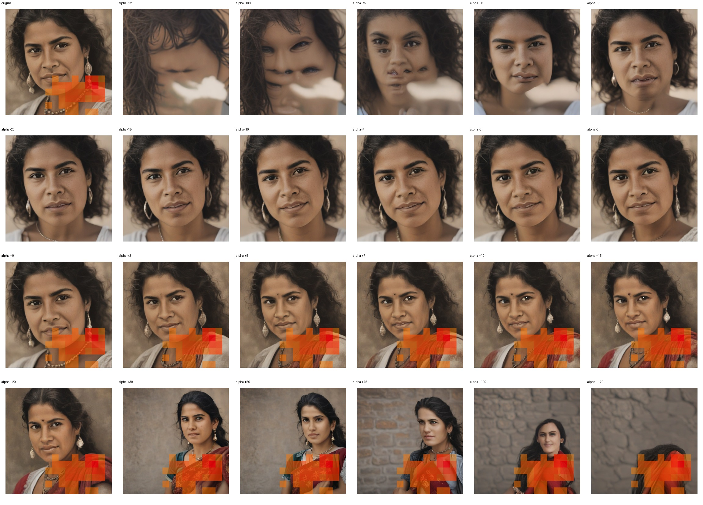

# Feature 2527 — Hispanic Woman

Biased dataset; original prompt and seed replay for seeds 0–19. Values are means across 20 source images. The table reports the mean post-re-encoded activation of feature 2527, the active spatial fraction, mean RGB pixel MAE versus the original image (0–255 scale), and coefficient change magnitudes for each alpha.

## Activation graph

## Mean metrics by alpha

| Alpha | Mean post-reencoded feature 2527 activation | Active spatial fraction | Mean pixel change (MAE) | Mean absolute coefficient change | Mean absolute scaled coefficient |
|---:|---:|---:|---:|---:|---:|
| -120 | 0.000 | 0.000 | 38.073 | 245.454 | 243.426 |
| -100 | 0.000 | 0.000 | 38.557 | 204.883 | 202.855 |
| -75 | 0.000 | 0.000 | 39.039 | 154.170 | 152.141 |
| -50 | 0.000 | 0.000 | 33.735 | 103.456 | 101.427 |
| -30 | 0.000 | 0.000 | 24.490 | 62.885 | 60.856 |
| -20 | 0.000 | 0.000 | 19.825 | 42.600 | 40.571 |
| -15 | 0.000 | 0.000 | 17.611 | 32.457 | 30.428 |
| -10 | 0.000 | 0.000 | 15.488 | 22.314 | 20.285 |
| -7 | 0.000 | 0.000 | 13.687 | 16.228 | 14.200 |
| -5 | 0.000 | 0.000 | 12.006 | 12.171 | 10.143 |
| -3 | 0.000 | 0.000 | 9.758 | 8.114 | 6.086 |
| +0 | 0.000 | 0.000 | 4.308 | 2.029 | 0.000 |
| +3 | 5.824 | 0.145 | 8.461 | 4.057 | 6.086 |
| +5 | 9.620 | 0.145 | 14.093 | 8.114 | 10.143 |
| +7 | 13.416 | 0.145 | 18.053 | 12.171 | 14.200 |
| +10 | 19.109 | 0.145 | 21.618 | 18.257 | 20.285 |
| +15 | 28.598 | 0.145 | 25.341 | 28.400 | 30.428 |
| +20 | 38.088 | 0.145 | 27.886 | 38.542 | 40.571 |
| +30 | 57.066 | 0.145 | 31.492 | 58.828 | 60.856 |
| +50 | 95.024 | 0.145 | 34.691 | 99.399 | 101.427 |
| +75 | 142.470 | 0.145 | 35.503 | 150.113 | 152.141 |
| +100 | 189.916 | 0.145 | 37.779 | 200.826 | 202.855 |
| +120 | 227.873 | 0.145 | 37.617 | 241.397 | 243.426 |

## Per-seed grids

Each 4×6 sheet contains the original followed by the 23 alpha variants in ascending alpha order, from −120 through +120.

### Plain images

[All 20 plain-image grids](seed_sheets/)

### Signed coefficient overlays

[All 20 signed coefficient grids](signed_coefficient_overlays/)

### Post-re-encoded activation overlays

[All 20 post-activation grids](post_activation_overlays/)

### Intervention-footprint overlays

[All 20 intervention-footprint grids](intervention_footprint_overlays/)

Zero is transparent. Negative coefficient colors progress green through blue to purple; positive colors progress yellow through orange to red. Each map tile is normalized individually for visibility. The original and alpha-zero tiles show the pre-intervention feature map so its location remains visible.
