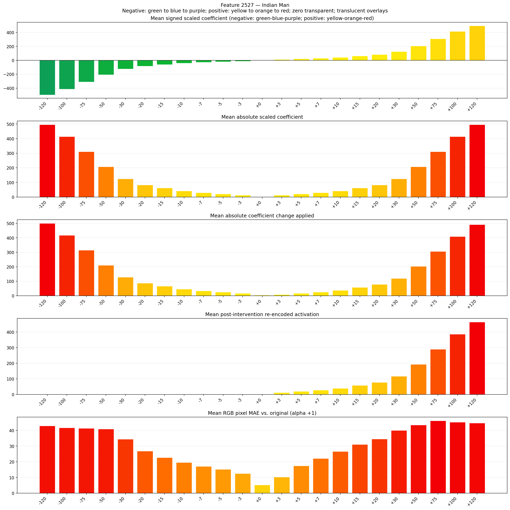
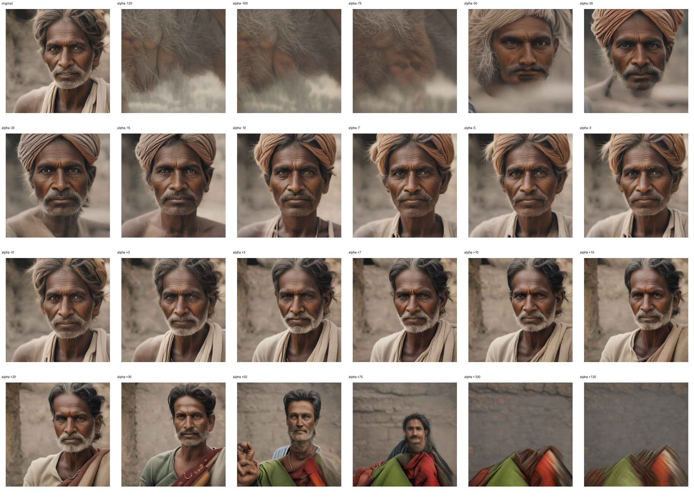
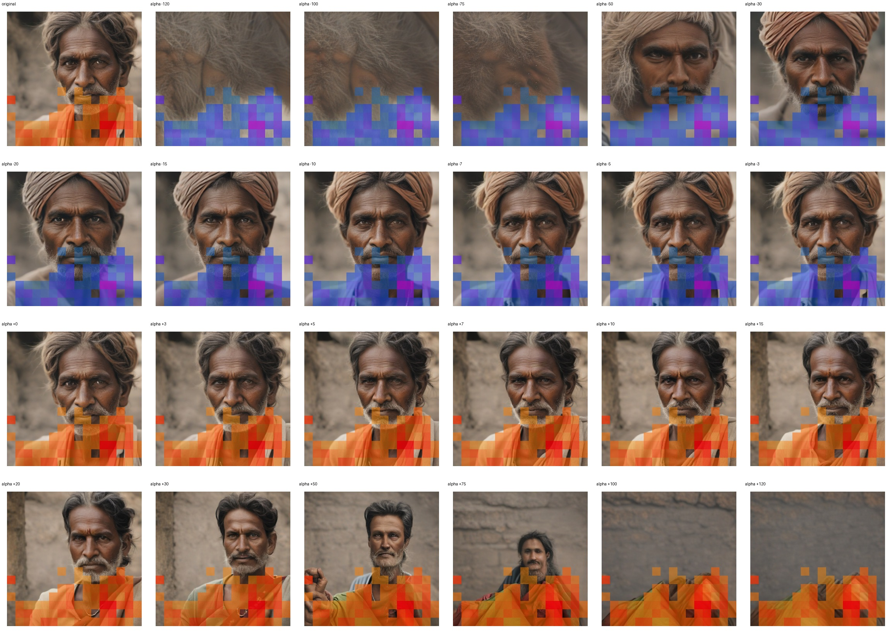
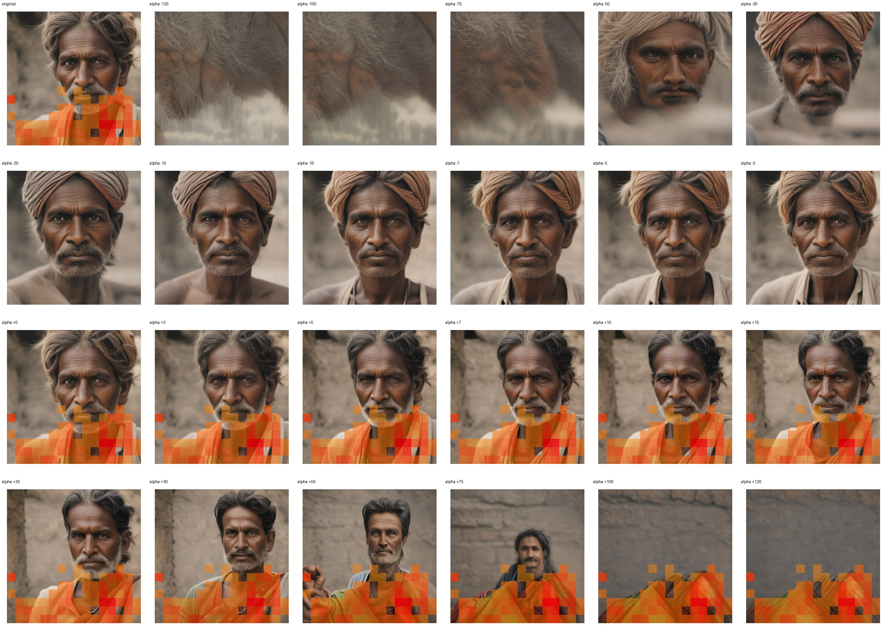

# Feature 2527 — Indian Man

Biased dataset; original prompt and seed replay for seeds 0–19. Values are means across 20 source images. The table reports the mean post-re-encoded activation of feature 2527, the active spatial fraction, mean RGB pixel MAE versus the original image (0–255 scale), and coefficient change magnitudes for each alpha.

## Activation graph

## Mean metrics by alpha

| Alpha | Mean post-reencoded feature 2527 activation | Active spatial fraction | Mean pixel change (MAE) | Mean absolute coefficient change | Mean absolute scaled coefficient |
|---:|---:|---:|---:|---:|---:|
| -120 | 0.000 | 0.000 | 42.868 | 500.181 | 496.048 |
| -100 | 0.000 | 0.000 | 41.719 | 417.507 | 413.373 |
| -75 | 0.000 | 0.000 | 41.302 | 314.164 | 310.030 |
| -50 | 0.000 | 0.000 | 40.931 | 210.820 | 206.687 |
| -30 | 0.000 | 0.000 | 34.368 | 128.146 | 124.012 |
| -20 | 0.000 | 0.000 | 26.783 | 86.808 | 82.675 |
| -15 | 0.000 | 0.000 | 22.654 | 66.140 | 62.006 |
| -10 | 0.000 | 0.000 | 19.575 | 45.471 | 41.337 |
| -7 | 0.000 | 0.000 | 17.044 | 33.070 | 28.936 |
| -5 | 0.000 | 0.000 | 15.179 | 24.802 | 20.669 |
| -3 | 0.000 | 0.000 | 12.515 | 16.535 | 12.401 |
| +0 | 0.000 | 0.000 | 5.279 | 4.134 | 0.000 |
| +3 | 11.869 | 0.266 | 10.267 | 8.267 | 12.401 |
| +5 | 19.603 | 0.266 | 17.416 | 16.535 | 20.669 |
| +7 | 27.338 | 0.266 | 22.136 | 24.802 | 28.936 |
| +10 | 38.940 | 0.266 | 26.534 | 37.204 | 41.337 |
| +15 | 58.277 | 0.266 | 31.109 | 57.872 | 62.006 |
| +20 | 77.614 | 0.266 | 34.533 | 78.541 | 82.675 |
| +30 | 116.288 | 0.266 | 39.969 | 119.878 | 124.012 |
| +50 | 193.637 | 0.266 | 43.506 | 202.553 | 206.687 |
| +75 | 290.322 | 0.266 | 46.165 | 305.896 | 310.030 |
| +100 | 387.007 | 0.266 | 45.213 | 409.239 | 413.373 |
| +120 | 464.355 | 0.266 | 44.677 | 491.914 | 496.048 |

## Per-seed grids

Each 4×6 sheet contains the original followed by the 23 alpha variants in ascending alpha order, from −120 through +120.

### Plain images

[All 20 plain-image grids](seed_sheets/)

### Signed coefficient overlays

[All 20 signed coefficient grids](signed_coefficient_overlays/)

### Post-re-encoded activation overlays

[All 20 post-activation grids](post_activation_overlays/)

### Intervention-footprint overlays

[All 20 intervention-footprint grids](intervention_footprint_overlays/)

Zero is transparent. Negative coefficient colors progress green through blue to purple; positive colors progress yellow through orange to red. Each map tile is normalized individually for visibility. The original and alpha-zero tiles show the pre-intervention feature map so its location remains visible.
