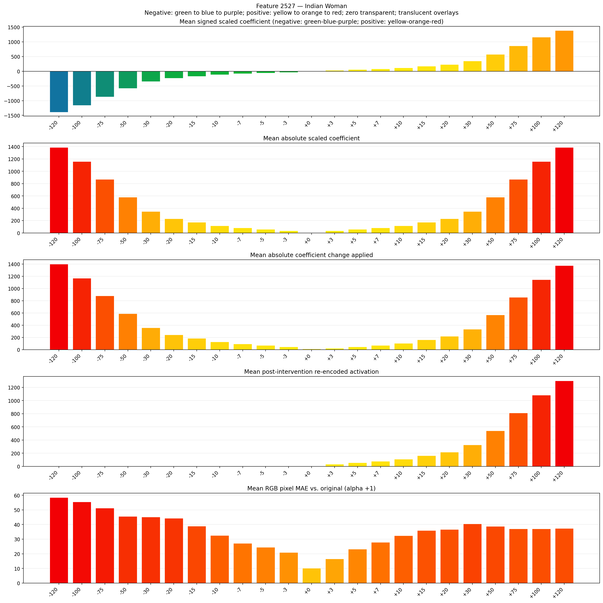
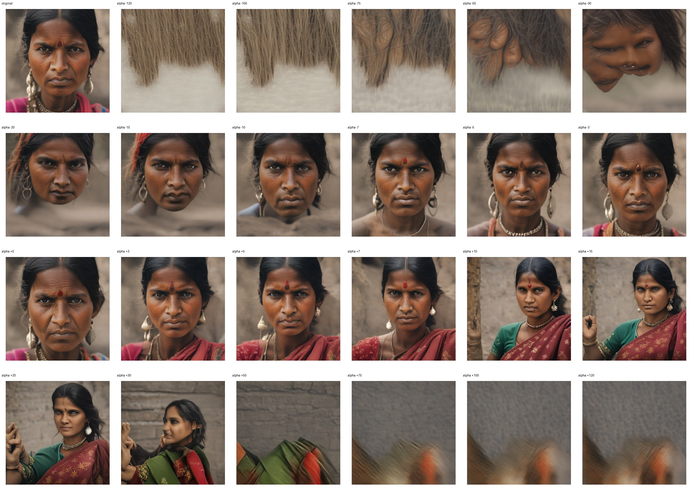
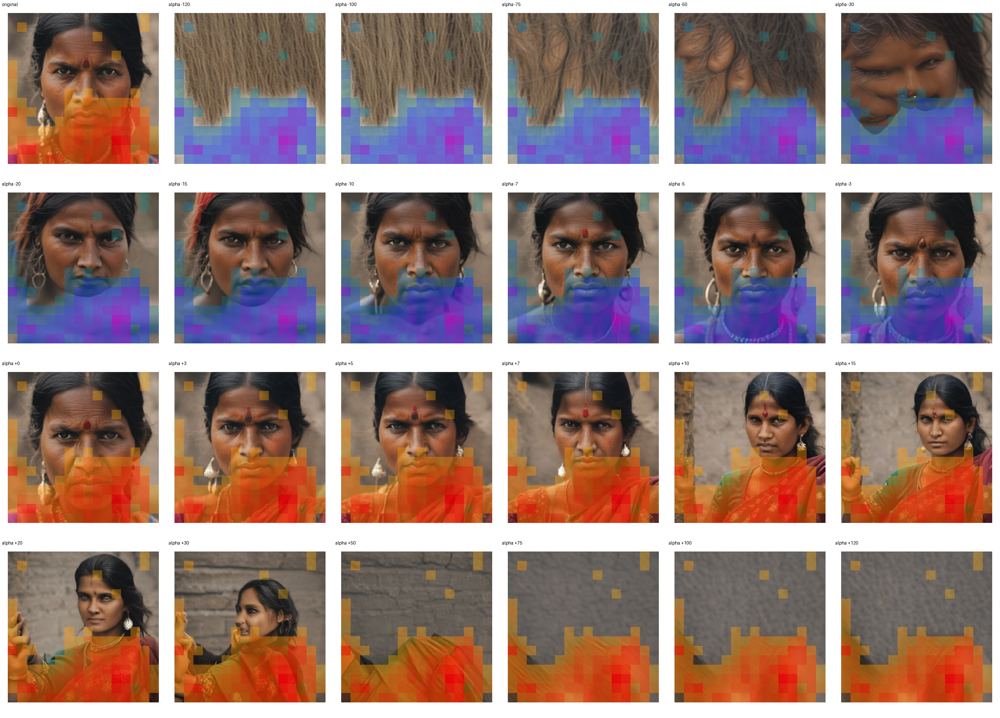
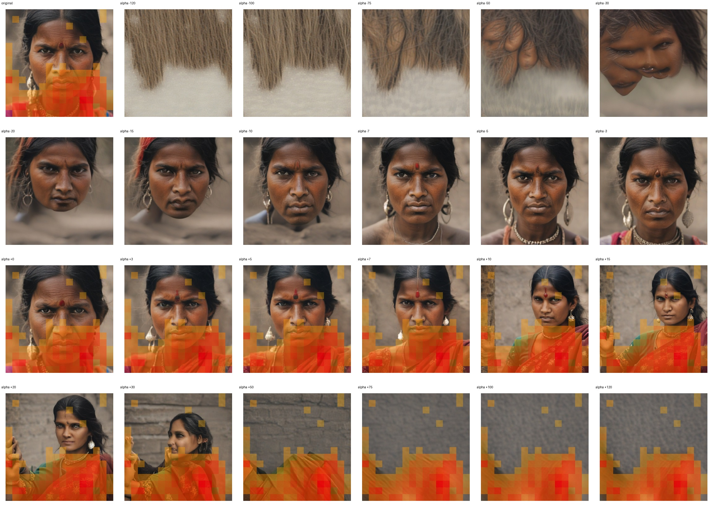

# Feature 2527 — Indian Woman

Biased dataset; original prompt and seed replay for seeds 0–19. Values are means across 20 source images. The table reports the mean post-re-encoded activation of feature 2527, the active spatial fraction, mean RGB pixel MAE versus the original image (0–255 scale), and coefficient change magnitudes for each alpha.

## Activation graph

## Mean metrics by alpha

| Alpha | Mean post-reencoded feature 2527 activation | Active spatial fraction | Mean pixel change (MAE) | Mean absolute coefficient change | Mean absolute scaled coefficient |
|---:|---:|---:|---:|---:|---:|
| -120 | 0.000 | 0.000 | 58.505 | 1401.029 | 1389.450 |
| -100 | 0.000 | 0.000 | 55.560 | 1169.454 | 1157.875 |
| -75 | 0.000 | 0.000 | 51.247 | 879.985 | 868.406 |
| -50 | 0.000 | 0.000 | 45.638 | 590.516 | 578.937 |
| -30 | 0.000 | 0.000 | 45.129 | 358.941 | 347.362 |
| -20 | 0.000 | 0.000 | 44.291 | 243.154 | 231.575 |
| -15 | 0.000 | 0.000 | 38.919 | 185.260 | 173.681 |
| -10 | 0.000 | 0.000 | 32.560 | 127.366 | 115.787 |
| -7 | 0.000 | 0.000 | 27.215 | 92.630 | 81.051 |
| -5 | 0.000 | 0.000 | 24.521 | 69.472 | 57.894 |
| -3 | 0.000 | 0.000 | 20.966 | 46.315 | 34.736 |
| +0 | 0.000 | 0.000 | 10.106 | 11.579 | 0.000 |
| +3 | 33.244 | 0.483 | 16.582 | 23.157 | 34.736 |
| +5 | 54.910 | 0.483 | 23.224 | 46.315 | 57.894 |
| +7 | 76.575 | 0.483 | 27.866 | 69.472 | 81.051 |
| +10 | 109.074 | 0.483 | 32.490 | 104.209 | 115.787 |
| +15 | 163.237 | 0.483 | 36.012 | 162.102 | 173.681 |
| +20 | 217.401 | 0.483 | 36.652 | 219.996 | 231.575 |
| +30 | 325.729 | 0.483 | 40.473 | 335.784 | 347.362 |
| +50 | 542.384 | 0.483 | 38.808 | 567.359 | 578.937 |
| +75 | 813.202 | 0.483 | 37.062 | 856.827 | 868.406 |
| +100 | 1084.022 | 0.483 | 37.079 | 1146.296 | 1157.875 |
| +120 | 1300.678 | 0.483 | 37.350 | 1377.871 | 1389.450 |

## Per-seed grids

Each 4×6 sheet contains the original followed by the 23 alpha variants in ascending alpha order, from −120 through +120.

### Plain images

[All 20 plain-image grids](seed_sheets/)

### Signed coefficient overlays

[All 20 signed coefficient grids](signed_coefficient_overlays/)

### Post-re-encoded activation overlays

[All 20 post-activation grids](post_activation_overlays/)

### Intervention-footprint overlays

[All 20 intervention-footprint grids](intervention_footprint_overlays/)

Zero is transparent. Negative coefficient colors progress green through blue to purple; positive colors progress yellow through orange to red. Each map tile is normalized individually for visibility. The original and alpha-zero tiles show the pre-intervention feature map so its location remains visible.
