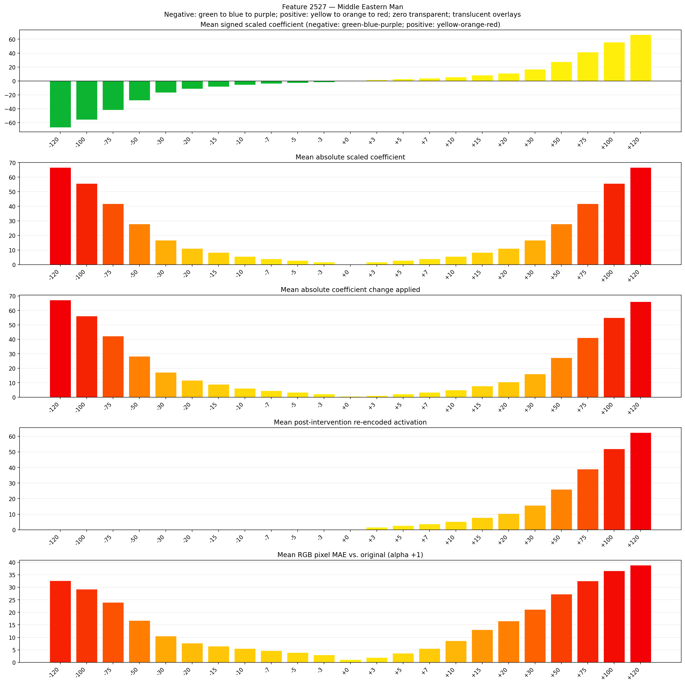
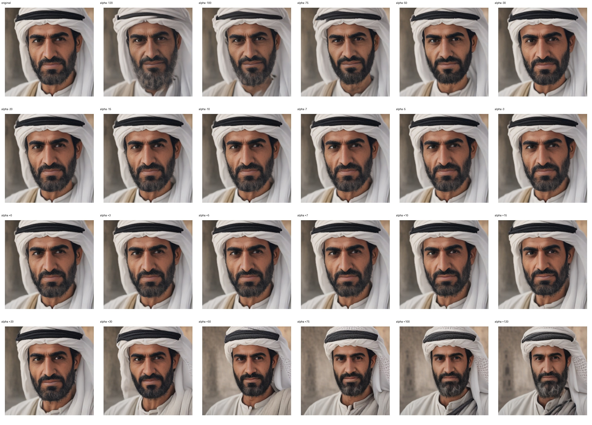
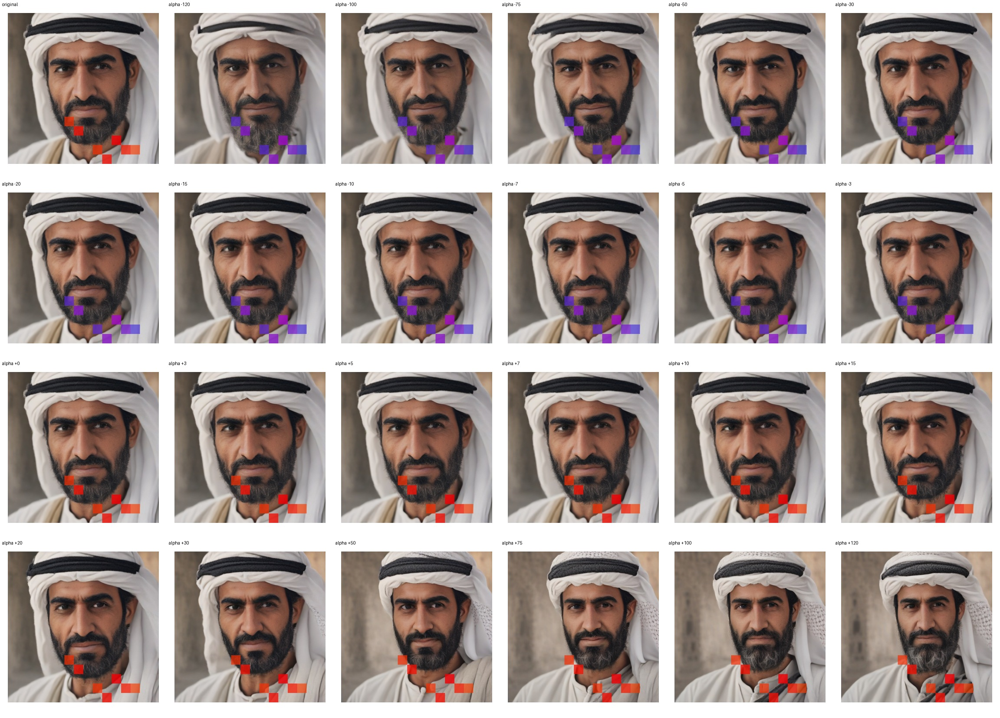
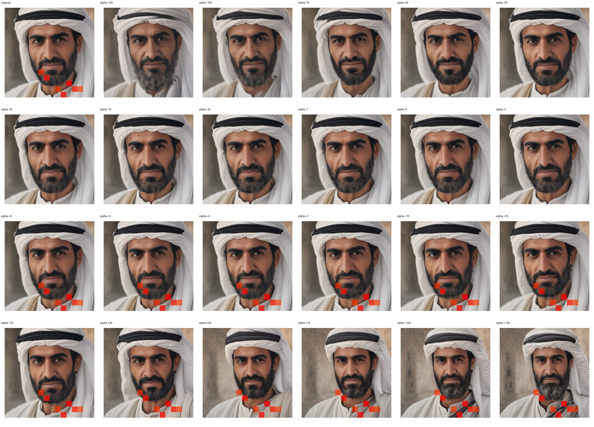

# Feature 2527 — Middle Eastern Man

Biased dataset; original prompt and seed replay for seeds 0–19. Values are means across 20 source images. The table reports the mean post-re-encoded activation of feature 2527, the active spatial fraction, mean RGB pixel MAE versus the original image (0–255 scale), and coefficient change magnitudes for each alpha.

## Activation graph

## Mean metrics by alpha

| Alpha | Mean post-reencoded feature 2527 activation | Active spatial fraction | Mean pixel change (MAE) | Mean absolute coefficient change | Mean absolute scaled coefficient |
|---:|---:|---:|---:|---:|---:|
| -120 | 0.000 | 0.000 | 32.688 | 67.273 | 66.717 |
| -100 | 0.000 | 0.000 | 29.271 | 56.153 | 55.597 |
| -75 | 0.000 | 0.000 | 23.949 | 42.254 | 41.698 |
| -50 | 0.000 | 0.000 | 16.714 | 28.355 | 27.799 |
| -30 | 0.000 | 0.000 | 10.484 | 17.235 | 16.679 |
| -20 | 0.000 | 0.000 | 7.661 | 11.675 | 11.119 |
| -15 | 0.000 | 0.000 | 6.481 | 8.896 | 8.340 |
| -10 | 0.000 | 0.000 | 5.561 | 6.116 | 5.560 |
| -7 | 0.000 | 0.000 | 4.664 | 4.448 | 3.892 |
| -5 | 0.000 | 0.000 | 3.917 | 3.336 | 2.780 |
| -3 | 0.000 | 0.000 | 3.008 | 2.224 | 1.668 |
| +0 | 0.000 | 0.000 | 1.152 | 0.556 | 0.000 |
| +3 | 1.596 | 0.048 | 1.999 | 1.112 | 1.668 |
| +5 | 2.637 | 0.048 | 3.673 | 2.224 | 2.780 |
| +7 | 3.677 | 0.048 | 5.558 | 3.336 | 3.892 |
| +10 | 5.237 | 0.048 | 8.610 | 5.004 | 5.560 |
| +15 | 7.838 | 0.048 | 13.078 | 7.784 | 8.340 |
| +20 | 10.439 | 0.048 | 16.503 | 10.564 | 11.119 |
| +30 | 15.640 | 0.048 | 21.141 | 16.123 | 16.679 |
| +50 | 26.044 | 0.048 | 27.255 | 27.243 | 27.799 |
| +75 | 39.047 | 0.048 | 32.565 | 41.142 | 41.698 |
| +100 | 52.051 | 0.048 | 36.638 | 55.041 | 55.597 |
| +120 | 62.454 | 0.048 | 38.868 | 66.161 | 66.717 |

## Per-seed grids

Each 4×6 sheet contains the original followed by the 23 alpha variants in ascending alpha order, from −120 through +120.

### Plain images

[All 20 plain-image grids](seed_sheets/)

### Signed coefficient overlays

[All 20 signed coefficient grids](signed_coefficient_overlays/)

### Post-re-encoded activation overlays

[All 20 post-activation grids](post_activation_overlays/)

### Intervention-footprint overlays

[All 20 intervention-footprint grids](intervention_footprint_overlays/)

Zero is transparent. Negative coefficient colors progress green through blue to purple; positive colors progress yellow through orange to red. Each map tile is normalized individually for visibility. The original and alpha-zero tiles show the pre-intervention feature map so its location remains visible.
