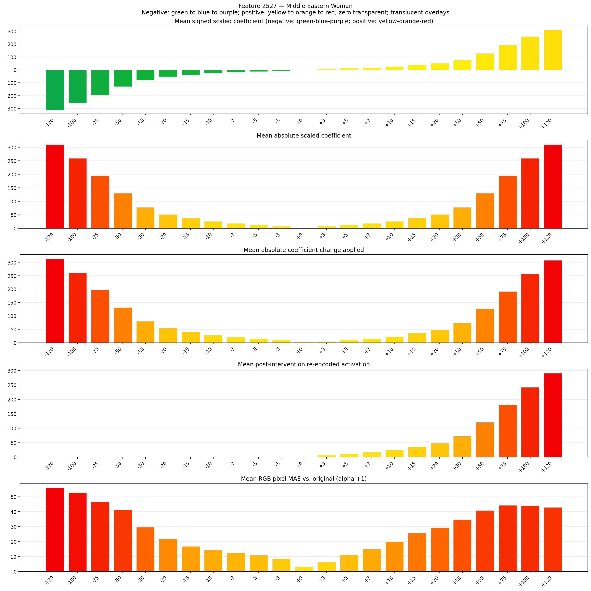
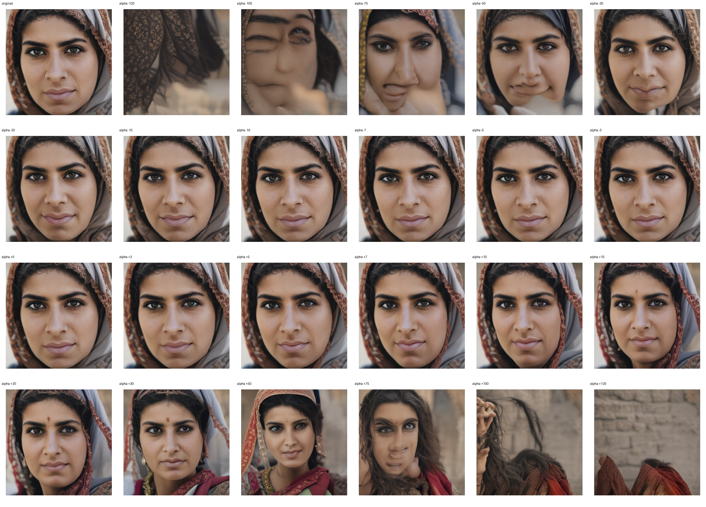
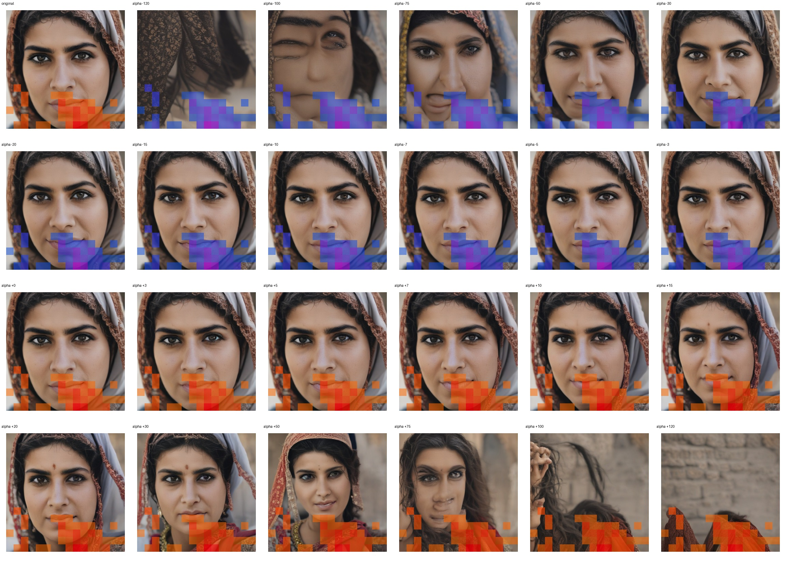
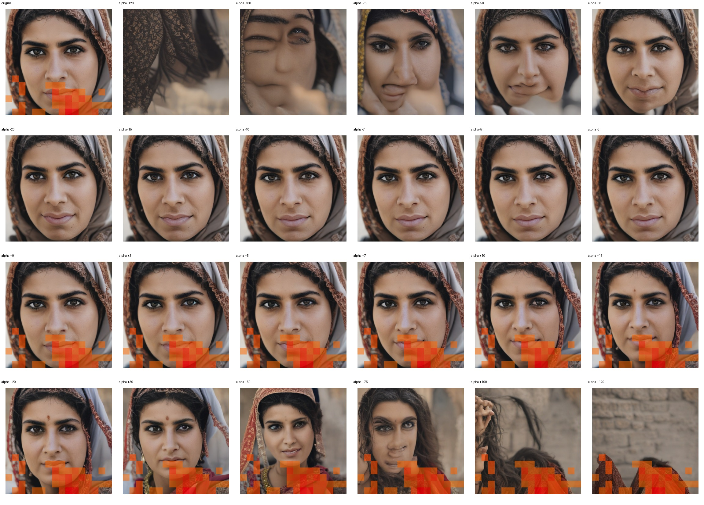

# Feature 2527 — Middle Eastern Woman

Biased dataset; original prompt and seed replay for seeds 0–19. Values are means across 20 source images. The table reports the mean post-re-encoded activation of feature 2527, the active spatial fraction, mean RGB pixel MAE versus the original image (0–255 scale), and coefficient change magnitudes for each alpha.

## Activation graph

## Mean metrics by alpha

| Alpha | Mean post-reencoded feature 2527 activation | Active spatial fraction | Mean pixel change (MAE) | Mean absolute coefficient change | Mean absolute scaled coefficient |
|---:|---:|---:|---:|---:|---:|
| -120 | 0.000 | 0.000 | 56.119 | 313.338 | 310.748 |
| -100 | 0.000 | 0.000 | 52.659 | 261.547 | 258.957 |
| -75 | 0.000 | 0.000 | 46.739 | 196.807 | 194.218 |
| -50 | 0.000 | 0.000 | 41.373 | 132.068 | 129.479 |
| -30 | 0.000 | 0.000 | 29.670 | 80.277 | 77.687 |
| -20 | 0.000 | 0.000 | 21.660 | 54.381 | 51.791 |
| -15 | 0.000 | 0.000 | 16.889 | 41.433 | 38.844 |
| -10 | 0.000 | 0.000 | 14.330 | 28.485 | 25.896 |
| -7 | 0.000 | 0.000 | 12.589 | 20.717 | 18.127 |
| -5 | 0.000 | 0.000 | 10.967 | 15.537 | 12.948 |
| -3 | 0.000 | 0.000 | 8.719 | 10.358 | 7.769 |
| +0 | 0.000 | 0.000 | 3.323 | 2.590 | 0.000 |
| +3 | 7.435 | 0.201 | 6.275 | 5.179 | 7.769 |
| +5 | 12.280 | 0.201 | 11.051 | 10.358 | 12.948 |
| +7 | 17.126 | 0.201 | 15.092 | 15.537 | 18.127 |
| +10 | 24.394 | 0.201 | 20.118 | 23.306 | 25.896 |
| +15 | 36.508 | 0.201 | 25.735 | 36.254 | 38.844 |
| +20 | 48.622 | 0.201 | 29.478 | 49.202 | 51.791 |
| +30 | 72.849 | 0.201 | 34.792 | 75.098 | 77.687 |
| +50 | 121.303 | 0.201 | 40.867 | 126.889 | 129.479 |
| +75 | 181.872 | 0.201 | 44.269 | 191.628 | 194.218 |
| +100 | 242.440 | 0.201 | 44.094 | 256.367 | 258.957 |
| +120 | 290.894 | 0.201 | 42.893 | 308.159 | 310.748 |

## Per-seed grids

Each 4×6 sheet contains the original followed by the 23 alpha variants in ascending alpha order, from −120 through +120.

### Plain images

[All 20 plain-image grids](seed_sheets/)

### Signed coefficient overlays

[All 20 signed coefficient grids](signed_coefficient_overlays/)

### Post-re-encoded activation overlays

[All 20 post-activation grids](post_activation_overlays/)

### Intervention-footprint overlays

[All 20 intervention-footprint grids](intervention_footprint_overlays/)

Zero is transparent. Negative coefficient colors progress green through blue to purple; positive colors progress yellow through orange to red. Each map tile is normalized individually for visibility. The original and alpha-zero tiles show the pre-intervention feature map so its location remains visible.
