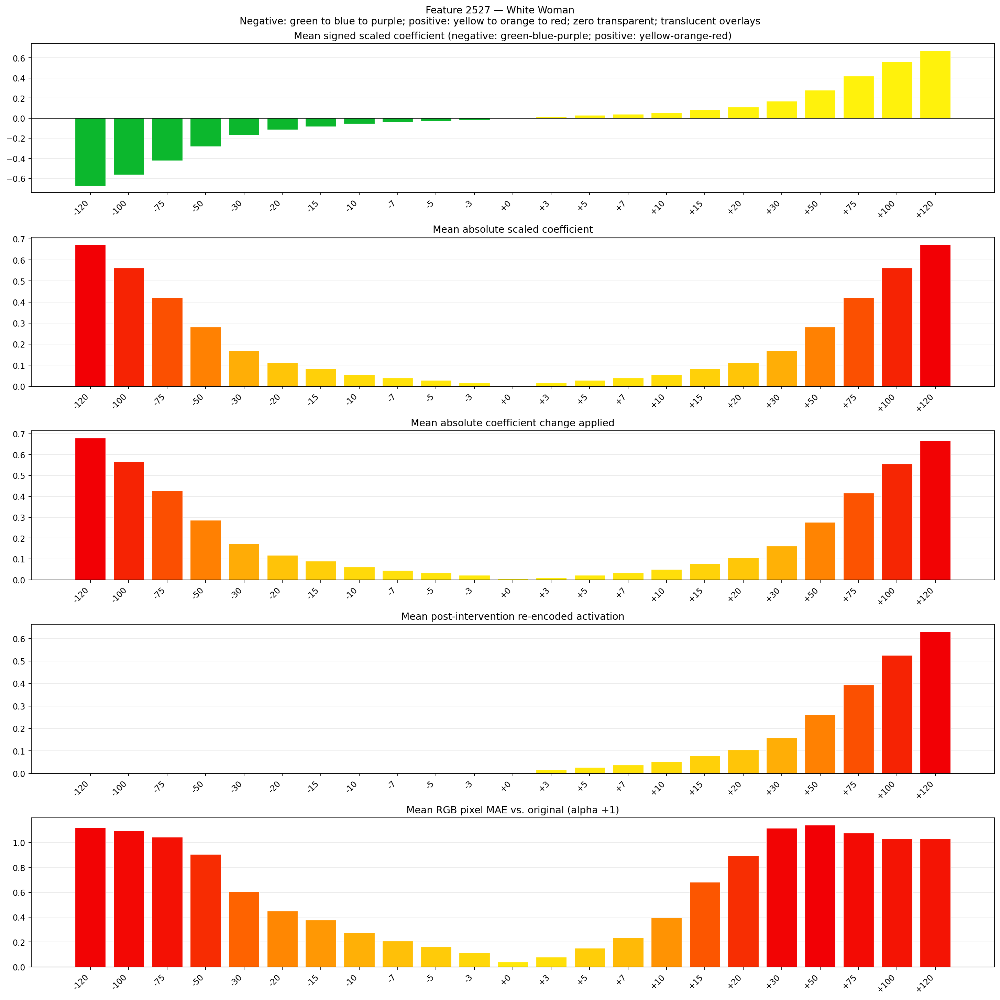
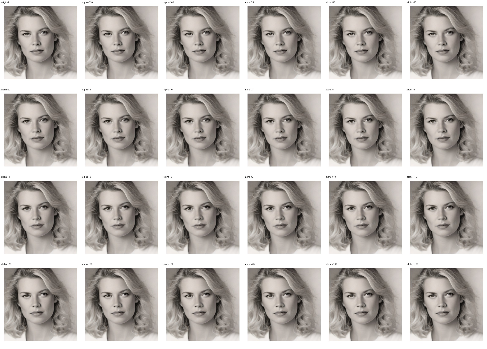
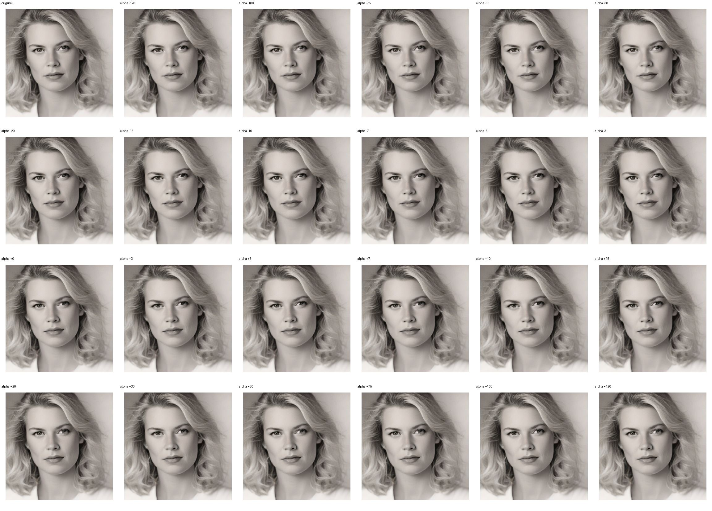

# Feature 2527 — White Woman

Biased dataset; original prompt and seed replay for seeds 0–19. Values are means across 20 source images. The table reports the mean post-re-encoded activation of feature 2527, the active spatial fraction, mean RGB pixel MAE versus the original image (0–255 scale), and coefficient change magnitudes for each alpha.

## Activation graph

## Mean metrics by alpha

| Alpha | Mean post-reencoded feature 2527 activation | Active spatial fraction | Mean pixel change (MAE) | Mean absolute coefficient change | Mean absolute scaled coefficient |
|---:|---:|---:|---:|---:|---:|
| -120 | 0.000 | 0.000 | 1.122 | 0.680 | 0.675 |
| -100 | 0.000 | 0.000 | 1.098 | 0.568 | 0.562 |
| -75 | 0.000 | 0.000 | 1.046 | 0.427 | 0.422 |
| -50 | 0.000 | 0.000 | 0.905 | 0.287 | 0.281 |
| -30 | 0.000 | 0.000 | 0.609 | 0.174 | 0.169 |
| -20 | 0.000 | 0.000 | 0.450 | 0.118 | 0.112 |
| -15 | 0.000 | 0.000 | 0.378 | 0.090 | 0.084 |
| -10 | 0.000 | 0.000 | 0.277 | 0.062 | 0.056 |
| -7 | 0.000 | 0.000 | 0.209 | 0.045 | 0.039 |
| -5 | 0.000 | 0.000 | 0.163 | 0.034 | 0.028 |
| -3 | 0.000 | 0.000 | 0.115 | 0.022 | 0.017 |
| +0 | 0.000 | 0.000 | 0.040 | 0.006 | 0.000 |
| +3 | 0.016 | 0.001 | 0.079 | 0.011 | 0.017 |
| +5 | 0.027 | 0.001 | 0.153 | 0.022 | 0.028 |
| +7 | 0.037 | 0.001 | 0.237 | 0.034 | 0.039 |
| +10 | 0.053 | 0.001 | 0.398 | 0.051 | 0.056 |
| +15 | 0.079 | 0.001 | 0.681 | 0.079 | 0.084 |
| +20 | 0.106 | 0.001 | 0.895 | 0.107 | 0.112 |
| +30 | 0.158 | 0.001 | 1.117 | 0.163 | 0.169 |
| +50 | 0.263 | 0.001 | 1.141 | 0.275 | 0.281 |
| +75 | 0.395 | 0.001 | 1.078 | 0.416 | 0.422 |
| +100 | 0.526 | 0.001 | 1.034 | 0.557 | 0.562 |
| +120 | 0.631 | 0.001 | 1.034 | 0.669 | 0.675 |

## Per-seed grids

Each 4×6 sheet contains the original followed by the 23 alpha variants in ascending alpha order, from −120 through +120.

### Plain images

[All 20 plain-image grids](seed_sheets/)

### Signed coefficient overlays

[All 20 signed coefficient grids](signed_coefficient_overlays/)

### Post-re-encoded activation overlays

[All 20 post-activation grids](post_activation_overlays/)

### Intervention-footprint overlays

[All 20 intervention-footprint grids](intervention_footprint_overlays/)

Zero is transparent. Negative coefficient colors progress green through blue to purple; positive colors progress yellow through orange to red. Each map tile is normalized individually for visibility. The original and alpha-zero tiles show the pre-intervention feature map so its location remains visible.
