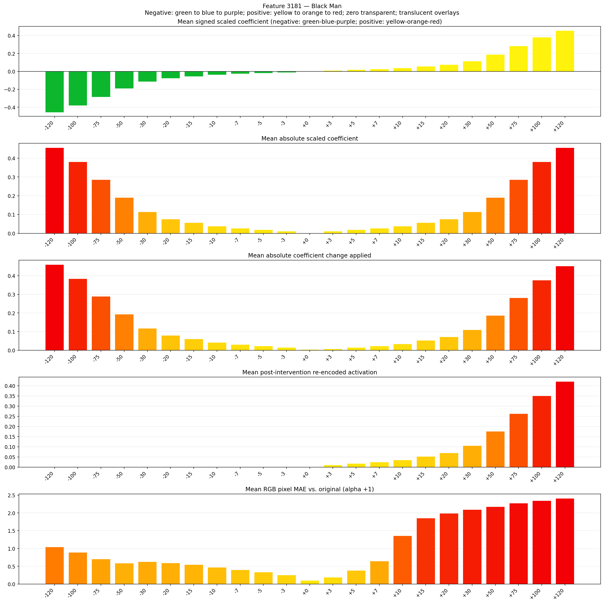
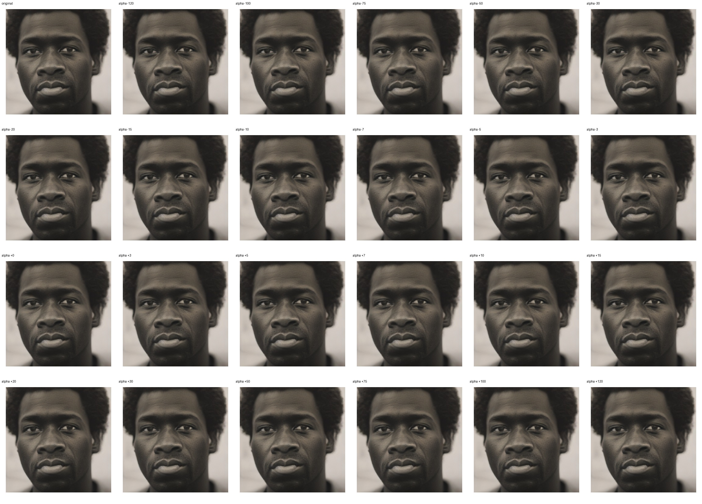

# Feature 3181 — Black Man

Biased dataset; original prompt and seed replay for seeds 0–19. Values are means across 20 source images. The table reports the mean post-re-encoded activation of feature 3181, the active spatial fraction, mean RGB pixel MAE versus the original image (0–255 scale), and coefficient change magnitudes for each alpha.

## Activation graph

## Mean metrics by alpha

| Alpha | Mean post-reencoded feature 3181 activation | Active spatial fraction | Mean pixel change (MAE) | Mean absolute coefficient change | Mean absolute scaled coefficient |
|---:|---:|---:|---:|---:|---:|
| -120 | 0.000 | 0.000 | 1.047 | 0.460 | 0.457 |
| -100 | 0.000 | 0.000 | 0.890 | 0.384 | 0.381 |
| -75 | 0.000 | 0.000 | 0.705 | 0.289 | 0.285 |
| -50 | 0.000 | 0.000 | 0.586 | 0.194 | 0.190 |
| -30 | 0.000 | 0.000 | 0.628 | 0.118 | 0.114 |
| -20 | 0.000 | 0.000 | 0.594 | 0.080 | 0.076 |
| -15 | 0.000 | 0.000 | 0.547 | 0.061 | 0.057 |
| -10 | 0.000 | 0.000 | 0.474 | 0.042 | 0.038 |
| -7 | 0.000 | 0.000 | 0.399 | 0.030 | 0.027 |
| -5 | 0.000 | 0.000 | 0.338 | 0.023 | 0.019 |
| -3 | 0.000 | 0.000 | 0.257 | 0.015 | 0.011 |
| +0 | 0.000 | 0.000 | 0.104 | 0.004 | 0.000 |
| +3 | 0.011 | 0.000 | 0.193 | 0.008 | 0.011 |
| +5 | 0.018 | 0.000 | 0.385 | 0.015 | 0.019 |
| +7 | 0.025 | 0.000 | 0.648 | 0.023 | 0.027 |
| +10 | 0.035 | 0.000 | 1.357 | 0.034 | 0.038 |
| +15 | 0.053 | 0.000 | 1.856 | 0.053 | 0.057 |
| +20 | 0.070 | 0.000 | 1.988 | 0.072 | 0.076 |
| +30 | 0.106 | 0.000 | 2.093 | 0.110 | 0.114 |
| +50 | 0.176 | 0.000 | 2.177 | 0.186 | 0.190 |
| +75 | 0.263 | 0.000 | 2.278 | 0.282 | 0.285 |
| +100 | 0.351 | 0.000 | 2.349 | 0.377 | 0.381 |
| +120 | 0.421 | 0.000 | 2.411 | 0.453 | 0.457 |

## Per-seed grids

Each 4×6 sheet contains the original followed by the 23 alpha variants in ascending alpha order, from −120 through +120.

### Plain images

[All 20 plain-image grids](seed_sheets/)

### Signed coefficient overlays

[All 20 signed coefficient grids](signed_coefficient_overlays/)

### Post-re-encoded activation overlays

[All 20 post-activation grids](post_activation_overlays/)

### Intervention-footprint overlays

[All 20 intervention-footprint grids](intervention_footprint_overlays/)

Zero is transparent. Negative coefficient colors progress green through blue to purple; positive colors progress yellow through orange to red. Each map tile is normalized individually for visibility. The original and alpha-zero tiles show the pre-intervention feature map so its location remains visible.
