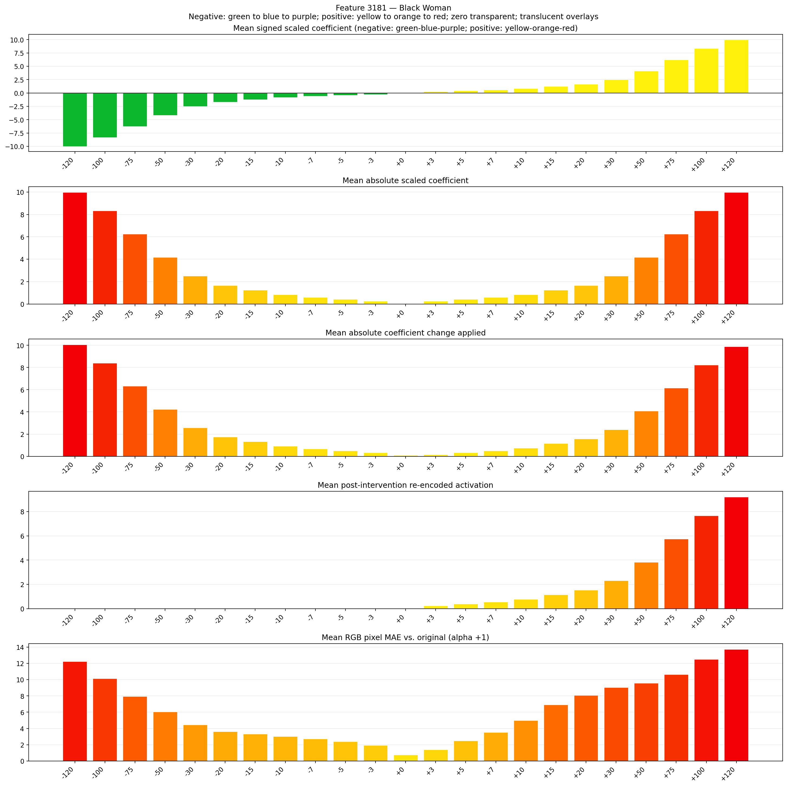
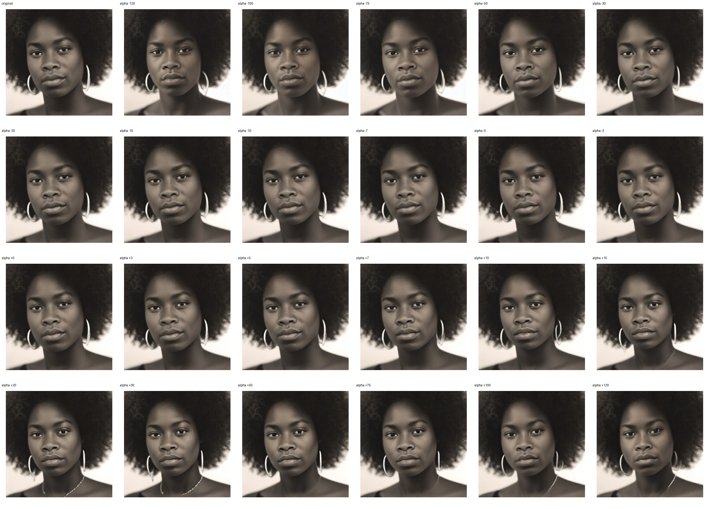
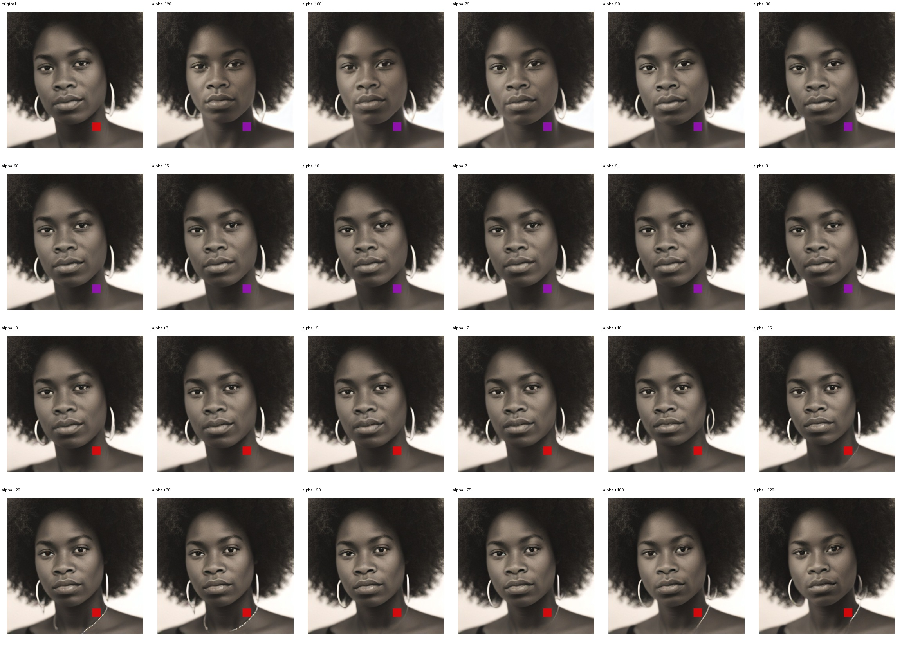
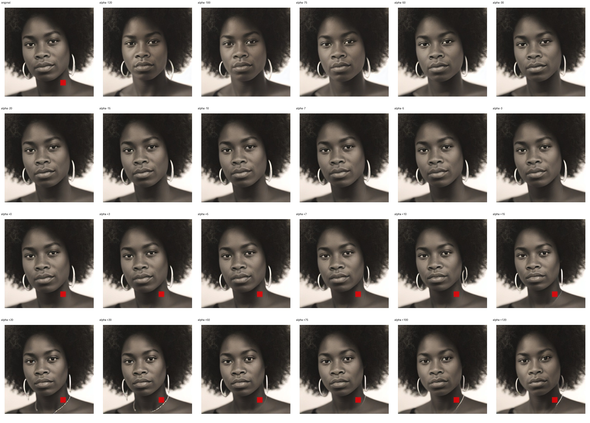

# Feature 3181 — Black Woman

Biased dataset; original prompt and seed replay for seeds 0–19. Values are means across 20 source images. The table reports the mean post-re-encoded activation of feature 3181, the active spatial fraction, mean RGB pixel MAE versus the original image (0–255 scale), and coefficient change magnitudes for each alpha.

## Activation graph

## Mean metrics by alpha

| Alpha | Mean post-reencoded feature 3181 activation | Active spatial fraction | Mean pixel change (MAE) | Mean absolute coefficient change | Mean absolute scaled coefficient |
|---:|---:|---:|---:|---:|---:|
| -120 | 0.000 | 0.000 | 12.220 | 10.062 | 9.979 |
| -100 | 0.000 | 0.000 | 10.142 | 8.399 | 8.316 |
| -75 | 0.000 | 0.000 | 7.934 | 6.320 | 6.237 |
| -50 | 0.000 | 0.000 | 6.036 | 4.241 | 4.158 |
| -30 | 0.000 | 0.000 | 4.456 | 2.578 | 2.495 |
| -20 | 0.000 | 0.000 | 3.617 | 1.746 | 1.663 |
| -15 | 0.000 | 0.000 | 3.305 | 1.331 | 1.247 |
| -10 | 0.000 | 0.000 | 3.019 | 0.915 | 0.832 |
| -7 | 0.000 | 0.000 | 2.714 | 0.665 | 0.582 |
| -5 | 0.000 | 0.000 | 2.398 | 0.499 | 0.416 |
| -3 | 0.000 | 0.000 | 1.914 | 0.333 | 0.249 |
| +0 | 0.000 | 0.000 | 0.763 | 0.083 | 0.000 |
| +3 | 0.236 | 0.006 | 1.388 | 0.166 | 0.249 |
| +5 | 0.390 | 0.006 | 2.474 | 0.333 | 0.416 |
| +7 | 0.543 | 0.006 | 3.531 | 0.499 | 0.582 |
| +10 | 0.773 | 0.006 | 4.994 | 0.748 | 0.832 |
| +15 | 1.156 | 0.006 | 6.904 | 1.164 | 1.247 |
| +20 | 1.539 | 0.006 | 8.063 | 1.580 | 1.663 |
| +30 | 2.306 | 0.006 | 9.050 | 2.412 | 2.495 |
| +50 | 3.839 | 0.006 | 9.575 | 4.075 | 4.158 |
| +75 | 5.755 | 0.006 | 10.639 | 6.154 | 6.237 |
| +100 | 7.671 | 0.006 | 12.492 | 8.233 | 8.316 |
| +120 | 9.204 | 0.006 | 13.732 | 9.896 | 9.979 |

## Per-seed grids

Each 4×6 sheet contains the original followed by the 23 alpha variants in ascending alpha order, from −120 through +120.

### Plain images

[All 20 plain-image grids](seed_sheets/)

### Signed coefficient overlays

[All 20 signed coefficient grids](signed_coefficient_overlays/)

### Post-re-encoded activation overlays

[All 20 post-activation grids](post_activation_overlays/)

### Intervention-footprint overlays

[All 20 intervention-footprint grids](intervention_footprint_overlays/)

Zero is transparent. Negative coefficient colors progress green through blue to purple; positive colors progress yellow through orange to red. Each map tile is normalized individually for visibility. The original and alpha-zero tiles show the pre-intervention feature map so its location remains visible.
