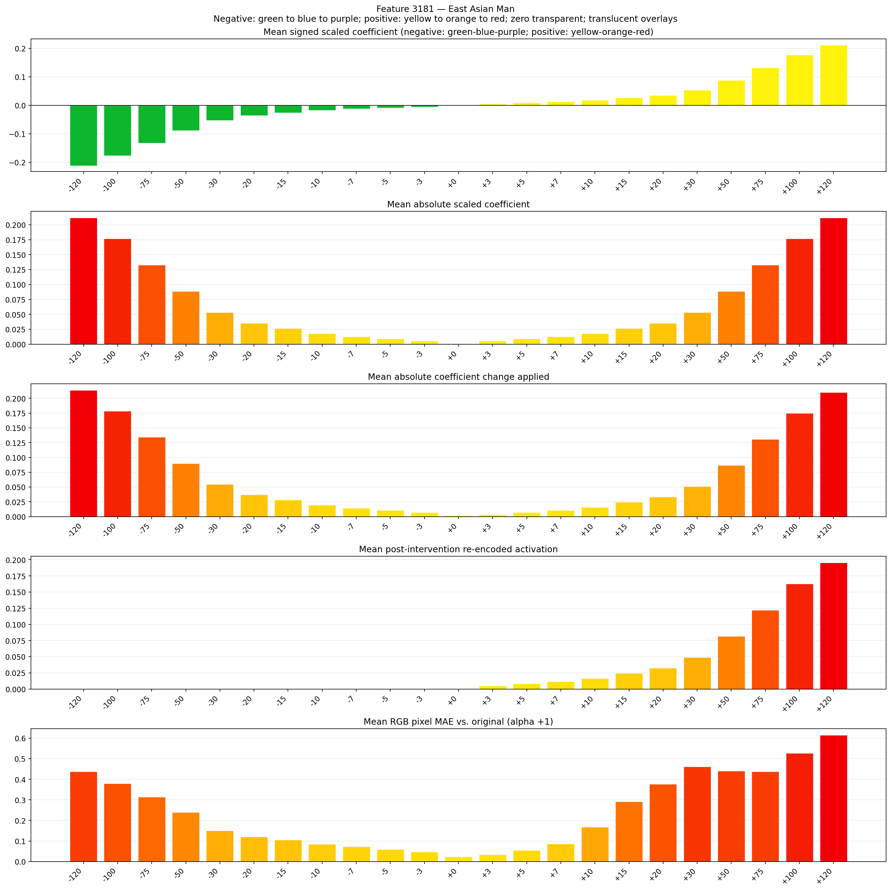

# Feature 3181 — East Asian Man

Biased dataset; original prompt and seed replay for seeds 0–19. Values are means across 20 source images. The table reports the mean post-re-encoded activation of feature 3181, the active spatial fraction, mean RGB pixel MAE versus the original image (0–255 scale), and coefficient change magnitudes for each alpha.

## Activation graph

## Mean metrics by alpha

| Alpha | Mean post-reencoded feature 3181 activation | Active spatial fraction | Mean pixel change (MAE) | Mean absolute coefficient change | Mean absolute scaled coefficient |
|---:|---:|---:|---:|---:|---:|
| -120 | 0.000 | 0.000 | 0.438 | 0.214 | 0.212 |
| -100 | 0.000 | 0.000 | 0.380 | 0.178 | 0.177 |
| -75 | 0.000 | 0.000 | 0.314 | 0.134 | 0.133 |
| -50 | 0.000 | 0.000 | 0.240 | 0.090 | 0.088 |
| -30 | 0.000 | 0.000 | 0.151 | 0.055 | 0.053 |
| -20 | 0.000 | 0.000 | 0.120 | 0.037 | 0.035 |
| -15 | 0.000 | 0.000 | 0.105 | 0.028 | 0.027 |
| -10 | 0.000 | 0.000 | 0.085 | 0.019 | 0.018 |
| -7 | 0.000 | 0.000 | 0.072 | 0.014 | 0.012 |
| -5 | 0.000 | 0.000 | 0.060 | 0.011 | 0.009 |
| -3 | 0.000 | 0.000 | 0.048 | 0.007 | 0.005 |
| +0 | 0.000 | 0.000 | 0.023 | 0.002 | 0.000 |
| +3 | 0.005 | 0.000 | 0.034 | 0.004 | 0.005 |
| +5 | 0.008 | 0.000 | 0.055 | 0.007 | 0.009 |
| +7 | 0.012 | 0.000 | 0.086 | 0.011 | 0.012 |
| +10 | 0.016 | 0.000 | 0.168 | 0.016 | 0.018 |
| +15 | 0.025 | 0.000 | 0.291 | 0.025 | 0.027 |
| +20 | 0.033 | 0.000 | 0.376 | 0.034 | 0.035 |
| +30 | 0.049 | 0.000 | 0.461 | 0.051 | 0.053 |
| +50 | 0.082 | 0.000 | 0.441 | 0.087 | 0.088 |
| +75 | 0.122 | 0.000 | 0.438 | 0.131 | 0.133 |
| +100 | 0.163 | 0.000 | 0.527 | 0.175 | 0.177 |
| +120 | 0.196 | 0.000 | 0.615 | 0.210 | 0.212 |

## Per-seed grids

Each 4×6 sheet contains the original followed by the 23 alpha variants in ascending alpha order, from −120 through +120.

### Plain images

[All 20 plain-image grids](seed_sheets/)

### Signed coefficient overlays

[All 20 signed coefficient grids](signed_coefficient_overlays/)

### Post-re-encoded activation overlays

[All 20 post-activation grids](post_activation_overlays/)

### Intervention-footprint overlays

[All 20 intervention-footprint grids](intervention_footprint_overlays/)

Zero is transparent. Negative coefficient colors progress green through blue to purple; positive colors progress yellow through orange to red. Each map tile is normalized individually for visibility. The original and alpha-zero tiles show the pre-intervention feature map so its location remains visible.
