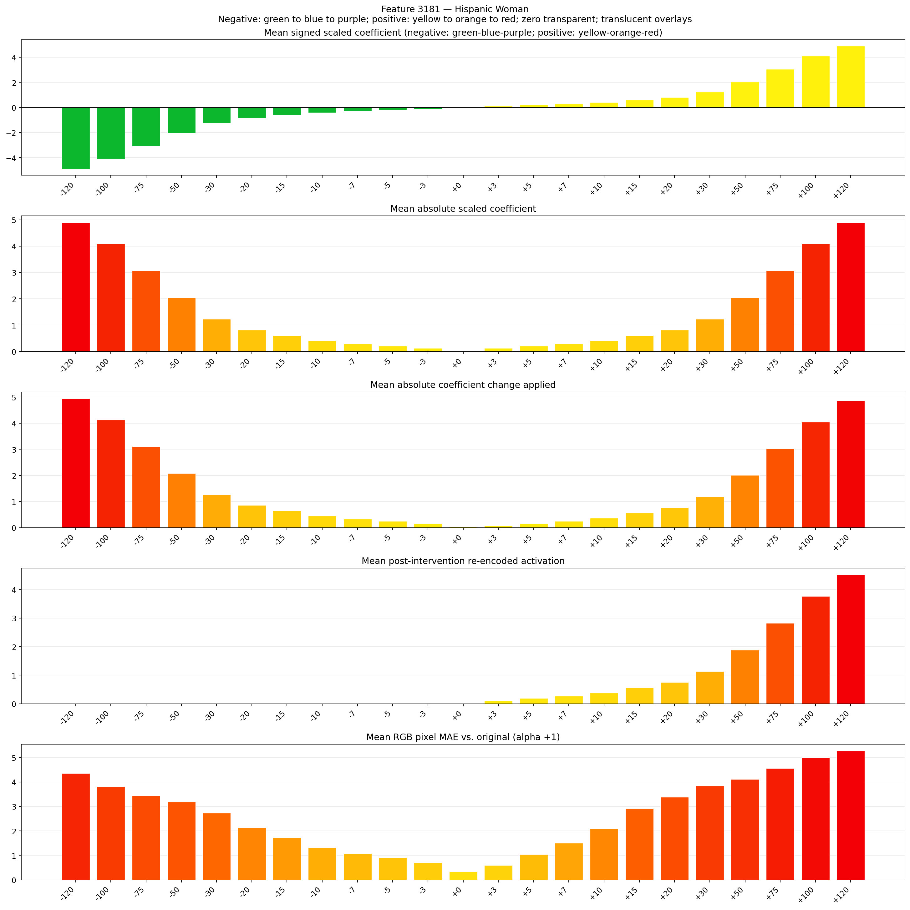
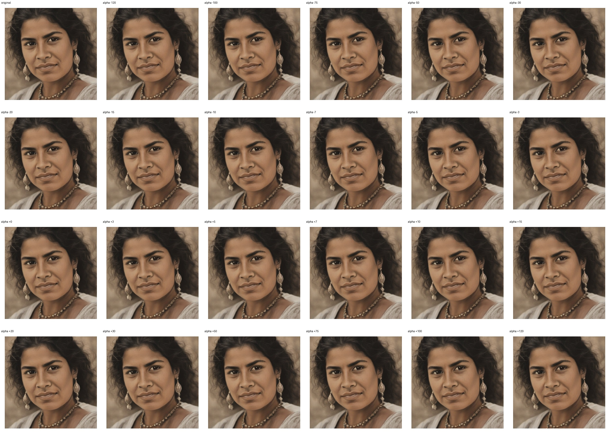

# Feature 3181 — Hispanic Woman

Biased dataset; original prompt and seed replay for seeds 0–19. Values are means across 20 source images. The table reports the mean post-re-encoded activation of feature 3181, the active spatial fraction, mean RGB pixel MAE versus the original image (0–255 scale), and coefficient change magnitudes for each alpha.

## Activation graph

## Mean metrics by alpha

| Alpha | Mean post-reencoded feature 3181 activation | Active spatial fraction | Mean pixel change (MAE) | Mean absolute coefficient change | Mean absolute scaled coefficient |
|---:|---:|---:|---:|---:|---:|
| -120 | 0.000 | 0.000 | 4.358 | 4.946 | 4.905 |
| -100 | 0.000 | 0.000 | 3.818 | 4.129 | 4.088 |
| -75 | 0.000 | 0.000 | 3.443 | 3.107 | 3.066 |
| -50 | 0.000 | 0.000 | 3.192 | 2.085 | 2.044 |
| -30 | 0.000 | 0.000 | 2.732 | 1.267 | 1.226 |
| -20 | 0.000 | 0.000 | 2.128 | 0.858 | 0.818 |
| -15 | 0.000 | 0.000 | 1.720 | 0.654 | 0.613 |
| -10 | 0.000 | 0.000 | 1.322 | 0.450 | 0.409 |
| -7 | 0.000 | 0.000 | 1.089 | 0.327 | 0.286 |
| -5 | 0.000 | 0.000 | 0.911 | 0.245 | 0.204 |
| -3 | 0.000 | 0.000 | 0.714 | 0.164 | 0.123 |
| +0 | 0.000 | 0.000 | 0.338 | 0.041 | 0.000 |
| +3 | 0.116 | 0.003 | 0.597 | 0.082 | 0.123 |
| +5 | 0.192 | 0.003 | 1.039 | 0.164 | 0.204 |
| +7 | 0.267 | 0.003 | 1.501 | 0.245 | 0.286 |
| +10 | 0.380 | 0.003 | 2.088 | 0.368 | 0.409 |
| +15 | 0.568 | 0.003 | 2.922 | 0.572 | 0.613 |
| +20 | 0.757 | 0.003 | 3.381 | 0.777 | 0.818 |
| +30 | 1.134 | 0.003 | 3.843 | 1.185 | 1.226 |
| +50 | 1.887 | 0.003 | 4.109 | 2.003 | 2.044 |
| +75 | 2.829 | 0.003 | 4.560 | 3.025 | 3.066 |
| +100 | 3.771 | 0.003 | 5.007 | 4.047 | 4.088 |
| +120 | 4.524 | 0.003 | 5.273 | 4.865 | 4.905 |

## Per-seed grids

Each 4×6 sheet contains the original followed by the 23 alpha variants in ascending alpha order, from −120 through +120.

### Plain images

[All 20 plain-image grids](seed_sheets/)

### Signed coefficient overlays

[All 20 signed coefficient grids](signed_coefficient_overlays/)

### Post-re-encoded activation overlays

[All 20 post-activation grids](post_activation_overlays/)

### Intervention-footprint overlays

[All 20 intervention-footprint grids](intervention_footprint_overlays/)

Zero is transparent. Negative coefficient colors progress green through blue to purple; positive colors progress yellow through orange to red. Each map tile is normalized individually for visibility. The original and alpha-zero tiles show the pre-intervention feature map so its location remains visible.
