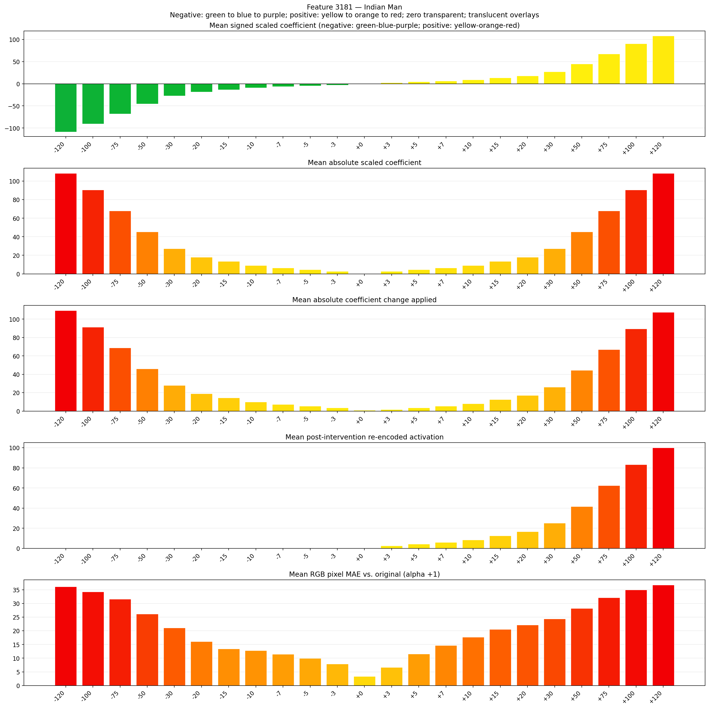
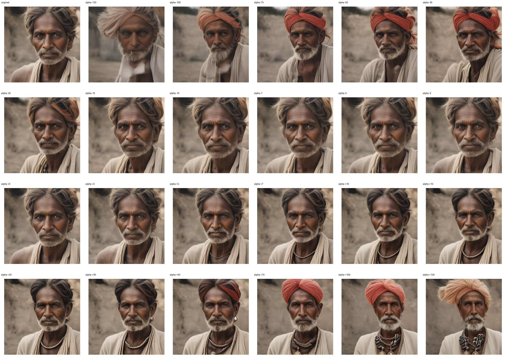
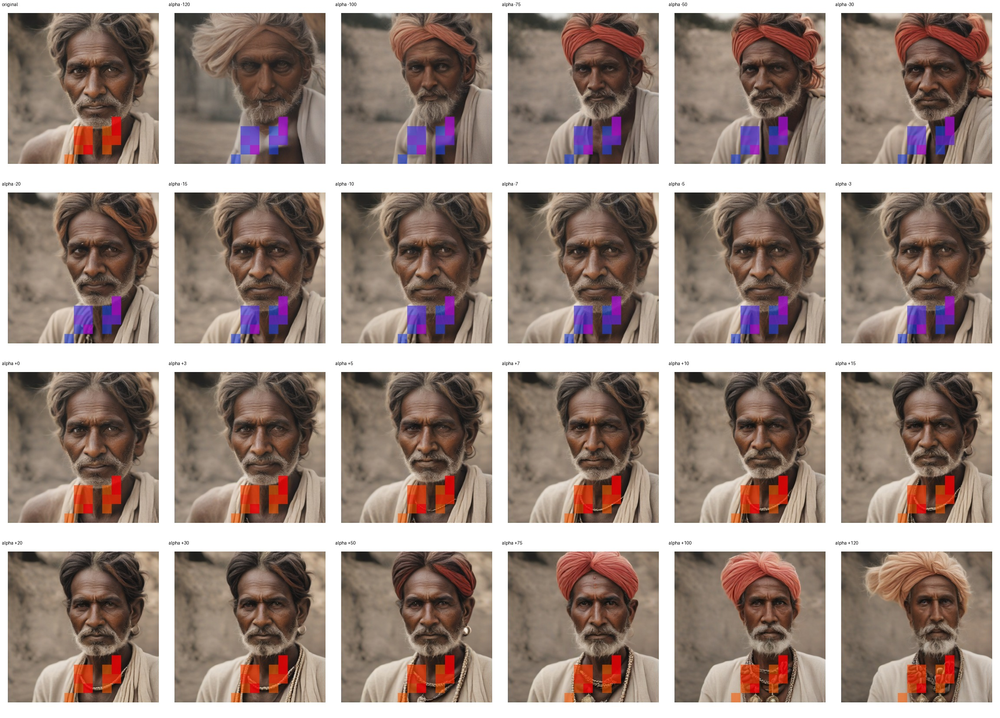
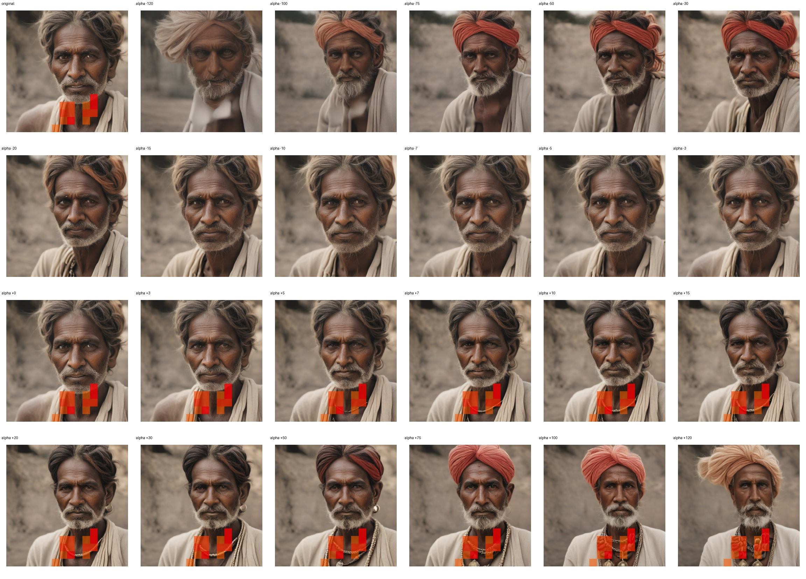

# Feature 3181 — Indian Man

Biased dataset; original prompt and seed replay for seeds 0–19. Values are means across 20 source images. The table reports the mean post-re-encoded activation of feature 3181, the active spatial fraction, mean RGB pixel MAE versus the original image (0–255 scale), and coefficient change magnitudes for each alpha.

## Activation graph

## Mean metrics by alpha

| Alpha | Mean post-reencoded feature 3181 activation | Active spatial fraction | Mean pixel change (MAE) | Mean absolute coefficient change | Mean absolute scaled coefficient |
|---:|---:|---:|---:|---:|---:|
| -120 | 0.000 | 0.000 | 36.126 | 109.415 | 108.510 |
| -100 | 0.000 | 0.000 | 34.212 | 91.330 | 90.425 |
| -75 | 0.000 | 0.000 | 31.569 | 68.723 | 67.819 |
| -50 | 0.000 | 0.000 | 26.163 | 46.117 | 45.213 |
| -30 | 0.000 | 0.000 | 21.113 | 28.032 | 27.128 |
| -20 | 0.000 | 0.000 | 16.108 | 18.989 | 18.085 |
| -15 | 0.000 | 0.000 | 13.442 | 14.468 | 13.564 |
| -10 | 0.000 | 0.000 | 12.845 | 9.947 | 9.043 |
| -7 | 0.000 | 0.000 | 11.463 | 7.234 | 6.330 |
| -5 | 0.000 | 0.000 | 9.980 | 5.426 | 4.521 |
| -3 | 0.000 | 0.000 | 7.921 | 3.617 | 2.713 |
| +0 | 0.000 | 0.000 | 3.349 | 0.904 | 0.000 |
| +3 | 2.571 | 0.054 | 6.677 | 1.809 | 2.713 |
| +5 | 4.238 | 0.054 | 11.512 | 3.617 | 4.521 |
| +7 | 5.905 | 0.054 | 14.687 | 5.426 | 6.330 |
| +10 | 8.405 | 0.054 | 17.700 | 8.138 | 9.043 |
| +15 | 12.572 | 0.054 | 20.537 | 12.660 | 13.564 |
| +20 | 16.739 | 0.054 | 22.174 | 17.181 | 18.085 |
| +30 | 25.073 | 0.054 | 24.347 | 26.223 | 27.128 |
| +50 | 41.742 | 0.054 | 28.171 | 44.308 | 45.213 |
| +75 | 62.577 | 0.054 | 32.079 | 66.915 | 67.819 |
| +100 | 83.413 | 0.054 | 35.000 | 89.521 | 90.425 |
| +120 | 100.081 | 0.054 | 36.759 | 107.606 | 108.510 |

## Per-seed grids

Each 4×6 sheet contains the original followed by the 23 alpha variants in ascending alpha order, from −120 through +120.

### Plain images

[All 20 plain-image grids](seed_sheets/)

### Signed coefficient overlays

[All 20 signed coefficient grids](signed_coefficient_overlays/)

### Post-re-encoded activation overlays

[All 20 post-activation grids](post_activation_overlays/)

### Intervention-footprint overlays

[All 20 intervention-footprint grids](intervention_footprint_overlays/)

Zero is transparent. Negative coefficient colors progress green through blue to purple; positive colors progress yellow through orange to red. Each map tile is normalized individually for visibility. The original and alpha-zero tiles show the pre-intervention feature map so its location remains visible.
