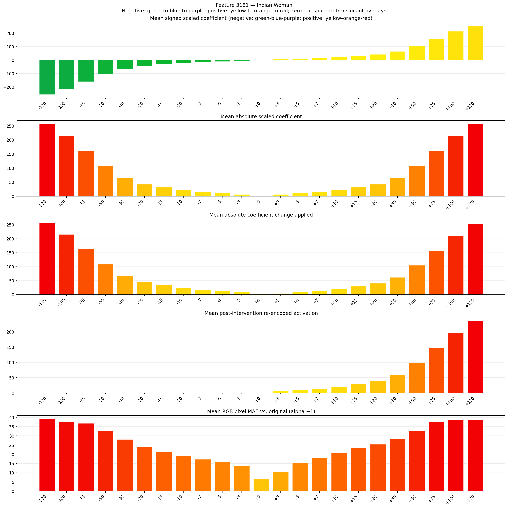
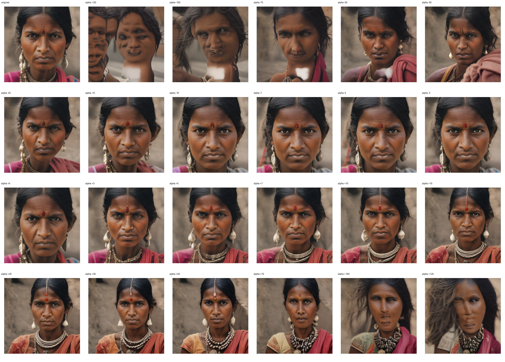
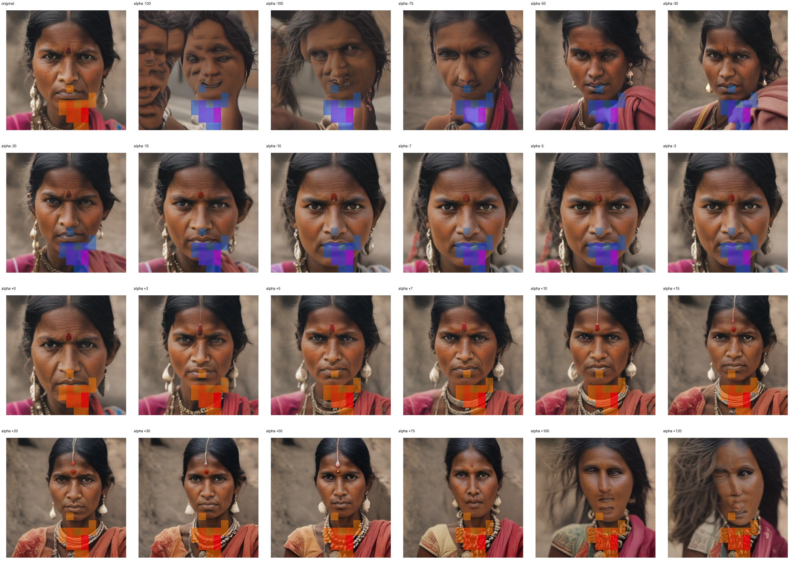
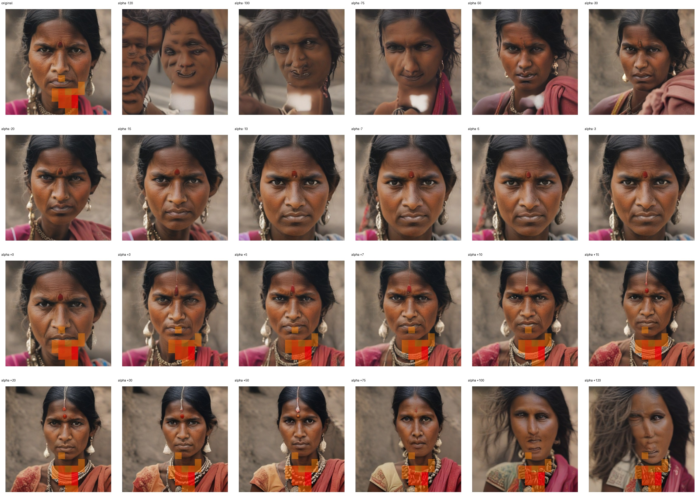

# Feature 3181 — Indian Woman

Biased dataset; original prompt and seed replay for seeds 0–19. Values are means across 20 source images. The table reports the mean post-re-encoded activation of feature 3181, the active spatial fraction, mean RGB pixel MAE versus the original image (0–255 scale), and coefficient change magnitudes for each alpha.

## Activation graph

## Mean metrics by alpha

| Alpha | Mean post-reencoded feature 3181 activation | Active spatial fraction | Mean pixel change (MAE) | Mean absolute coefficient change | Mean absolute scaled coefficient |
|---:|---:|---:|---:|---:|---:|
| -120 | 0.000 | 0.000 | 39.033 | 258.271 | 256.136 |
| -100 | 0.000 | 0.000 | 37.369 | 215.581 | 213.447 |
| -75 | 0.000 | 0.000 | 36.710 | 162.220 | 160.085 |
| -50 | 0.000 | 0.000 | 32.595 | 108.858 | 106.723 |
| -30 | 0.000 | 0.000 | 28.071 | 66.169 | 64.034 |
| -20 | 0.000 | 0.000 | 23.933 | 44.824 | 42.689 |
| -15 | 0.000 | 0.000 | 21.369 | 34.152 | 32.017 |
| -10 | 0.000 | 0.000 | 19.241 | 23.479 | 21.345 |
| -7 | 0.000 | 0.000 | 17.253 | 17.076 | 14.941 |
| -5 | 0.000 | 0.000 | 15.922 | 12.807 | 10.672 |
| -3 | 0.000 | 0.000 | 13.887 | 8.538 | 6.403 |
| +0 | 0.000 | 0.000 | 6.520 | 2.134 | 0.000 |
| +3 | 6.069 | 0.110 | 10.539 | 4.269 | 6.403 |
| +5 | 10.004 | 0.110 | 15.411 | 8.538 | 10.672 |
| +7 | 13.938 | 0.110 | 18.055 | 12.807 | 14.941 |
| +10 | 19.840 | 0.110 | 20.571 | 19.210 | 21.345 |
| +15 | 29.676 | 0.110 | 23.344 | 29.883 | 32.017 |
| +20 | 39.513 | 0.110 | 25.373 | 40.555 | 42.689 |
| +30 | 59.185 | 0.110 | 28.466 | 61.900 | 64.034 |
| +50 | 98.531 | 0.110 | 32.694 | 104.589 | 106.723 |
| +75 | 147.712 | 0.110 | 37.497 | 157.951 | 160.085 |
| +100 | 196.894 | 0.110 | 38.659 | 211.312 | 213.447 |
| +120 | 236.239 | 0.110 | 38.645 | 254.002 | 256.136 |

## Per-seed grids

Each 4×6 sheet contains the original followed by the 23 alpha variants in ascending alpha order, from −120 through +120.

### Plain images

[All 20 plain-image grids](seed_sheets/)

### Signed coefficient overlays

[All 20 signed coefficient grids](signed_coefficient_overlays/)

### Post-re-encoded activation overlays

[All 20 post-activation grids](post_activation_overlays/)

### Intervention-footprint overlays

[All 20 intervention-footprint grids](intervention_footprint_overlays/)

Zero is transparent. Negative coefficient colors progress green through blue to purple; positive colors progress yellow through orange to red. Each map tile is normalized individually for visibility. The original and alpha-zero tiles show the pre-intervention feature map so its location remains visible.
