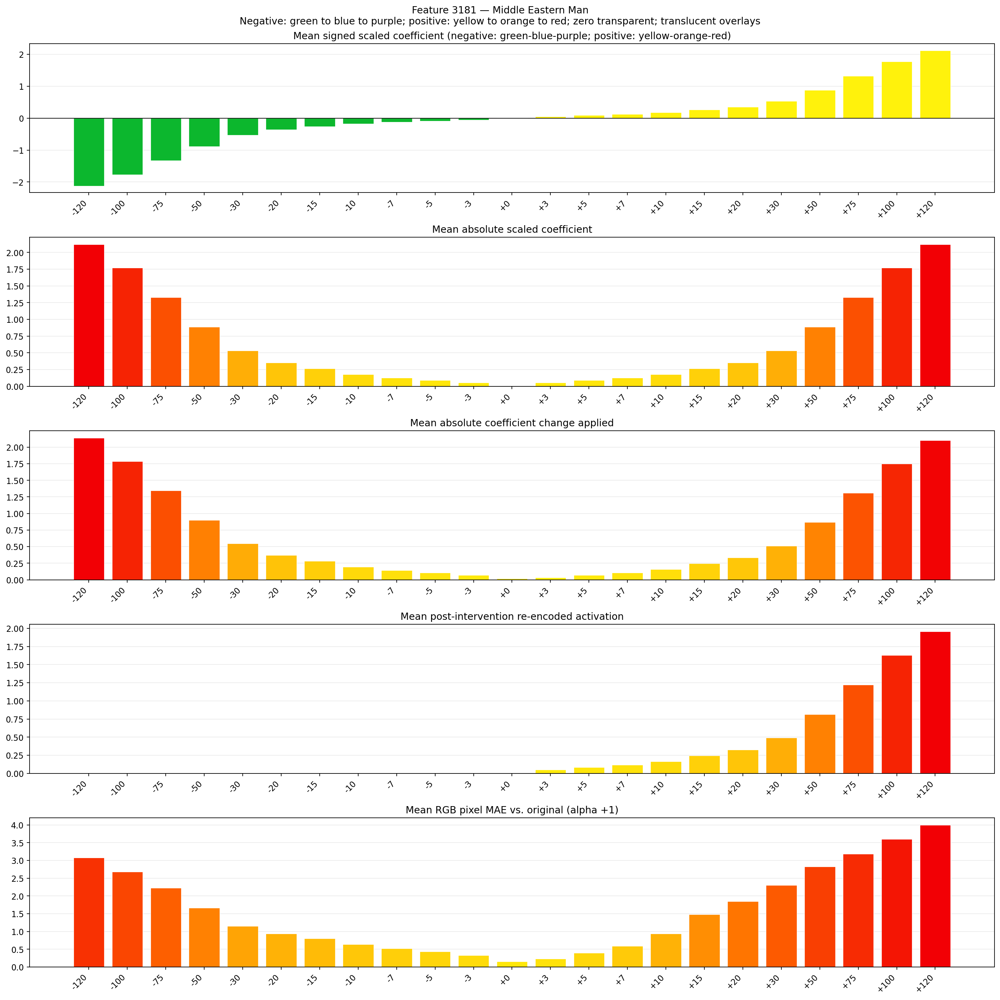
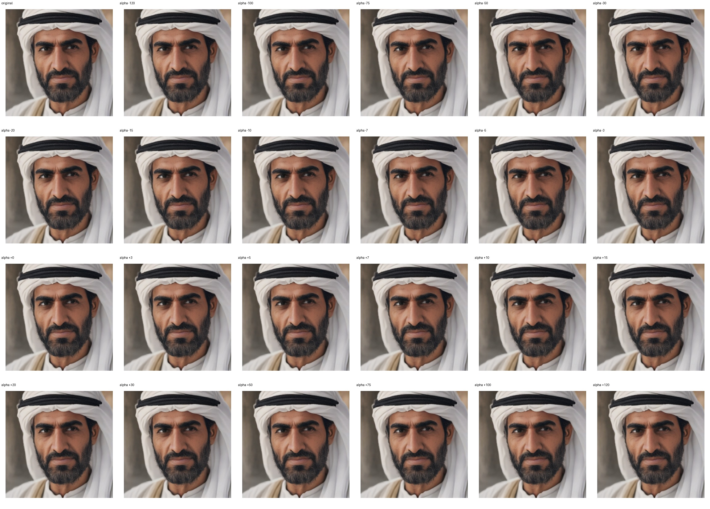

# Feature 3181 — Middle Eastern Man

Biased dataset; original prompt and seed replay for seeds 0–19. Values are means across 20 source images. The table reports the mean post-re-encoded activation of feature 3181, the active spatial fraction, mean RGB pixel MAE versus the original image (0–255 scale), and coefficient change magnitudes for each alpha.

## Activation graph

## Mean metrics by alpha

| Alpha | Mean post-reencoded feature 3181 activation | Active spatial fraction | Mean pixel change (MAE) | Mean absolute coefficient change | Mean absolute scaled coefficient |
|---:|---:|---:|---:|---:|---:|
| -120 | 0.000 | 0.000 | 3.080 | 2.140 | 2.122 |
| -100 | 0.000 | 0.000 | 2.677 | 1.786 | 1.769 |
| -75 | 0.000 | 0.000 | 2.224 | 1.344 | 1.326 |
| -50 | 0.000 | 0.000 | 1.662 | 0.902 | 0.884 |
| -30 | 0.000 | 0.000 | 1.151 | 0.548 | 0.531 |
| -20 | 0.000 | 0.000 | 0.937 | 0.371 | 0.354 |
| -15 | 0.000 | 0.000 | 0.807 | 0.283 | 0.265 |
| -10 | 0.000 | 0.000 | 0.640 | 0.195 | 0.177 |
| -7 | 0.000 | 0.000 | 0.518 | 0.141 | 0.124 |
| -5 | 0.000 | 0.000 | 0.429 | 0.106 | 0.088 |
| -3 | 0.000 | 0.000 | 0.331 | 0.071 | 0.053 |
| +0 | 0.000 | 0.000 | 0.157 | 0.018 | 0.000 |
| +3 | 0.050 | 0.002 | 0.234 | 0.035 | 0.053 |
| +5 | 0.083 | 0.002 | 0.394 | 0.071 | 0.088 |
| +7 | 0.115 | 0.002 | 0.588 | 0.106 | 0.124 |
| +10 | 0.164 | 0.002 | 0.937 | 0.159 | 0.177 |
| +15 | 0.246 | 0.002 | 1.481 | 0.248 | 0.265 |
| +20 | 0.327 | 0.002 | 1.847 | 0.336 | 0.354 |
| +30 | 0.490 | 0.002 | 2.308 | 0.513 | 0.531 |
| +50 | 0.816 | 0.002 | 2.823 | 0.867 | 0.884 |
| +75 | 1.224 | 0.002 | 3.189 | 1.309 | 1.326 |
| +100 | 1.632 | 0.002 | 3.601 | 1.751 | 1.769 |
| +120 | 1.958 | 0.002 | 4.000 | 2.105 | 2.122 |

## Per-seed grids

Each 4×6 sheet contains the original followed by the 23 alpha variants in ascending alpha order, from −120 through +120.

### Plain images

[All 20 plain-image grids](seed_sheets/)

### Signed coefficient overlays

[All 20 signed coefficient grids](signed_coefficient_overlays/)

### Post-re-encoded activation overlays

[All 20 post-activation grids](post_activation_overlays/)

### Intervention-footprint overlays

[All 20 intervention-footprint grids](intervention_footprint_overlays/)

Zero is transparent. Negative coefficient colors progress green through blue to purple; positive colors progress yellow through orange to red. Each map tile is normalized individually for visibility. The original and alpha-zero tiles show the pre-intervention feature map so its location remains visible.
