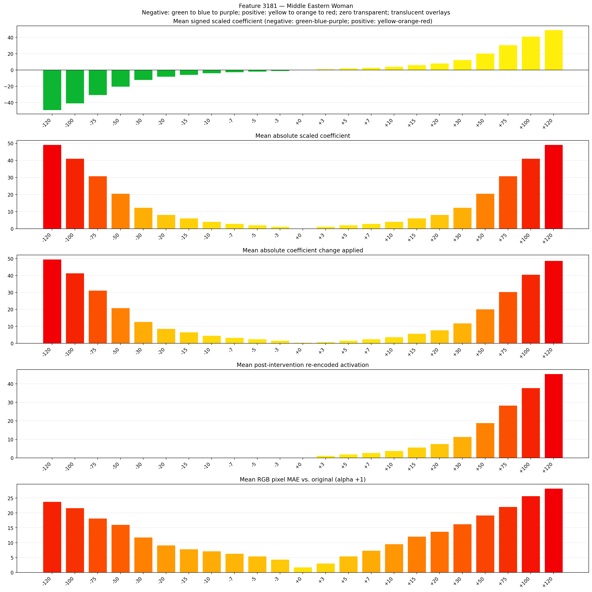
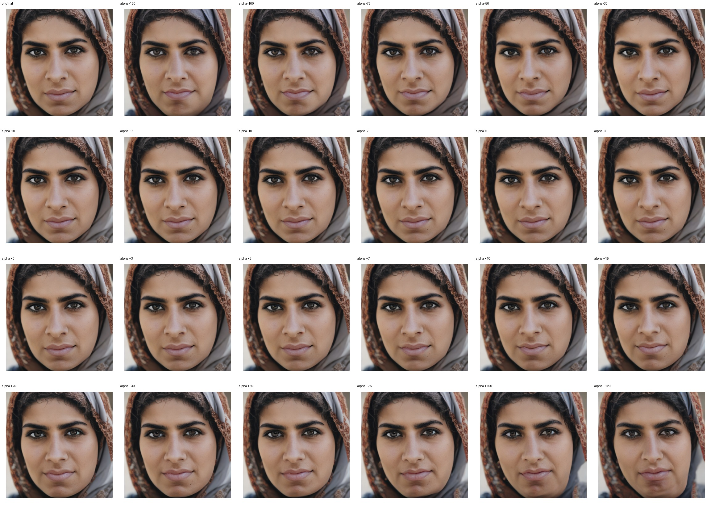
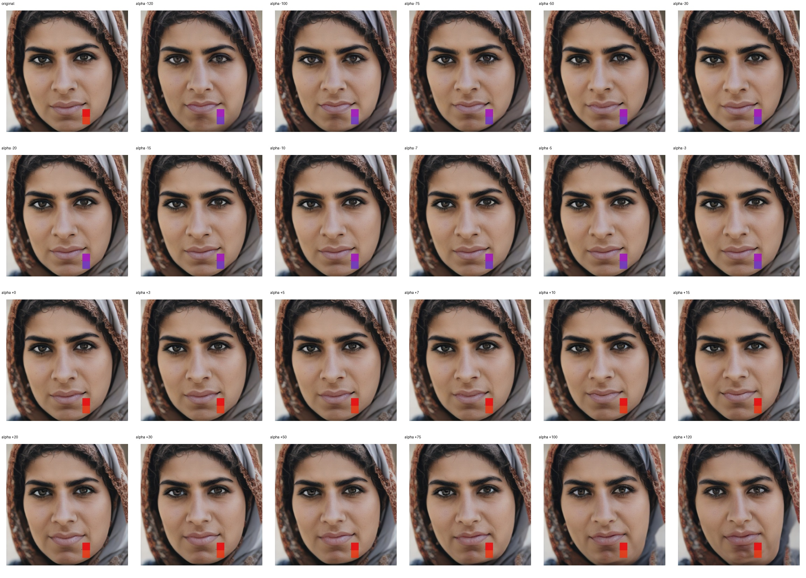
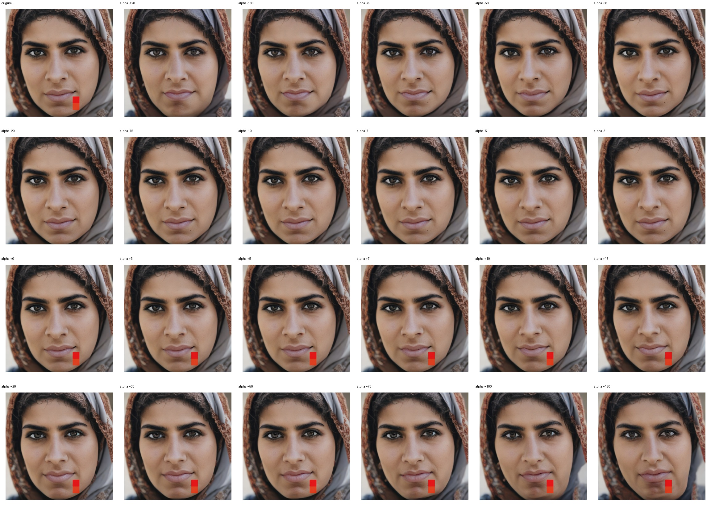

# Feature 3181 — Middle Eastern Woman

Biased dataset; original prompt and seed replay for seeds 0–19. Values are means across 20 source images. The table reports the mean post-re-encoded activation of feature 3181, the active spatial fraction, mean RGB pixel MAE versus the original image (0–255 scale), and coefficient change magnitudes for each alpha.

## Activation graph

## Mean metrics by alpha

| Alpha | Mean post-reencoded feature 3181 activation | Active spatial fraction | Mean pixel change (MAE) | Mean absolute coefficient change | Mean absolute scaled coefficient |
|---:|---:|---:|---:|---:|---:|
| -120 | 0.000 | 0.000 | 23.767 | 49.602 | 49.192 |
| -100 | 0.000 | 0.000 | 21.646 | 41.403 | 40.993 |
| -75 | 0.000 | 0.000 | 18.180 | 31.155 | 30.745 |
| -50 | 0.000 | 0.000 | 16.063 | 20.907 | 20.497 |
| -30 | 0.000 | 0.000 | 11.820 | 12.708 | 12.298 |
| -20 | 0.000 | 0.000 | 9.121 | 8.609 | 8.199 |
| -15 | 0.000 | 0.000 | 7.843 | 6.559 | 6.149 |
| -10 | 0.000 | 0.000 | 7.182 | 4.509 | 4.099 |
| -7 | 0.000 | 0.000 | 6.327 | 3.279 | 2.870 |
| -5 | 0.000 | 0.000 | 5.479 | 2.460 | 2.050 |
| -3 | 0.000 | 0.000 | 4.362 | 1.640 | 1.230 |
| +0 | 0.000 | 0.000 | 1.753 | 0.410 | 0.000 |
| +3 | 1.166 | 0.032 | 3.092 | 0.820 | 1.230 |
| +5 | 1.921 | 0.032 | 5.424 | 1.640 | 2.050 |
| +7 | 2.677 | 0.032 | 7.352 | 2.460 | 2.870 |
| +10 | 3.810 | 0.032 | 9.557 | 3.689 | 4.099 |
| +15 | 5.699 | 0.032 | 12.106 | 5.739 | 6.149 |
| +20 | 7.589 | 0.032 | 13.760 | 7.789 | 8.199 |
| +30 | 11.367 | 0.032 | 16.274 | 11.888 | 12.298 |
| +50 | 18.923 | 0.032 | 19.198 | 20.087 | 20.497 |
| +75 | 28.369 | 0.032 | 22.043 | 30.335 | 30.745 |
| +100 | 37.814 | 0.032 | 25.700 | 40.583 | 40.993 |
| +120 | 45.371 | 0.032 | 28.235 | 48.782 | 49.192 |

## Per-seed grids

Each 4×6 sheet contains the original followed by the 23 alpha variants in ascending alpha order, from −120 through +120.

### Plain images

[All 20 plain-image grids](seed_sheets/)

### Signed coefficient overlays

[All 20 signed coefficient grids](signed_coefficient_overlays/)

### Post-re-encoded activation overlays

[All 20 post-activation grids](post_activation_overlays/)

### Intervention-footprint overlays

[All 20 intervention-footprint grids](intervention_footprint_overlays/)

Zero is transparent. Negative coefficient colors progress green through blue to purple; positive colors progress yellow through orange to red. Each map tile is normalized individually for visibility. The original and alpha-zero tiles show the pre-intervention feature map so its location remains visible.
