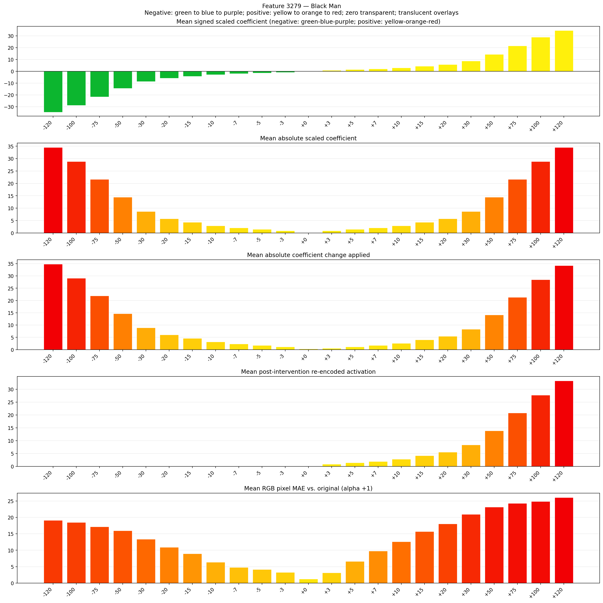
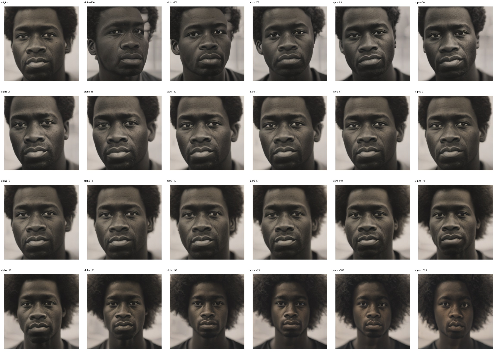
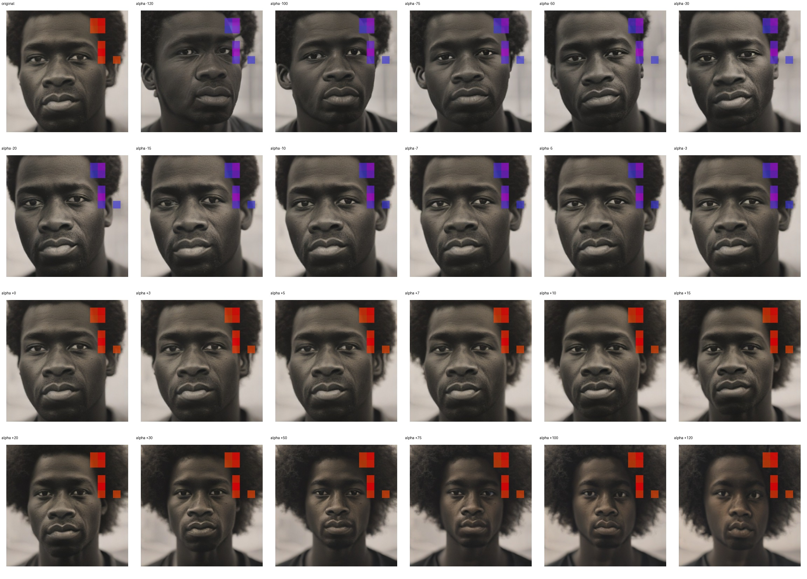
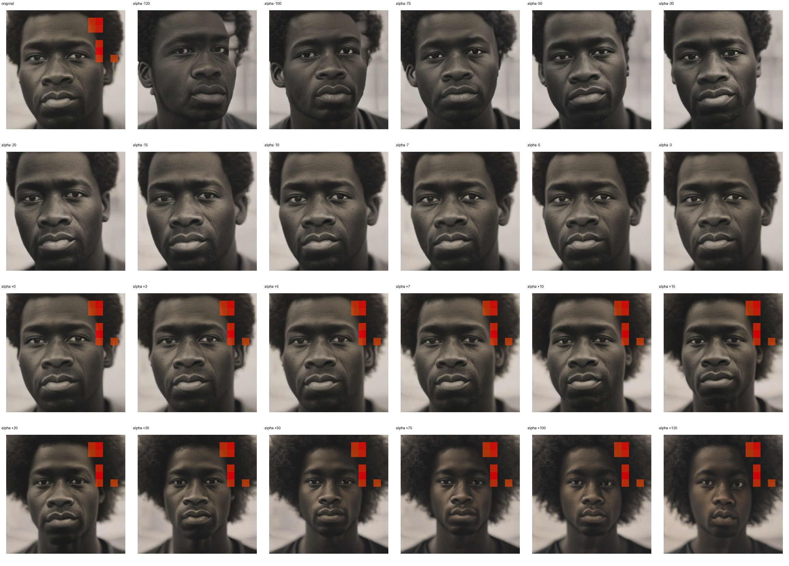

# Feature 3279 — Black Man

Biased dataset; original prompt and seed replay for seeds 0–19. Values are means across 20 source images. The table reports the mean post-re-encoded activation of feature 3279, the active spatial fraction, mean RGB pixel MAE versus the original image (0–255 scale), and coefficient change magnitudes for each alpha.

## Activation graph

## Mean metrics by alpha

| Alpha | Mean post-reencoded feature 3279 activation | Active spatial fraction | Mean pixel change (MAE) | Mean absolute coefficient change | Mean absolute scaled coefficient |
|---:|---:|---:|---:|---:|---:|
| -120 | 0.000 | 0.000 | 19.102 | 34.840 | 34.552 |
| -100 | 0.000 | 0.000 | 18.458 | 29.081 | 28.793 |
| -75 | 0.000 | 0.000 | 17.173 | 21.883 | 21.595 |
| -50 | 0.000 | 0.000 | 15.959 | 14.684 | 14.397 |
| -30 | 0.000 | 0.000 | 13.391 | 8.926 | 8.638 |
| -20 | 0.000 | 0.000 | 10.937 | 6.047 | 5.759 |
| -15 | 0.000 | 0.000 | 8.926 | 4.607 | 4.319 |
| -10 | 0.000 | 0.000 | 6.383 | 3.167 | 2.879 |
| -7 | 0.000 | 0.000 | 4.803 | 2.303 | 2.016 |
| -5 | 0.000 | 0.000 | 4.155 | 1.728 | 1.440 |
| -3 | 0.000 | 0.000 | 3.251 | 1.152 | 0.864 |
| +0 | 0.000 | 0.000 | 1.262 | 0.288 | 0.000 |
| +3 | 0.842 | 0.019 | 3.154 | 0.576 | 0.864 |
| +5 | 1.397 | 0.019 | 6.625 | 1.152 | 1.440 |
| +7 | 1.951 | 0.019 | 9.751 | 1.728 | 2.016 |
| +10 | 2.783 | 0.019 | 12.580 | 2.591 | 2.879 |
| +15 | 4.169 | 0.019 | 15.685 | 4.031 | 4.319 |
| +20 | 5.556 | 0.019 | 18.039 | 5.471 | 5.759 |
| +30 | 8.328 | 0.019 | 20.961 | 8.350 | 8.638 |
| +50 | 13.873 | 0.019 | 23.163 | 14.109 | 14.397 |
| +75 | 20.804 | 0.019 | 24.289 | 21.307 | 21.595 |
| +100 | 27.735 | 0.019 | 24.840 | 28.505 | 28.793 |
| +120 | 33.281 | 0.019 | 26.061 | 34.264 | 34.552 |

## Per-seed grids

Each 4×6 sheet contains the original followed by the 23 alpha variants in ascending alpha order, from −120 through +120.

### Plain images

[All 20 plain-image grids](seed_sheets/)

### Signed coefficient overlays

[All 20 signed coefficient grids](signed_coefficient_overlays/)

### Post-re-encoded activation overlays

[All 20 post-activation grids](post_activation_overlays/)

### Intervention-footprint overlays

[All 20 intervention-footprint grids](intervention_footprint_overlays/)

Zero is transparent. Negative coefficient colors progress green through blue to purple; positive colors progress yellow through orange to red. Each map tile is normalized individually for visibility. The original and alpha-zero tiles show the pre-intervention feature map so its location remains visible.
