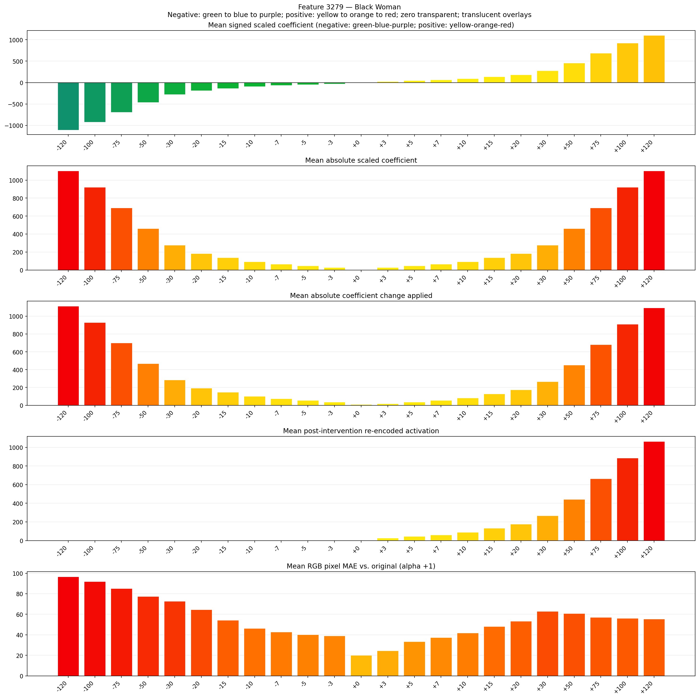
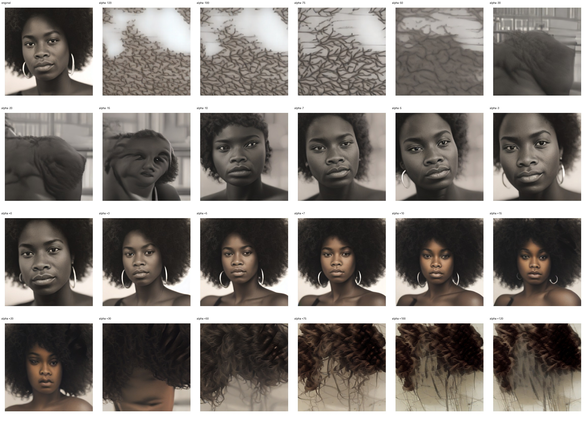
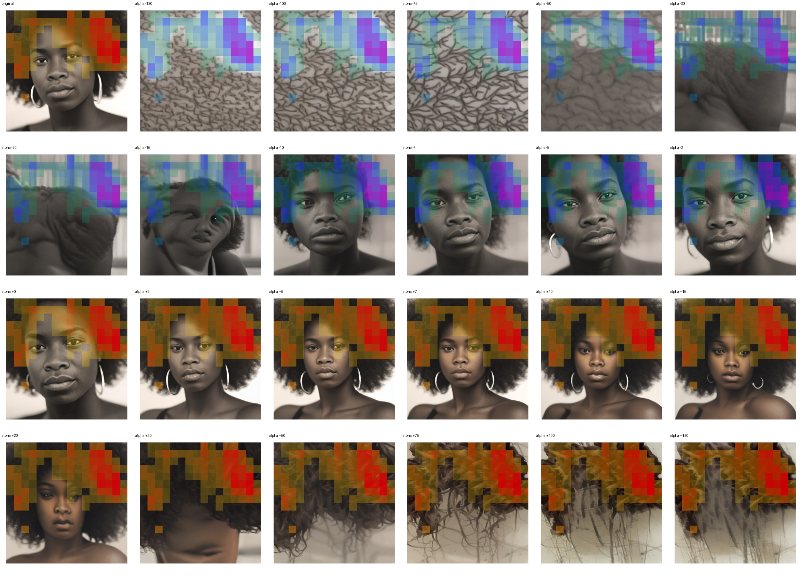
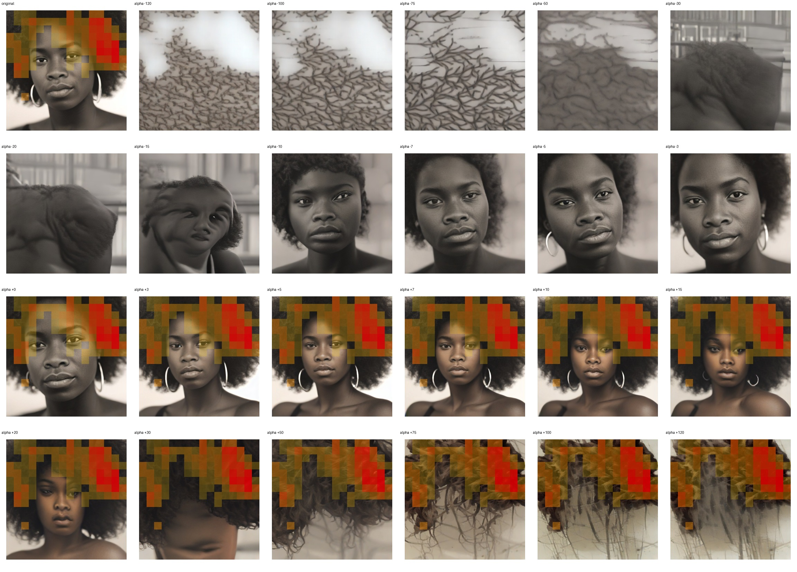

# Feature 3279 — Black Woman

Biased dataset; original prompt and seed replay for seeds 0–19. Values are means across 20 source images. The table reports the mean post-re-encoded activation of feature 3279, the active spatial fraction, mean RGB pixel MAE versus the original image (0–255 scale), and coefficient change magnitudes for each alpha.

## Activation graph

## Mean metrics by alpha

| Alpha | Mean post-reencoded feature 3279 activation | Active spatial fraction | Mean pixel change (MAE) | Mean absolute coefficient change | Mean absolute scaled coefficient |
|---:|---:|---:|---:|---:|---:|
| -120 | 0.000 | 0.000 | 96.647 | 1113.797 | 1104.592 |
| -100 | 0.000 | 0.000 | 91.930 | 929.698 | 920.493 |
| -75 | 0.000 | 0.000 | 85.266 | 699.575 | 690.370 |
| -50 | 0.000 | 0.000 | 77.371 | 469.451 | 460.247 |
| -30 | 0.000 | 0.000 | 72.645 | 285.353 | 276.148 |
| -20 | 0.000 | 0.000 | 64.580 | 193.304 | 184.099 |
| -15 | 0.000 | 0.000 | 54.227 | 147.279 | 138.074 |
| -10 | 0.000 | 0.000 | 46.343 | 101.254 | 92.049 |
| -7 | 0.000 | 0.000 | 42.753 | 73.639 | 64.435 |
| -5 | 0.000 | 0.000 | 40.276 | 55.230 | 46.025 |
| -3 | 0.000 | 0.000 | 39.128 | 36.820 | 27.615 |
| +0 | 0.000 | 0.000 | 20.142 | 9.205 | 0.000 |
| +3 | 26.932 | 0.351 | 24.482 | 18.410 | 27.615 |
| +5 | 44.659 | 0.351 | 33.427 | 36.820 | 46.025 |
| +7 | 62.385 | 0.351 | 37.450 | 55.230 | 64.435 |
| +10 | 88.976 | 0.351 | 41.801 | 82.844 | 92.049 |
| +15 | 133.293 | 0.351 | 48.209 | 128.869 | 138.074 |
| +20 | 177.610 | 0.351 | 53.436 | 174.894 | 184.099 |
| +30 | 266.243 | 0.351 | 62.954 | 266.943 | 276.148 |
| +50 | 443.512 | 0.351 | 60.915 | 451.042 | 460.247 |
| +75 | 665.097 | 0.351 | 57.105 | 681.165 | 690.370 |
| +100 | 886.682 | 0.351 | 56.192 | 911.288 | 920.493 |
| +120 | 1063.950 | 0.351 | 55.496 | 1095.387 | 1104.592 |

## Per-seed grids

Each 4×6 sheet contains the original followed by the 23 alpha variants in ascending alpha order, from −120 through +120.

### Plain images

[All 20 plain-image grids](seed_sheets/)

### Signed coefficient overlays

[All 20 signed coefficient grids](signed_coefficient_overlays/)

### Post-re-encoded activation overlays

[All 20 post-activation grids](post_activation_overlays/)

### Intervention-footprint overlays

[All 20 intervention-footprint grids](intervention_footprint_overlays/)

Zero is transparent. Negative coefficient colors progress green through blue to purple; positive colors progress yellow through orange to red. Each map tile is normalized individually for visibility. The original and alpha-zero tiles show the pre-intervention feature map so its location remains visible.
