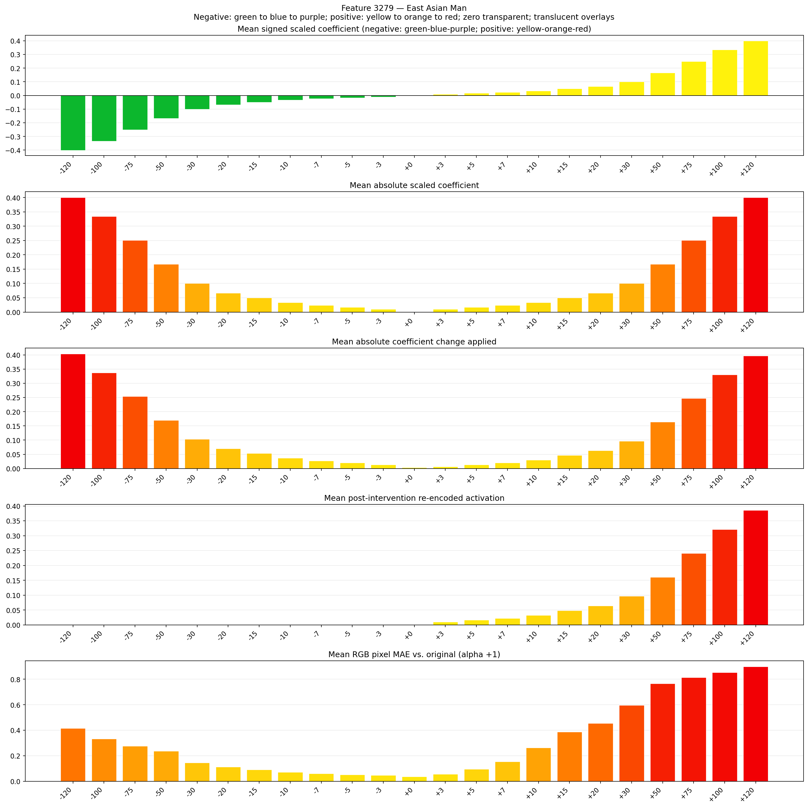
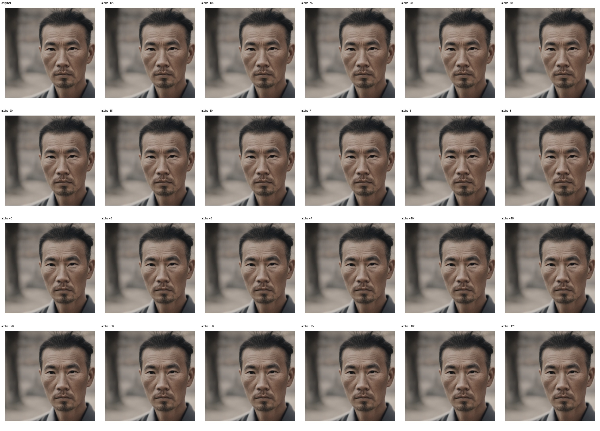

# Feature 3279 — East Asian Man

Biased dataset; original prompt and seed replay for seeds 0–19. Values are means across 20 source images. The table reports the mean post-re-encoded activation of feature 3279, the active spatial fraction, mean RGB pixel MAE versus the original image (0–255 scale), and coefficient change magnitudes for each alpha.

## Activation graph

## Mean metrics by alpha

| Alpha | Mean post-reencoded feature 3279 activation | Active spatial fraction | Mean pixel change (MAE) | Mean absolute coefficient change | Mean absolute scaled coefficient |
|---:|---:|---:|---:|---:|---:|
| -120 | 0.000 | 0.000 | 0.416 | 0.404 | 0.401 |
| -100 | 0.000 | 0.000 | 0.334 | 0.337 | 0.334 |
| -75 | 0.000 | 0.000 | 0.277 | 0.254 | 0.250 |
| -50 | 0.000 | 0.000 | 0.238 | 0.170 | 0.167 |
| -30 | 0.000 | 0.000 | 0.145 | 0.103 | 0.100 |
| -20 | 0.000 | 0.000 | 0.113 | 0.070 | 0.067 |
| -15 | 0.000 | 0.000 | 0.090 | 0.053 | 0.050 |
| -10 | 0.000 | 0.000 | 0.071 | 0.037 | 0.033 |
| -7 | 0.000 | 0.000 | 0.060 | 0.027 | 0.023 |
| -5 | 0.000 | 0.000 | 0.052 | 0.020 | 0.017 |
| -3 | 0.000 | 0.000 | 0.047 | 0.013 | 0.010 |
| +0 | 0.000 | 0.000 | 0.036 | 0.003 | 0.000 |
| +3 | 0.010 | 0.000 | 0.057 | 0.007 | 0.010 |
| +5 | 0.016 | 0.000 | 0.095 | 0.013 | 0.017 |
| +7 | 0.023 | 0.000 | 0.153 | 0.020 | 0.023 |
| +10 | 0.032 | 0.000 | 0.263 | 0.030 | 0.033 |
| +15 | 0.048 | 0.000 | 0.388 | 0.047 | 0.050 |
| +20 | 0.064 | 0.000 | 0.456 | 0.063 | 0.067 |
| +30 | 0.097 | 0.000 | 0.595 | 0.097 | 0.100 |
| +50 | 0.161 | 0.000 | 0.765 | 0.164 | 0.167 |
| +75 | 0.241 | 0.000 | 0.813 | 0.247 | 0.250 |
| +100 | 0.322 | 0.000 | 0.853 | 0.330 | 0.334 |
| +120 | 0.386 | 0.000 | 0.899 | 0.397 | 0.401 |

## Per-seed grids

Each 4×6 sheet contains the original followed by the 23 alpha variants in ascending alpha order, from −120 through +120.

### Plain images

[All 20 plain-image grids](seed_sheets/)

### Signed coefficient overlays

[All 20 signed coefficient grids](signed_coefficient_overlays/)

### Post-re-encoded activation overlays

[All 20 post-activation grids](post_activation_overlays/)

### Intervention-footprint overlays

[All 20 intervention-footprint grids](intervention_footprint_overlays/)

Zero is transparent. Negative coefficient colors progress green through blue to purple; positive colors progress yellow through orange to red. Each map tile is normalized individually for visibility. The original and alpha-zero tiles show the pre-intervention feature map so its location remains visible.
