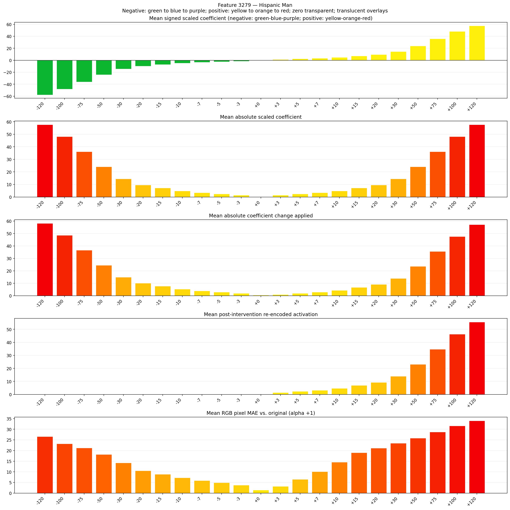
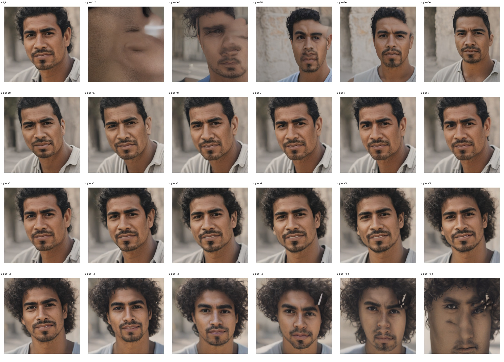
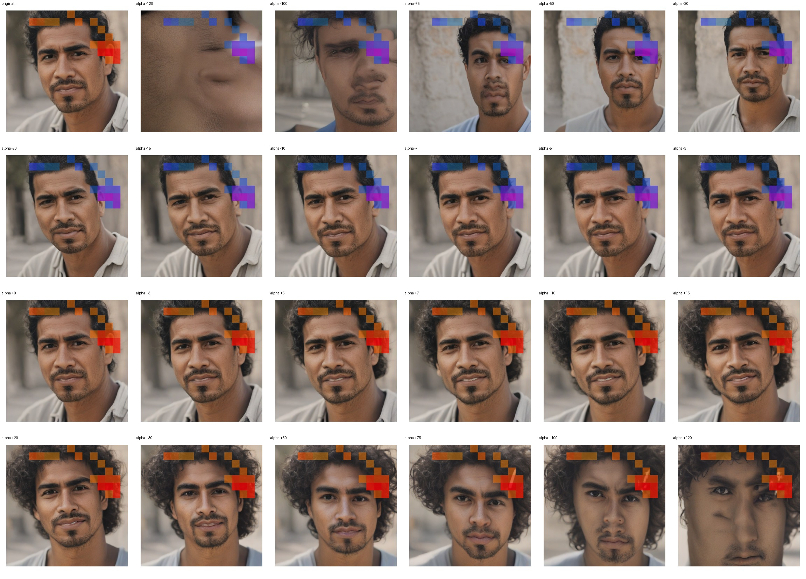
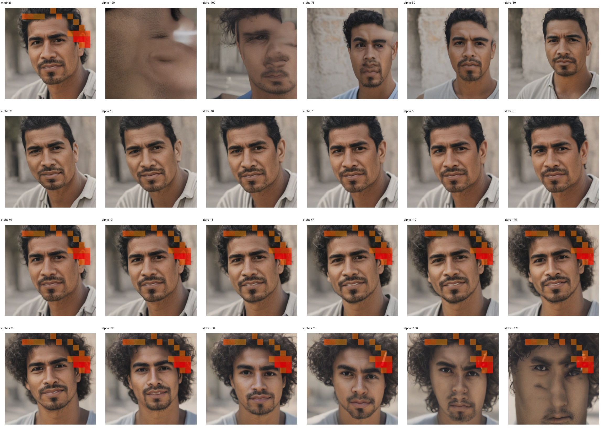

# Feature 3279 — Hispanic Man

Biased dataset; original prompt and seed replay for seeds 0–19. Values are means across 20 source images. The table reports the mean post-re-encoded activation of feature 3279, the active spatial fraction, mean RGB pixel MAE versus the original image (0–255 scale), and coefficient change magnitudes for each alpha.

## Activation graph

## Mean metrics by alpha

| Alpha | Mean post-reencoded feature 3279 activation | Active spatial fraction | Mean pixel change (MAE) | Mean absolute coefficient change | Mean absolute scaled coefficient |
|---:|---:|---:|---:|---:|---:|
| -120 | 0.000 | 0.000 | 26.580 | 58.202 | 57.721 |
| -100 | 0.000 | 0.000 | 23.197 | 48.582 | 48.101 |
| -75 | 0.000 | 0.000 | 21.215 | 36.557 | 36.076 |
| -50 | 0.000 | 0.000 | 18.192 | 24.532 | 24.051 |
| -30 | 0.000 | 0.000 | 14.239 | 14.911 | 14.430 |
| -20 | 0.000 | 0.000 | 10.519 | 10.101 | 9.620 |
| -15 | 0.000 | 0.000 | 8.895 | 7.696 | 7.215 |
| -10 | 0.000 | 0.000 | 7.225 | 5.291 | 4.810 |
| -7 | 0.000 | 0.000 | 5.948 | 3.848 | 3.367 |
| -5 | 0.000 | 0.000 | 4.938 | 2.886 | 2.405 |
| -3 | 0.000 | 0.000 | 3.806 | 1.924 | 1.443 |
| +0 | 0.000 | 0.000 | 1.506 | 0.481 | 0.000 |
| +3 | 1.407 | 0.035 | 3.206 | 0.962 | 1.443 |
| +5 | 2.334 | 0.035 | 6.522 | 1.924 | 2.405 |
| +7 | 3.260 | 0.035 | 10.128 | 2.886 | 3.367 |
| +10 | 4.649 | 0.035 | 14.553 | 4.329 | 4.810 |
| +15 | 6.965 | 0.035 | 18.983 | 6.734 | 7.215 |
| +20 | 9.281 | 0.035 | 21.164 | 9.139 | 9.620 |
| +30 | 13.913 | 0.035 | 23.417 | 13.949 | 14.430 |
| +50 | 23.176 | 0.035 | 25.871 | 23.570 | 24.051 |
| +75 | 34.755 | 0.035 | 28.736 | 35.595 | 36.076 |
| +100 | 46.334 | 0.035 | 31.627 | 47.620 | 48.101 |
| +120 | 55.598 | 0.035 | 33.989 | 57.240 | 57.721 |

## Per-seed grids

Each 4×6 sheet contains the original followed by the 23 alpha variants in ascending alpha order, from −120 through +120.

### Plain images

[All 20 plain-image grids](seed_sheets/)

### Signed coefficient overlays

[All 20 signed coefficient grids](signed_coefficient_overlays/)

### Post-re-encoded activation overlays

[All 20 post-activation grids](post_activation_overlays/)

### Intervention-footprint overlays

[All 20 intervention-footprint grids](intervention_footprint_overlays/)

Zero is transparent. Negative coefficient colors progress green through blue to purple; positive colors progress yellow through orange to red. Each map tile is normalized individually for visibility. The original and alpha-zero tiles show the pre-intervention feature map so its location remains visible.
