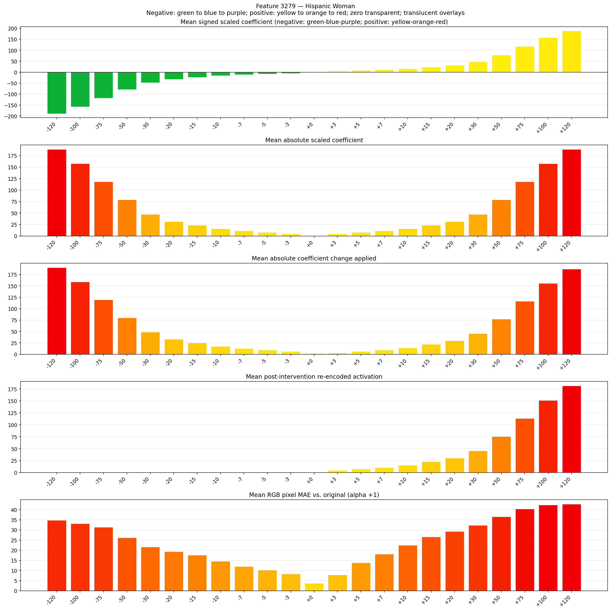
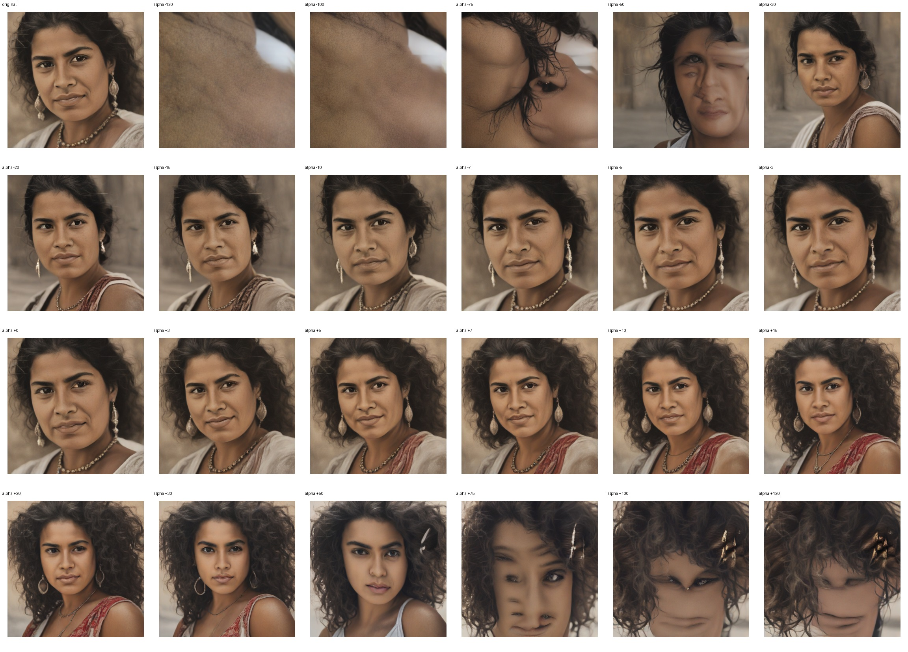
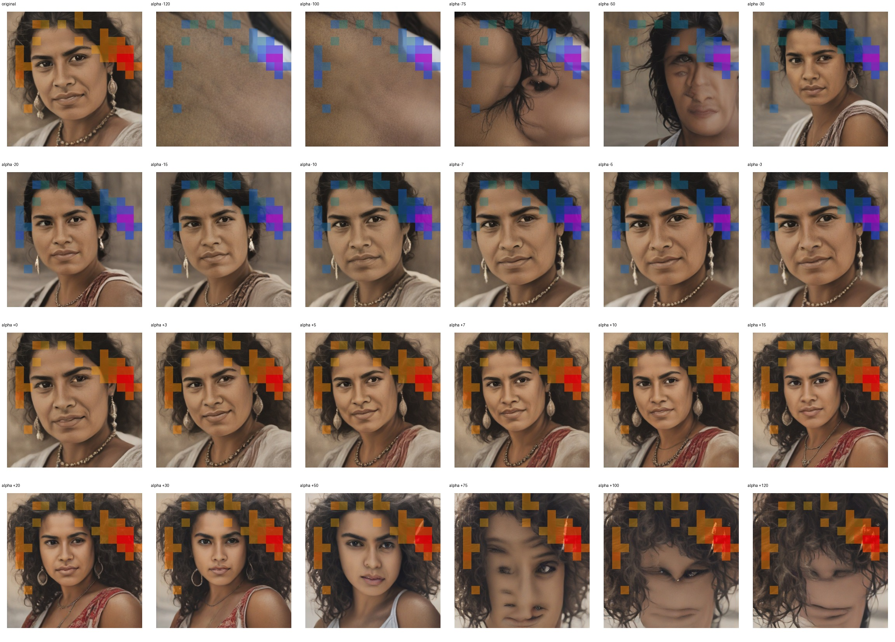
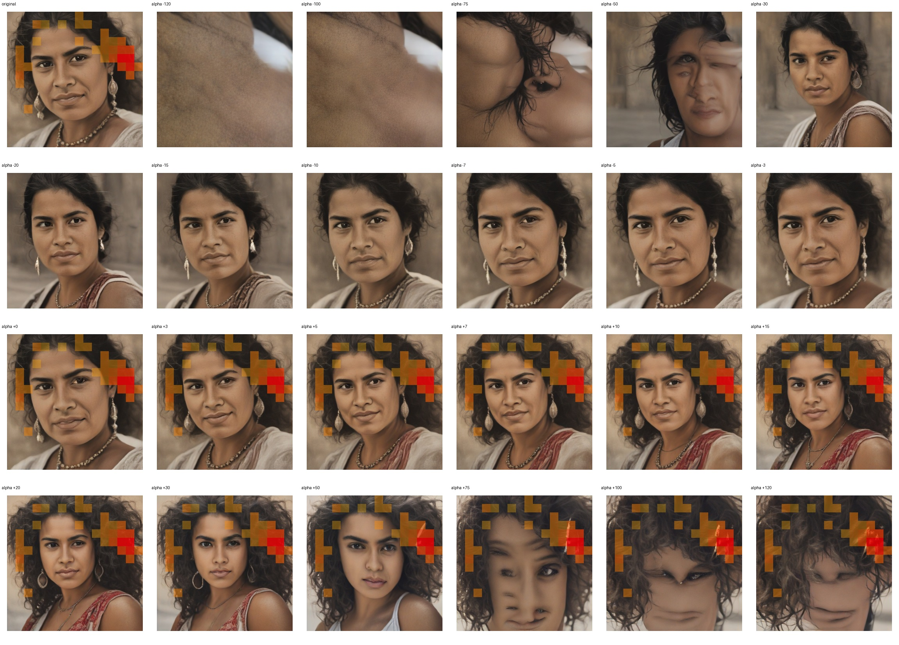

# Feature 3279 — Hispanic Woman

Biased dataset; original prompt and seed replay for seeds 0–19. Values are means across 20 source images. The table reports the mean post-re-encoded activation of feature 3279, the active spatial fraction, mean RGB pixel MAE versus the original image (0–255 scale), and coefficient change magnitudes for each alpha.

## Activation graph

## Mean metrics by alpha

| Alpha | Mean post-reencoded feature 3279 activation | Active spatial fraction | Mean pixel change (MAE) | Mean absolute coefficient change | Mean absolute scaled coefficient |
|---:|---:|---:|---:|---:|---:|
| -120 | 0.000 | 0.000 | 34.718 | 190.389 | 188.816 |
| -100 | 0.000 | 0.000 | 33.098 | 158.920 | 157.346 |
| -75 | 0.000 | 0.000 | 31.355 | 119.583 | 118.010 |
| -50 | 0.000 | 0.000 | 26.122 | 80.247 | 78.673 |
| -30 | 0.000 | 0.000 | 21.636 | 48.777 | 47.204 |
| -20 | 0.000 | 0.000 | 19.295 | 33.043 | 31.469 |
| -15 | 0.000 | 0.000 | 17.583 | 25.175 | 23.602 |
| -10 | 0.000 | 0.000 | 14.535 | 17.308 | 15.735 |
| -7 | 0.000 | 0.000 | 11.961 | 12.588 | 11.014 |
| -5 | 0.000 | 0.000 | 10.244 | 9.441 | 7.867 |
| -3 | 0.000 | 0.000 | 8.367 | 6.294 | 4.720 |
| +0 | 0.000 | 0.000 | 3.657 | 1.573 | 0.000 |
| +3 | 4.604 | 0.106 | 7.821 | 3.147 | 4.720 |
| +5 | 7.634 | 0.106 | 13.875 | 6.294 | 7.867 |
| +7 | 10.664 | 0.106 | 18.048 | 9.441 | 11.014 |
| +10 | 15.209 | 0.106 | 22.411 | 14.161 | 15.735 |
| +15 | 22.785 | 0.106 | 26.534 | 22.028 | 23.602 |
| +20 | 30.360 | 0.106 | 29.263 | 29.896 | 31.469 |
| +30 | 45.511 | 0.106 | 32.276 | 45.630 | 47.204 |
| +50 | 75.813 | 0.106 | 36.484 | 77.100 | 78.673 |
| +75 | 113.690 | 0.106 | 40.371 | 116.436 | 118.010 |
| +100 | 151.567 | 0.106 | 42.270 | 155.773 | 157.346 |
| +120 | 181.868 | 0.106 | 42.746 | 187.242 | 188.816 |

## Per-seed grids

Each 4×6 sheet contains the original followed by the 23 alpha variants in ascending alpha order, from −120 through +120.

### Plain images

[All 20 plain-image grids](seed_sheets/)

### Signed coefficient overlays

[All 20 signed coefficient grids](signed_coefficient_overlays/)

### Post-re-encoded activation overlays

[All 20 post-activation grids](post_activation_overlays/)

### Intervention-footprint overlays

[All 20 intervention-footprint grids](intervention_footprint_overlays/)

Zero is transparent. Negative coefficient colors progress green through blue to purple; positive colors progress yellow through orange to red. Each map tile is normalized individually for visibility. The original and alpha-zero tiles show the pre-intervention feature map so its location remains visible.
