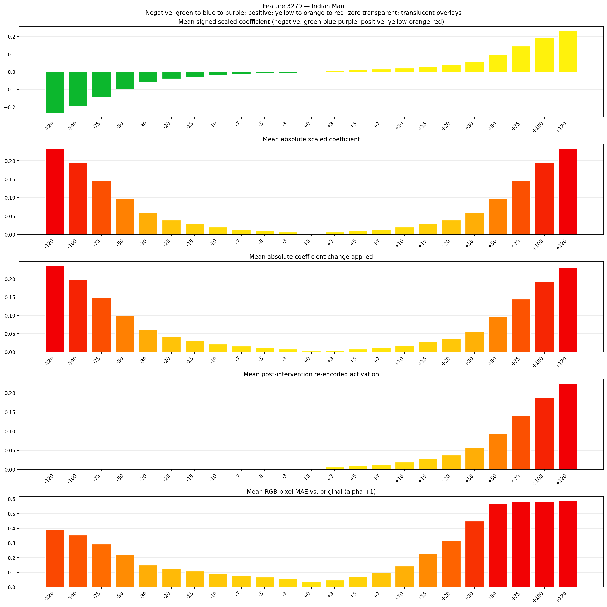
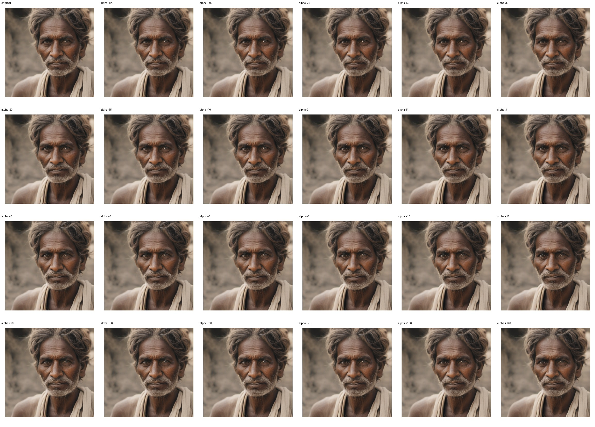
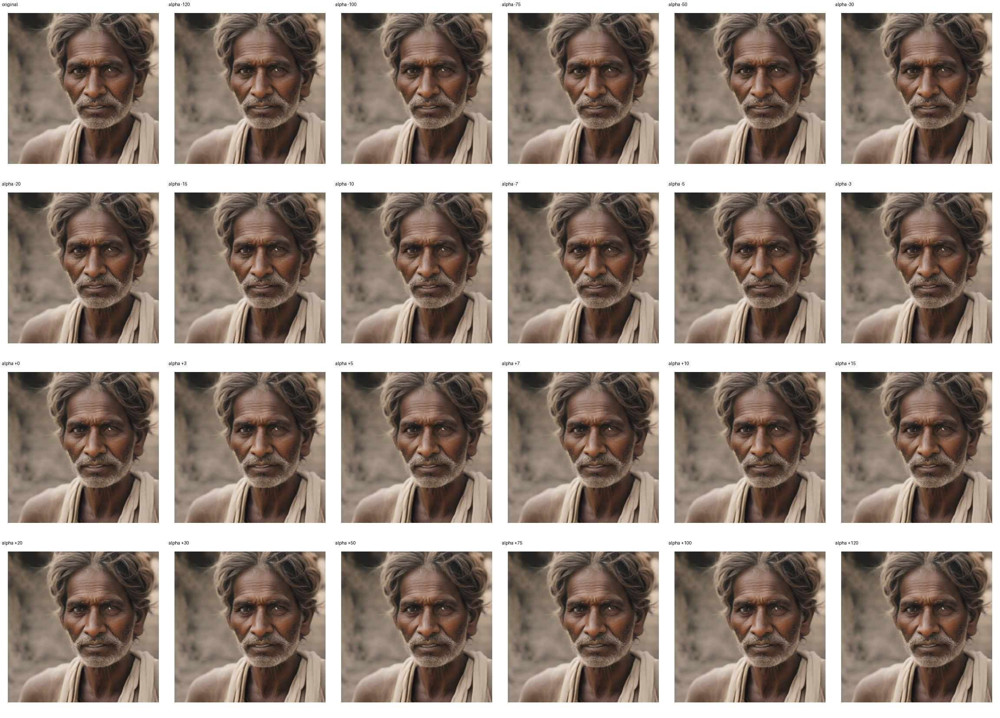

# Feature 3279 — Indian Man

Biased dataset; original prompt and seed replay for seeds 0–19. Values are means across 20 source images. The table reports the mean post-re-encoded activation of feature 3279, the active spatial fraction, mean RGB pixel MAE versus the original image (0–255 scale), and coefficient change magnitudes for each alpha.

## Activation graph

## Mean metrics by alpha

| Alpha | Mean post-reencoded feature 3279 activation | Active spatial fraction | Mean pixel change (MAE) | Mean absolute coefficient change | Mean absolute scaled coefficient |
|---:|---:|---:|---:|---:|---:|
| -120 | 0.000 | 0.000 | 0.388 | 0.236 | 0.234 |
| -100 | 0.000 | 0.000 | 0.353 | 0.197 | 0.195 |
| -75 | 0.000 | 0.000 | 0.291 | 0.148 | 0.146 |
| -50 | 0.000 | 0.000 | 0.221 | 0.099 | 0.097 |
| -30 | 0.000 | 0.000 | 0.147 | 0.060 | 0.058 |
| -20 | 0.000 | 0.000 | 0.121 | 0.041 | 0.039 |
| -15 | 0.000 | 0.000 | 0.108 | 0.031 | 0.029 |
| -10 | 0.000 | 0.000 | 0.092 | 0.021 | 0.019 |
| -7 | 0.000 | 0.000 | 0.078 | 0.016 | 0.014 |
| -5 | 0.000 | 0.000 | 0.067 | 0.012 | 0.010 |
| -3 | 0.000 | 0.000 | 0.056 | 0.008 | 0.006 |
| +0 | 0.000 | 0.000 | 0.034 | 0.002 | 0.000 |
| +3 | 0.006 | 0.000 | 0.045 | 0.004 | 0.006 |
| +5 | 0.009 | 0.000 | 0.070 | 0.008 | 0.010 |
| +7 | 0.013 | 0.000 | 0.096 | 0.012 | 0.014 |
| +10 | 0.019 | 0.000 | 0.142 | 0.018 | 0.019 |
| +15 | 0.028 | 0.000 | 0.226 | 0.027 | 0.029 |
| +20 | 0.038 | 0.000 | 0.314 | 0.037 | 0.039 |
| +30 | 0.056 | 0.000 | 0.449 | 0.057 | 0.058 |
| +50 | 0.094 | 0.000 | 0.567 | 0.095 | 0.097 |
| +75 | 0.141 | 0.000 | 0.581 | 0.144 | 0.146 |
| +100 | 0.188 | 0.000 | 0.581 | 0.193 | 0.195 |
| +120 | 0.225 | 0.000 | 0.587 | 0.232 | 0.234 |

## Per-seed grids

Each 4×6 sheet contains the original followed by the 23 alpha variants in ascending alpha order, from −120 through +120.

### Plain images

[All 20 plain-image grids](seed_sheets/)

### Signed coefficient overlays

[All 20 signed coefficient grids](signed_coefficient_overlays/)

### Post-re-encoded activation overlays

[All 20 post-activation grids](post_activation_overlays/)

### Intervention-footprint overlays

[All 20 intervention-footprint grids](intervention_footprint_overlays/)

Zero is transparent. Negative coefficient colors progress green through blue to purple; positive colors progress yellow through orange to red. Each map tile is normalized individually for visibility. The original and alpha-zero tiles show the pre-intervention feature map so its location remains visible.
