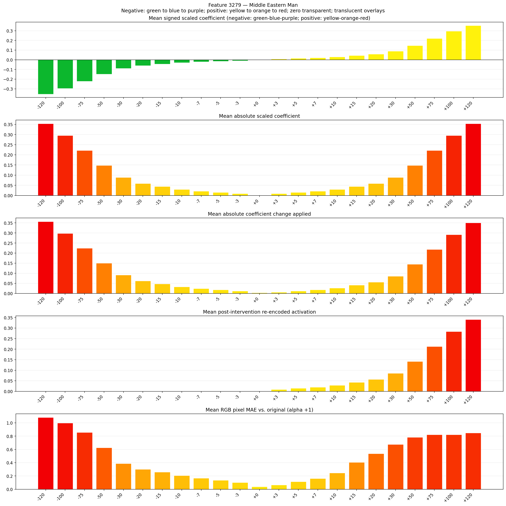
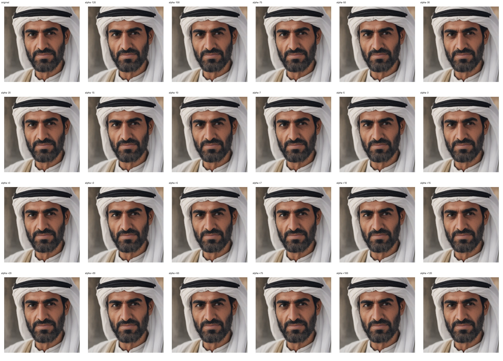

# Feature 3279 — Middle Eastern Man

Biased dataset; original prompt and seed replay for seeds 0–19. Values are means across 20 source images. The table reports the mean post-re-encoded activation of feature 3279, the active spatial fraction, mean RGB pixel MAE versus the original image (0–255 scale), and coefficient change magnitudes for each alpha.

## Activation graph

## Mean metrics by alpha

| Alpha | Mean post-reencoded feature 3279 activation | Active spatial fraction | Mean pixel change (MAE) | Mean absolute coefficient change | Mean absolute scaled coefficient |
|---:|---:|---:|---:|---:|---:|
| -120 | 0.000 | 0.000 | 1.082 | 0.357 | 0.354 |
| -100 | 0.000 | 0.000 | 0.998 | 0.298 | 0.295 |
| -75 | 0.000 | 0.000 | 0.857 | 0.224 | 0.221 |
| -50 | 0.000 | 0.000 | 0.625 | 0.150 | 0.147 |
| -30 | 0.000 | 0.000 | 0.387 | 0.091 | 0.088 |
| -20 | 0.000 | 0.000 | 0.300 | 0.062 | 0.059 |
| -15 | 0.000 | 0.000 | 0.258 | 0.047 | 0.044 |
| -10 | 0.000 | 0.000 | 0.206 | 0.032 | 0.029 |
| -7 | 0.000 | 0.000 | 0.166 | 0.024 | 0.021 |
| -5 | 0.000 | 0.000 | 0.136 | 0.018 | 0.015 |
| -3 | 0.000 | 0.000 | 0.102 | 0.012 | 0.009 |
| +0 | 0.000 | 0.000 | 0.040 | 0.003 | 0.000 |
| +3 | 0.009 | 0.000 | 0.066 | 0.006 | 0.009 |
| +5 | 0.014 | 0.000 | 0.115 | 0.012 | 0.015 |
| +7 | 0.020 | 0.000 | 0.162 | 0.018 | 0.021 |
| +10 | 0.028 | 0.000 | 0.246 | 0.027 | 0.029 |
| +15 | 0.043 | 0.000 | 0.406 | 0.041 | 0.044 |
| +20 | 0.057 | 0.000 | 0.537 | 0.056 | 0.059 |
| +30 | 0.085 | 0.000 | 0.675 | 0.085 | 0.088 |
| +50 | 0.142 | 0.000 | 0.784 | 0.144 | 0.147 |
| +75 | 0.213 | 0.000 | 0.822 | 0.218 | 0.221 |
| +100 | 0.284 | 0.000 | 0.821 | 0.292 | 0.295 |
| +120 | 0.341 | 0.000 | 0.850 | 0.351 | 0.354 |

## Per-seed grids

Each 4×6 sheet contains the original followed by the 23 alpha variants in ascending alpha order, from −120 through +120.

### Plain images

[All 20 plain-image grids](seed_sheets/)

### Signed coefficient overlays

[All 20 signed coefficient grids](signed_coefficient_overlays/)

### Post-re-encoded activation overlays

[All 20 post-activation grids](post_activation_overlays/)

### Intervention-footprint overlays

[All 20 intervention-footprint grids](intervention_footprint_overlays/)

Zero is transparent. Negative coefficient colors progress green through blue to purple; positive colors progress yellow through orange to red. Each map tile is normalized individually for visibility. The original and alpha-zero tiles show the pre-intervention feature map so its location remains visible.
