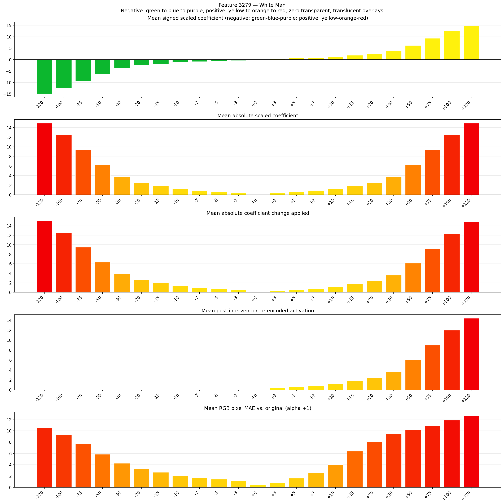
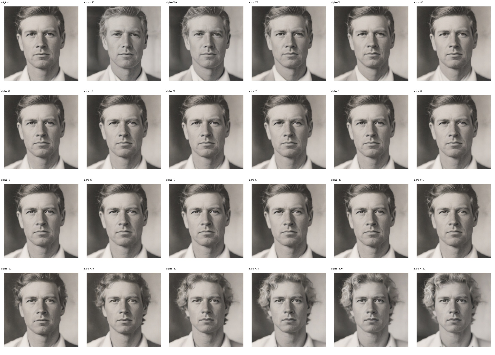
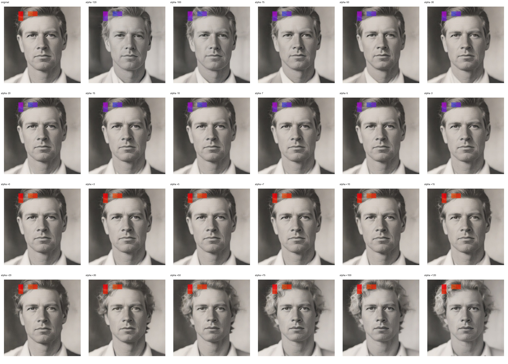
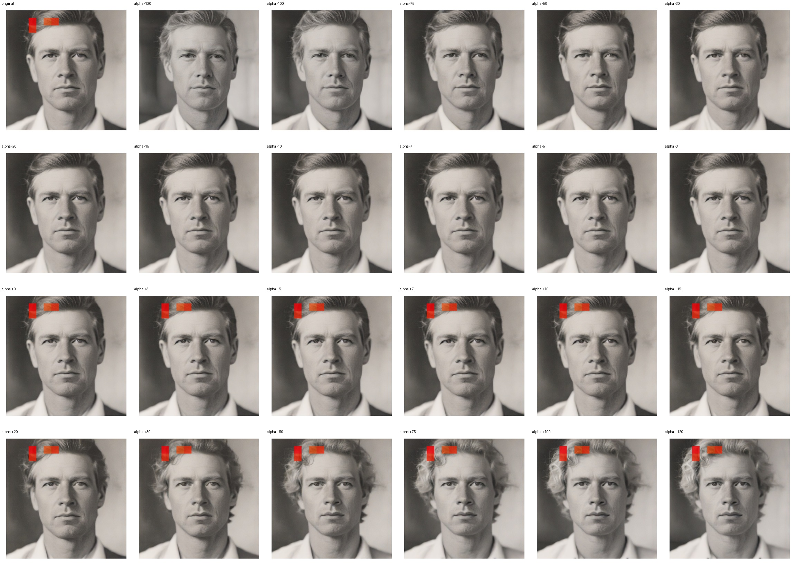

# Feature 3279 — White Man

Biased dataset; original prompt and seed replay for seeds 0–19. Values are means across 20 source images. The table reports the mean post-re-encoded activation of feature 3279, the active spatial fraction, mean RGB pixel MAE versus the original image (0–255 scale), and coefficient change magnitudes for each alpha.

## Activation graph

## Mean metrics by alpha

| Alpha | Mean post-reencoded feature 3279 activation | Active spatial fraction | Mean pixel change (MAE) | Mean absolute coefficient change | Mean absolute scaled coefficient |
|---:|---:|---:|---:|---:|---:|
| -120 | 0.000 | 0.000 | 10.490 | 15.058 | 14.934 |
| -100 | 0.000 | 0.000 | 9.315 | 12.569 | 12.445 |
| -75 | 0.000 | 0.000 | 7.735 | 9.458 | 9.333 |
| -50 | 0.000 | 0.000 | 5.843 | 6.347 | 6.222 |
| -30 | 0.000 | 0.000 | 4.254 | 3.858 | 3.733 |
| -20 | 0.000 | 0.000 | 3.224 | 2.613 | 2.489 |
| -15 | 0.000 | 0.000 | 2.649 | 1.991 | 1.867 |
| -10 | 0.000 | 0.000 | 2.011 | 1.369 | 1.244 |
| -7 | 0.000 | 0.000 | 1.676 | 0.996 | 0.871 |
| -5 | 0.000 | 0.000 | 1.426 | 0.747 | 0.622 |
| -3 | 0.000 | 0.000 | 1.132 | 0.498 | 0.373 |
| +0 | 0.000 | 0.000 | 0.518 | 0.124 | 0.000 |
| +3 | 0.364 | 0.010 | 0.864 | 0.249 | 0.373 |
| +5 | 0.604 | 0.010 | 1.628 | 0.498 | 0.622 |
| +7 | 0.843 | 0.010 | 2.549 | 0.747 | 0.871 |
| +10 | 1.203 | 0.010 | 4.026 | 1.120 | 1.244 |
| +15 | 1.802 | 0.010 | 6.383 | 1.742 | 1.867 |
| +20 | 2.401 | 0.010 | 8.110 | 2.364 | 2.489 |
| +30 | 3.600 | 0.010 | 9.470 | 3.609 | 3.733 |
| +50 | 5.996 | 0.010 | 10.209 | 6.098 | 6.222 |
| +75 | 8.992 | 0.010 | 10.883 | 9.209 | 9.333 |
| +100 | 11.988 | 0.010 | 11.844 | 12.320 | 12.445 |
| +120 | 14.384 | 0.010 | 12.622 | 14.809 | 14.934 |

## Per-seed grids

Each 4×6 sheet contains the original followed by the 23 alpha variants in ascending alpha order, from −120 through +120.

### Plain images

[All 20 plain-image grids](seed_sheets/)

### Signed coefficient overlays

[All 20 signed coefficient grids](signed_coefficient_overlays/)

### Post-re-encoded activation overlays

[All 20 post-activation grids](post_activation_overlays/)

### Intervention-footprint overlays

[All 20 intervention-footprint grids](intervention_footprint_overlays/)

Zero is transparent. Negative coefficient colors progress green through blue to purple; positive colors progress yellow through orange to red. Each map tile is normalized individually for visibility. The original and alpha-zero tiles show the pre-intervention feature map so its location remains visible.
