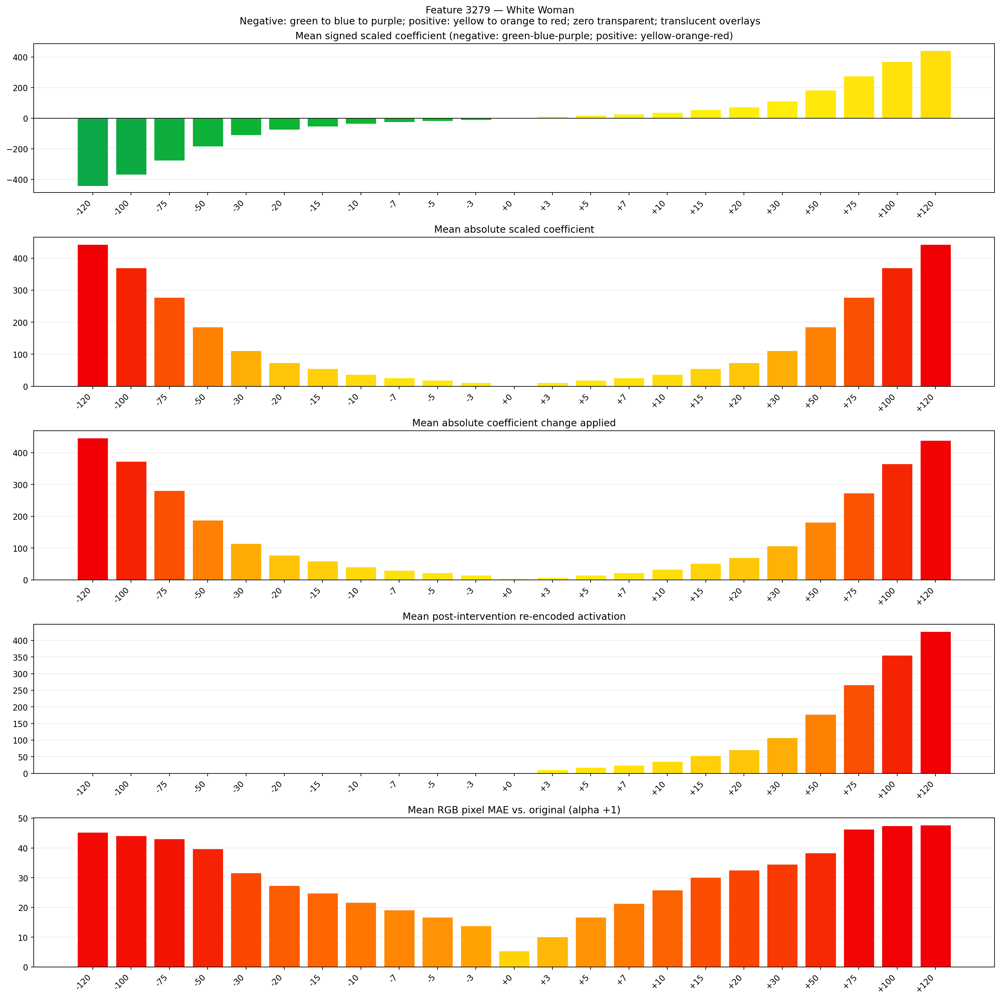
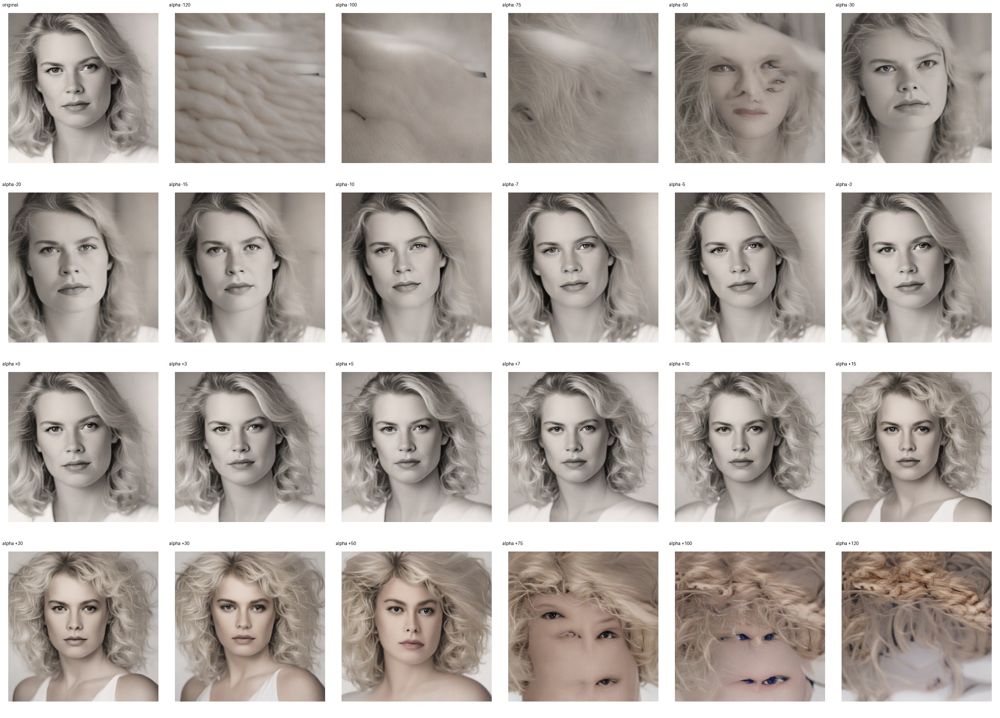
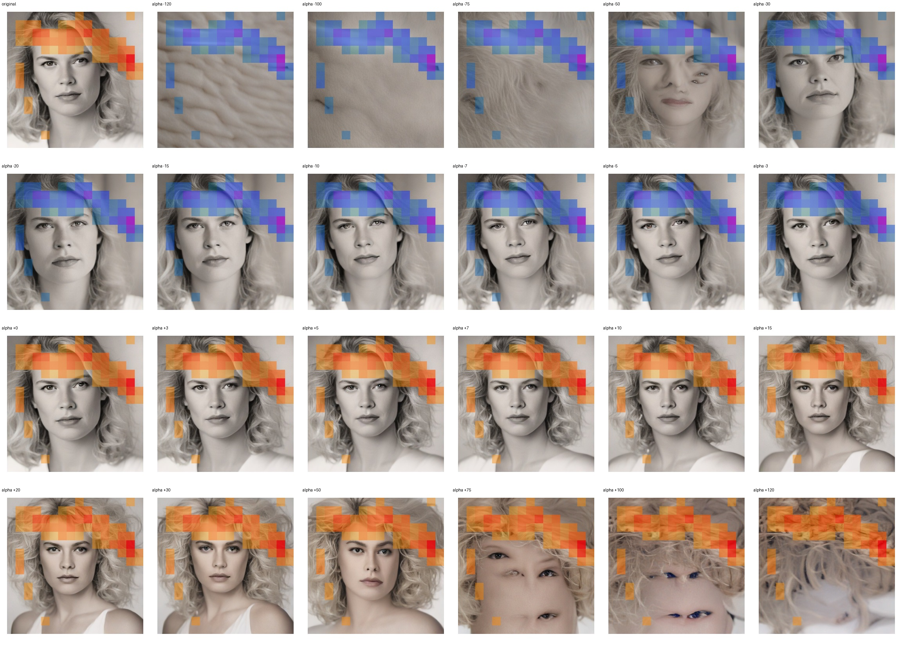
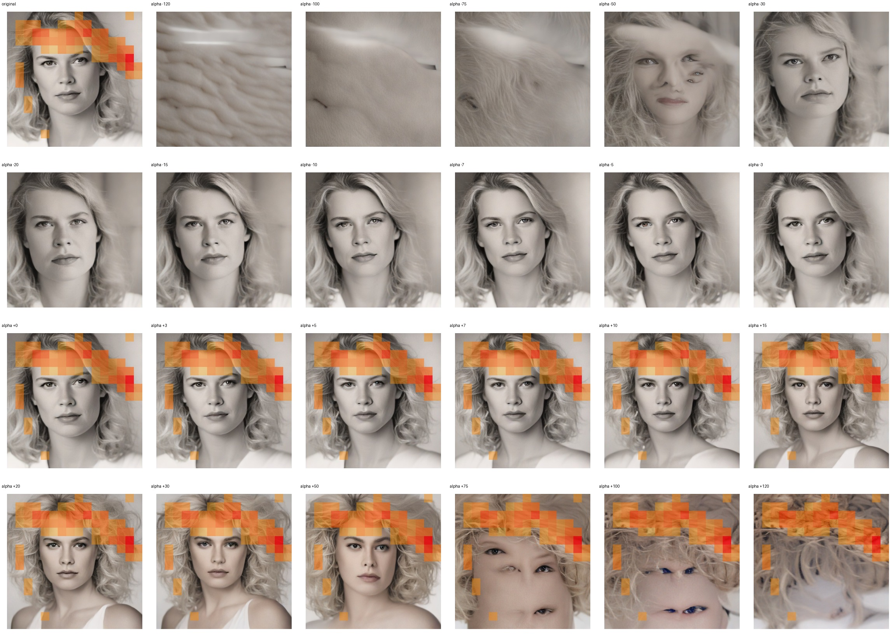

# Feature 3279 — White Woman

Biased dataset; original prompt and seed replay for seeds 0–19. Values are means across 20 source images. The table reports the mean post-re-encoded activation of feature 3279, the active spatial fraction, mean RGB pixel MAE versus the original image (0–255 scale), and coefficient change magnitudes for each alpha.

## Activation graph

## Mean metrics by alpha

| Alpha | Mean post-reencoded feature 3279 activation | Active spatial fraction | Mean pixel change (MAE) | Mean absolute coefficient change | Mean absolute scaled coefficient |
|---:|---:|---:|---:|---:|---:|
| -120 | 0.000 | 0.000 | 45.291 | 446.971 | 443.277 |
| -100 | 0.000 | 0.000 | 44.125 | 373.092 | 369.398 |
| -75 | 0.000 | 0.000 | 43.110 | 280.742 | 277.048 |
| -50 | 0.000 | 0.000 | 39.784 | 188.393 | 184.699 |
| -30 | 0.000 | 0.000 | 31.659 | 114.513 | 110.819 |
| -20 | 0.000 | 0.000 | 27.311 | 77.574 | 73.880 |
| -15 | 0.000 | 0.000 | 24.812 | 59.104 | 55.410 |
| -10 | 0.000 | 0.000 | 21.711 | 40.634 | 36.940 |
| -7 | 0.000 | 0.000 | 19.201 | 29.552 | 25.858 |
| -5 | 0.000 | 0.000 | 16.778 | 22.164 | 18.470 |
| -3 | 0.000 | 0.000 | 13.833 | 14.776 | 11.082 |
| +0 | 0.000 | 0.000 | 5.409 | 3.694 | 0.000 |
| +3 | 10.808 | 0.248 | 10.156 | 7.388 | 11.082 |
| +5 | 17.922 | 0.248 | 16.786 | 14.776 | 18.470 |
| +7 | 25.035 | 0.248 | 21.365 | 22.164 | 25.858 |
| +10 | 35.706 | 0.248 | 25.847 | 33.246 | 36.940 |
| +15 | 53.491 | 0.248 | 30.182 | 51.716 | 55.410 |
| +20 | 71.275 | 0.248 | 32.515 | 70.186 | 73.880 |
| +30 | 106.845 | 0.248 | 34.582 | 107.125 | 110.819 |
| +50 | 177.983 | 0.248 | 38.391 | 181.005 | 184.699 |
| +75 | 266.906 | 0.248 | 46.328 | 273.354 | 277.048 |
| +100 | 355.830 | 0.248 | 47.434 | 365.704 | 369.398 |
| +120 | 426.968 | 0.248 | 47.714 | 439.583 | 443.277 |

## Per-seed grids

Each 4×6 sheet contains the original followed by the 23 alpha variants in ascending alpha order, from −120 through +120.

### Plain images

[All 20 plain-image grids](seed_sheets/)

### Signed coefficient overlays

[All 20 signed coefficient grids](signed_coefficient_overlays/)

### Post-re-encoded activation overlays

[All 20 post-activation grids](post_activation_overlays/)

### Intervention-footprint overlays

[All 20 intervention-footprint grids](intervention_footprint_overlays/)

Zero is transparent. Negative coefficient colors progress green through blue to purple; positive colors progress yellow through orange to red. Each map tile is normalized individually for visibility. The original and alpha-zero tiles show the pre-intervention feature map so its location remains visible.
