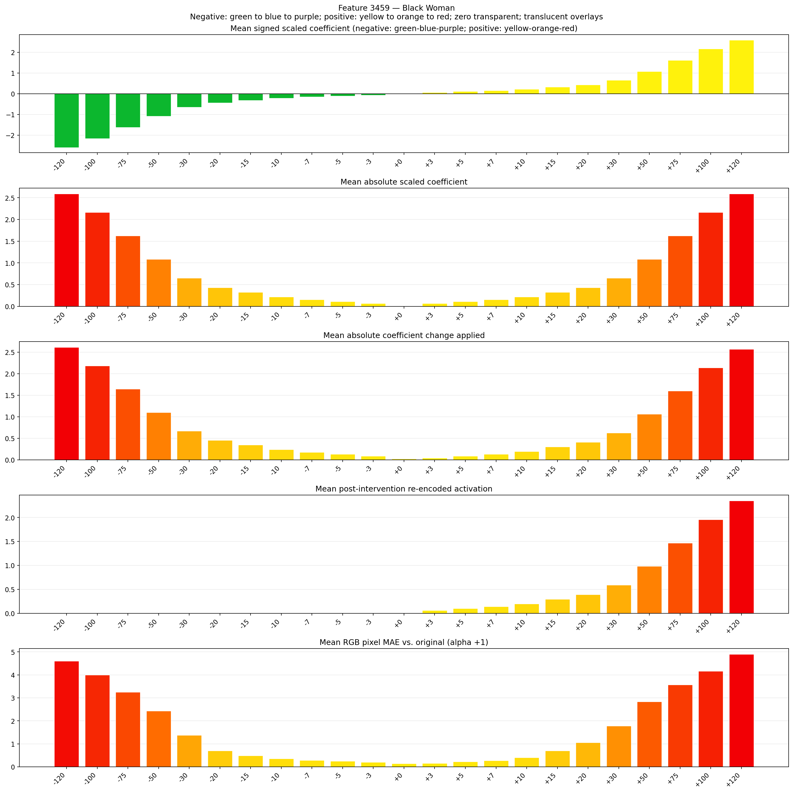
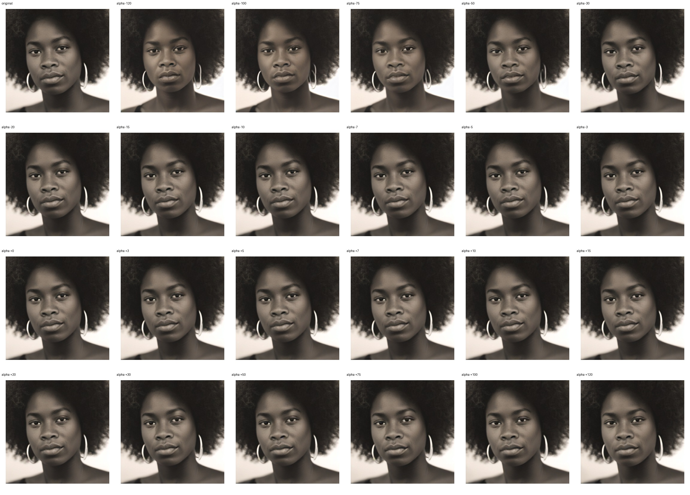
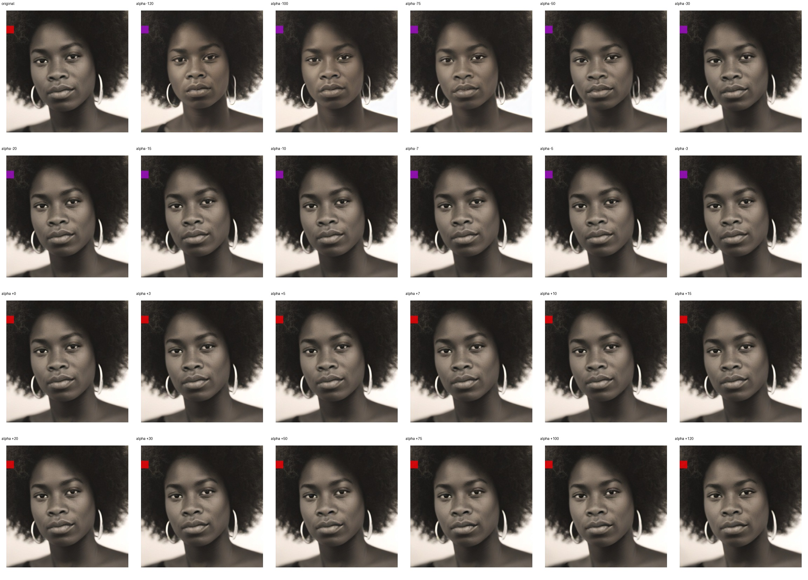
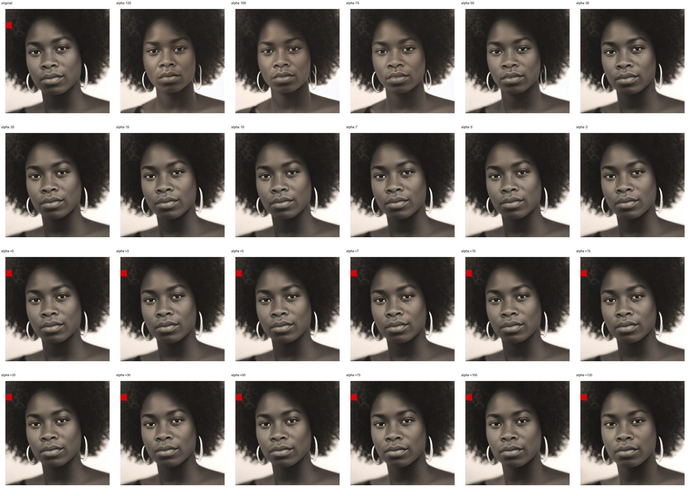

# Feature 3459 — Black Woman

Biased dataset; original prompt and seed replay for seeds 0–19. Values are means across 20 source images. The table reports the mean post-re-encoded activation of feature 3459, the active spatial fraction, mean RGB pixel MAE versus the original image (0–255 scale), and coefficient change magnitudes for each alpha.

## Activation graph

## Mean metrics by alpha

| Alpha | Mean post-reencoded feature 3459 activation | Active spatial fraction | Mean pixel change (MAE) | Mean absolute coefficient change | Mean absolute scaled coefficient |
|---:|---:|---:|---:|---:|---:|
| -120 | 0.000 | 0.000 | 4.602 | 2.613 | 2.592 |
| -100 | 0.000 | 0.000 | 3.990 | 2.181 | 2.160 |
| -75 | 0.000 | 0.000 | 3.250 | 1.641 | 1.620 |
| -50 | 0.000 | 0.000 | 2.424 | 1.102 | 1.080 |
| -30 | 0.000 | 0.000 | 1.380 | 0.670 | 0.648 |
| -20 | 0.000 | 0.000 | 0.692 | 0.454 | 0.432 |
| -15 | 0.000 | 0.000 | 0.487 | 0.346 | 0.324 |
| -10 | 0.000 | 0.000 | 0.354 | 0.238 | 0.216 |
| -7 | 0.000 | 0.000 | 0.283 | 0.173 | 0.151 |
| -5 | 0.000 | 0.000 | 0.242 | 0.130 | 0.108 |
| -3 | 0.000 | 0.000 | 0.201 | 0.086 | 0.065 |
| +0 | 0.000 | 0.000 | 0.137 | 0.022 | 0.000 |
| +3 | 0.061 | 0.002 | 0.153 | 0.043 | 0.065 |
| +5 | 0.100 | 0.002 | 0.219 | 0.086 | 0.108 |
| +7 | 0.139 | 0.002 | 0.274 | 0.130 | 0.151 |
| +10 | 0.198 | 0.002 | 0.402 | 0.194 | 0.216 |
| +15 | 0.295 | 0.002 | 0.698 | 0.302 | 0.324 |
| +20 | 0.393 | 0.002 | 1.055 | 0.410 | 0.432 |
| +30 | 0.589 | 0.002 | 1.777 | 0.626 | 0.648 |
| +50 | 0.980 | 0.002 | 2.834 | 1.058 | 1.080 |
| +75 | 1.469 | 0.002 | 3.565 | 1.598 | 1.620 |
| +100 | 1.958 | 0.002 | 4.167 | 2.138 | 2.160 |
| +120 | 2.349 | 0.002 | 4.899 | 2.570 | 2.592 |

## Per-seed grids

Each 4×6 sheet contains the original followed by the 23 alpha variants in ascending alpha order, from −120 through +120.

### Plain images

[All 20 plain-image grids](seed_sheets/)

### Signed coefficient overlays

[All 20 signed coefficient grids](signed_coefficient_overlays/)

### Post-re-encoded activation overlays

[All 20 post-activation grids](post_activation_overlays/)

### Intervention-footprint overlays

[All 20 intervention-footprint grids](intervention_footprint_overlays/)

Zero is transparent. Negative coefficient colors progress green through blue to purple; positive colors progress yellow through orange to red. Each map tile is normalized individually for visibility. The original and alpha-zero tiles show the pre-intervention feature map so its location remains visible.
