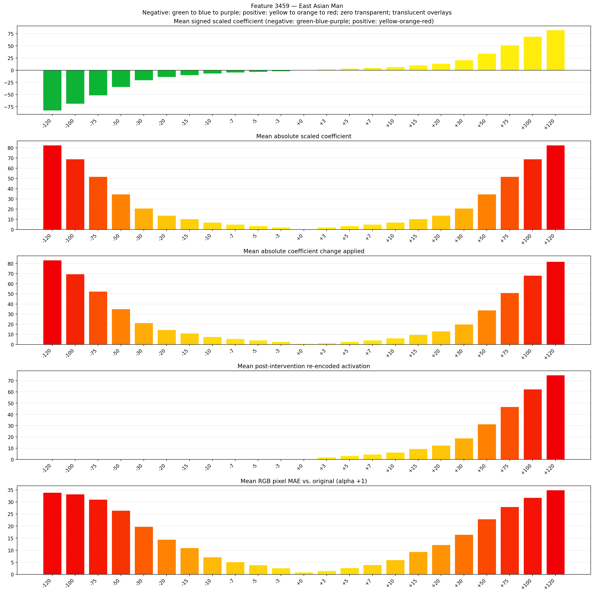
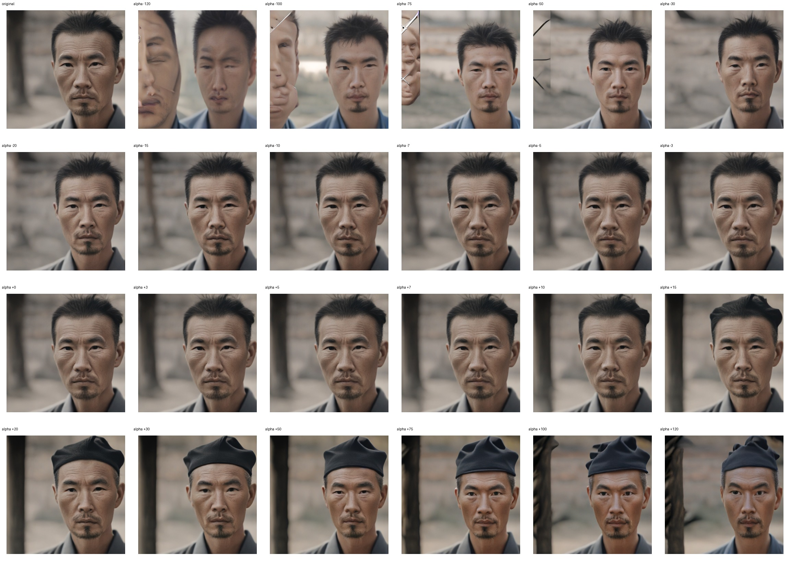
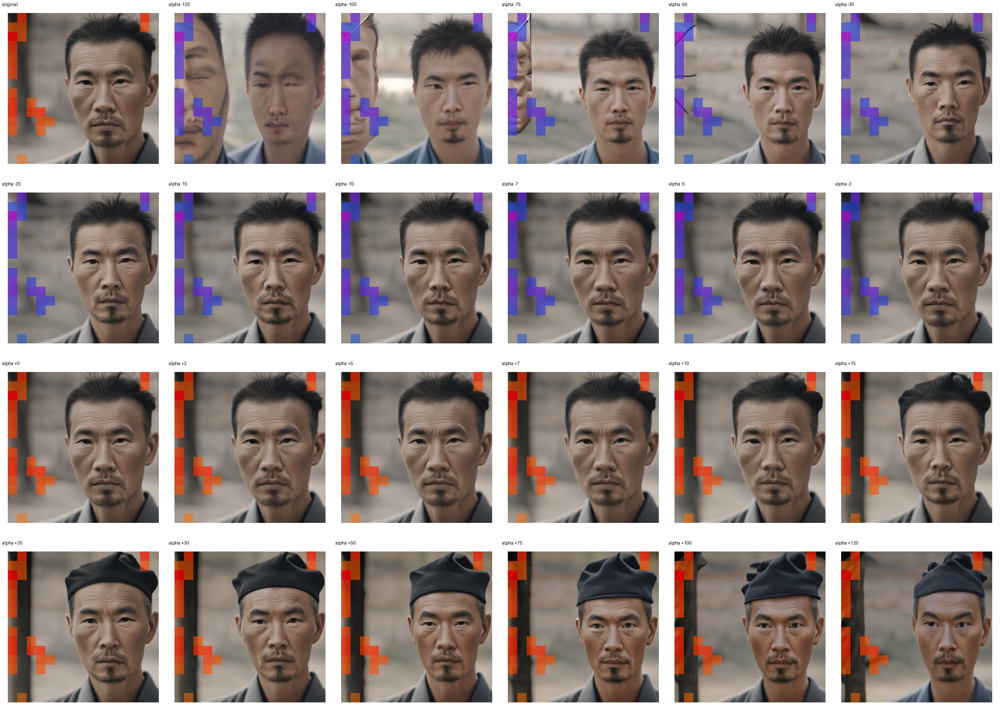
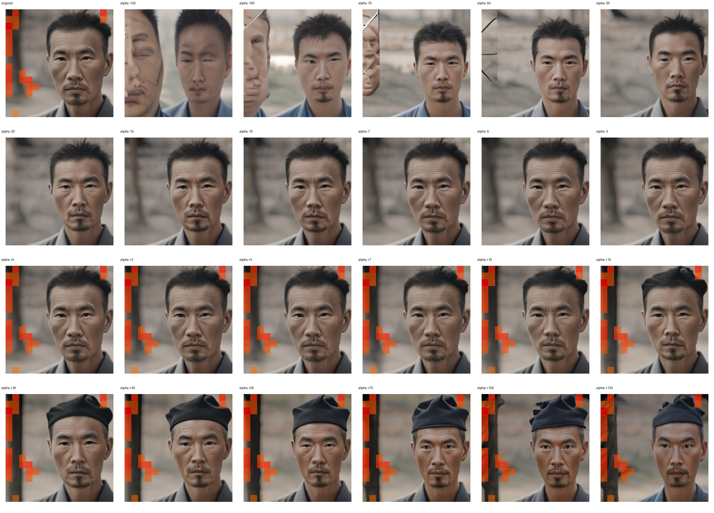

# Feature 3459 — East Asian Man

Biased dataset; original prompt and seed replay for seeds 0–19. Values are means across 20 source images. The table reports the mean post-re-encoded activation of feature 3459, the active spatial fraction, mean RGB pixel MAE versus the original image (0–255 scale), and coefficient change magnitudes for each alpha.

## Activation graph

## Mean metrics by alpha

| Alpha | Mean post-reencoded feature 3459 activation | Active spatial fraction | Mean pixel change (MAE) | Mean absolute coefficient change | Mean absolute scaled coefficient |
|---:|---:|---:|---:|---:|---:|
| -120 | 0.000 | 0.000 | 33.866 | 83.364 | 82.675 |
| -100 | 0.000 | 0.000 | 33.243 | 69.584 | 68.895 |
| -75 | 0.000 | 0.000 | 30.984 | 52.361 | 51.672 |
| -50 | 0.000 | 0.000 | 26.454 | 35.137 | 34.448 |
| -30 | 0.000 | 0.000 | 19.782 | 21.358 | 20.669 |
| -20 | 0.000 | 0.000 | 14.410 | 14.468 | 13.779 |
| -15 | 0.000 | 0.000 | 10.997 | 11.023 | 10.334 |
| -10 | 0.000 | 0.000 | 7.138 | 7.579 | 6.890 |
| -7 | 0.000 | 0.000 | 5.118 | 5.512 | 4.823 |
| -5 | 0.000 | 0.000 | 3.852 | 4.134 | 3.445 |
| -3 | 0.000 | 0.000 | 2.618 | 2.756 | 2.067 |
| +0 | 0.000 | 0.000 | 0.895 | 0.689 | 0.000 |
| +3 | 1.937 | 0.074 | 1.470 | 1.378 | 2.067 |
| +5 | 3.185 | 0.074 | 2.690 | 2.756 | 3.445 |
| +7 | 4.433 | 0.074 | 3.964 | 4.134 | 4.823 |
| +10 | 6.304 | 0.074 | 5.991 | 6.201 | 6.890 |
| +15 | 9.424 | 0.074 | 9.376 | 9.645 | 10.334 |
| +20 | 12.544 | 0.074 | 12.283 | 13.090 | 13.779 |
| +30 | 18.783 | 0.074 | 16.491 | 19.980 | 20.669 |
| +50 | 31.262 | 0.074 | 22.939 | 33.759 | 34.448 |
| +75 | 46.860 | 0.074 | 27.971 | 50.983 | 51.672 |
| +100 | 62.459 | 0.074 | 31.771 | 68.207 | 68.895 |
| +120 | 74.938 | 0.074 | 34.913 | 81.986 | 82.675 |

## Per-seed grids

Each 4×6 sheet contains the original followed by the 23 alpha variants in ascending alpha order, from −120 through +120.

### Plain images

[All 20 plain-image grids](seed_sheets/)

### Signed coefficient overlays

[All 20 signed coefficient grids](signed_coefficient_overlays/)

### Post-re-encoded activation overlays

[All 20 post-activation grids](post_activation_overlays/)

### Intervention-footprint overlays

[All 20 intervention-footprint grids](intervention_footprint_overlays/)

Zero is transparent. Negative coefficient colors progress green through blue to purple; positive colors progress yellow through orange to red. Each map tile is normalized individually for visibility. The original and alpha-zero tiles show the pre-intervention feature map so its location remains visible.
