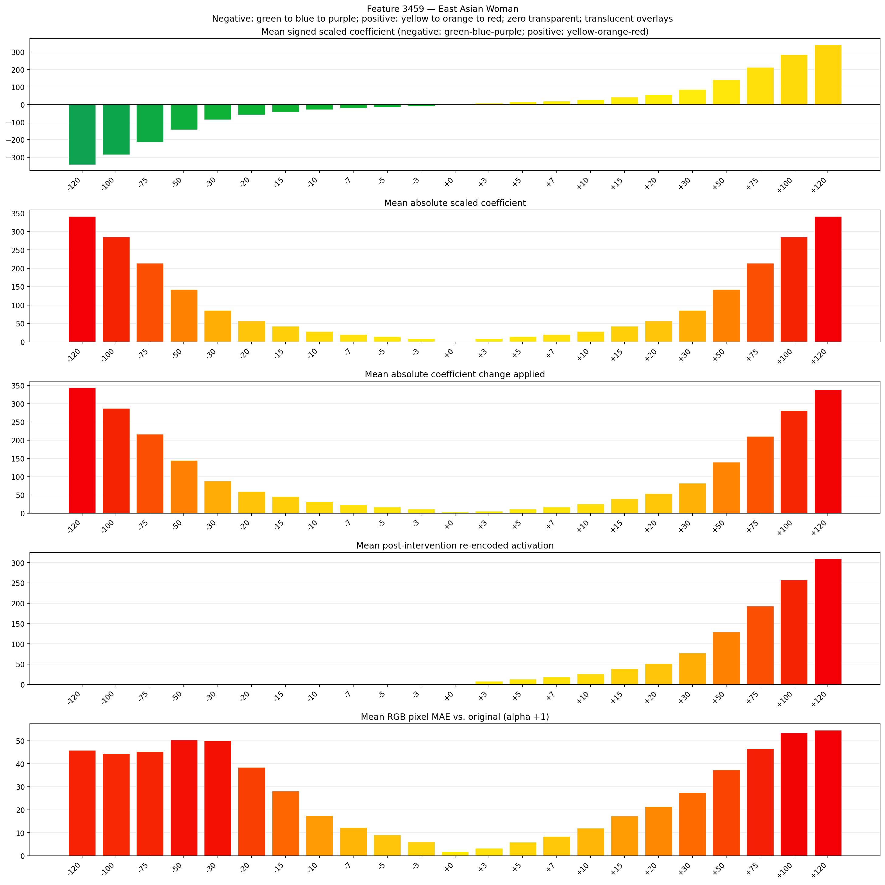
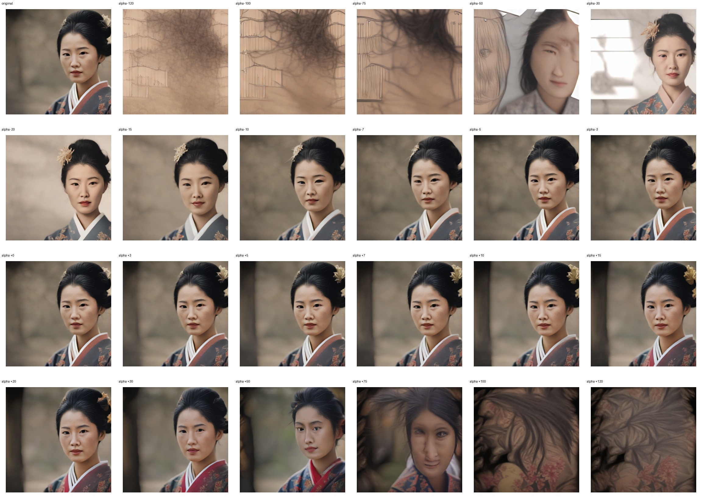
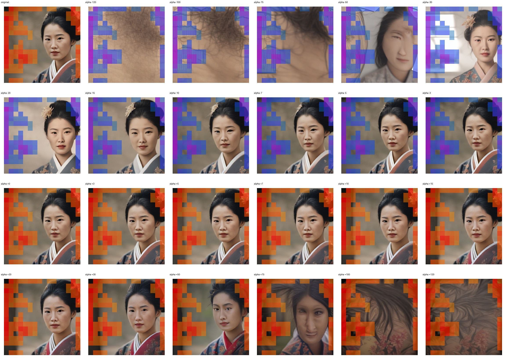
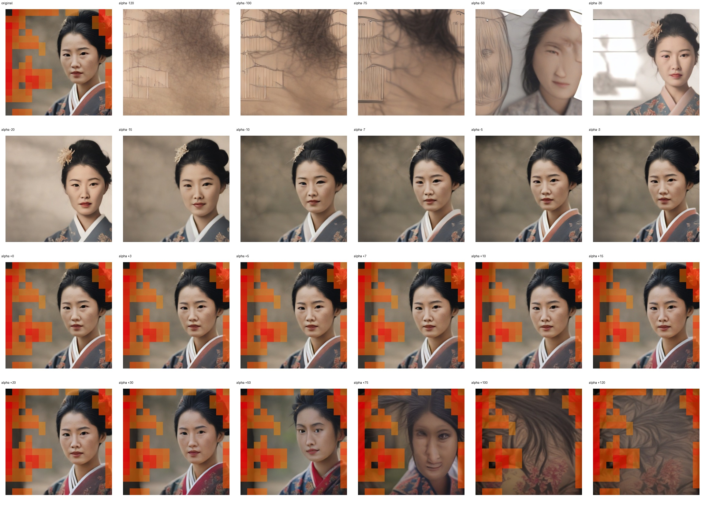

# Feature 3459 — East Asian Woman

Biased dataset; original prompt and seed replay for seeds 0–19. Values are means across 20 source images. The table reports the mean post-re-encoded activation of feature 3459, the active spatial fraction, mean RGB pixel MAE versus the original image (0–255 scale), and coefficient change magnitudes for each alpha.

## Activation graph

## Mean metrics by alpha

| Alpha | Mean post-reencoded feature 3459 activation | Active spatial fraction | Mean pixel change (MAE) | Mean absolute coefficient change | Mean absolute scaled coefficient |
|---:|---:|---:|---:|---:|---:|
| -120 | 0.000 | 0.000 | 45.885 | 344.280 | 341.435 |
| -100 | 0.000 | 0.000 | 44.403 | 287.374 | 284.529 |
| -75 | 0.000 | 0.000 | 45.291 | 216.242 | 213.397 |
| -50 | 0.000 | 0.000 | 50.363 | 145.110 | 142.264 |
| -30 | 0.000 | 0.000 | 50.081 | 88.204 | 85.359 |
| -20 | 0.000 | 0.000 | 38.407 | 59.751 | 56.906 |
| -15 | 0.000 | 0.000 | 28.180 | 45.525 | 42.679 |
| -10 | 0.000 | 0.000 | 17.434 | 31.298 | 28.453 |
| -7 | 0.000 | 0.000 | 12.324 | 22.762 | 19.917 |
| -5 | 0.000 | 0.000 | 9.087 | 17.072 | 14.226 |
| -3 | 0.000 | 0.000 | 6.114 | 11.381 | 8.536 |
| +0 | 0.000 | 0.000 | 1.824 | 2.845 | 0.000 |
| +3 | 7.999 | 0.245 | 3.235 | 5.691 | 8.536 |
| +5 | 13.152 | 0.245 | 5.901 | 11.381 | 14.226 |
| +7 | 18.306 | 0.245 | 8.427 | 17.072 | 19.917 |
| +10 | 26.036 | 0.245 | 12.065 | 25.608 | 28.453 |
| +15 | 38.920 | 0.245 | 17.292 | 39.834 | 42.679 |
| +20 | 51.804 | 0.245 | 21.434 | 54.060 | 56.906 |
| +30 | 77.572 | 0.245 | 27.501 | 82.513 | 85.359 |
| +50 | 129.107 | 0.245 | 37.217 | 139.419 | 142.264 |
| +75 | 193.526 | 0.245 | 46.592 | 210.551 | 213.397 |
| +100 | 257.946 | 0.245 | 53.439 | 281.684 | 284.529 |
| +120 | 309.481 | 0.245 | 54.622 | 338.589 | 341.435 |

## Per-seed grids

Each 4×6 sheet contains the original followed by the 23 alpha variants in ascending alpha order, from −120 through +120.

### Plain images

[All 20 plain-image grids](seed_sheets/)

### Signed coefficient overlays

[All 20 signed coefficient grids](signed_coefficient_overlays/)

### Post-re-encoded activation overlays

[All 20 post-activation grids](post_activation_overlays/)

### Intervention-footprint overlays

[All 20 intervention-footprint grids](intervention_footprint_overlays/)

Zero is transparent. Negative coefficient colors progress green through blue to purple; positive colors progress yellow through orange to red. Each map tile is normalized individually for visibility. The original and alpha-zero tiles show the pre-intervention feature map so its location remains visible.
