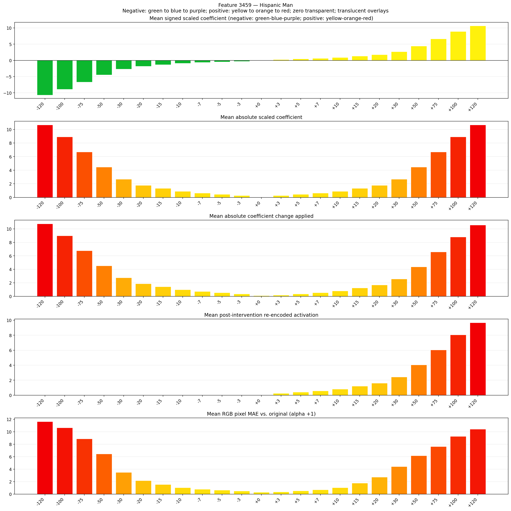
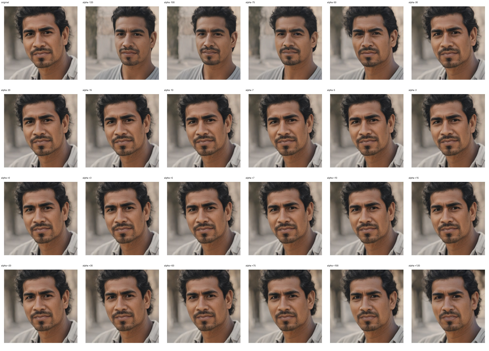
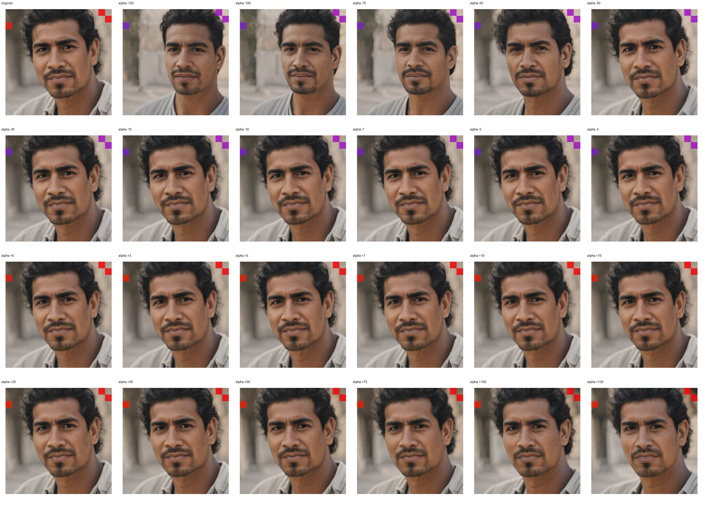
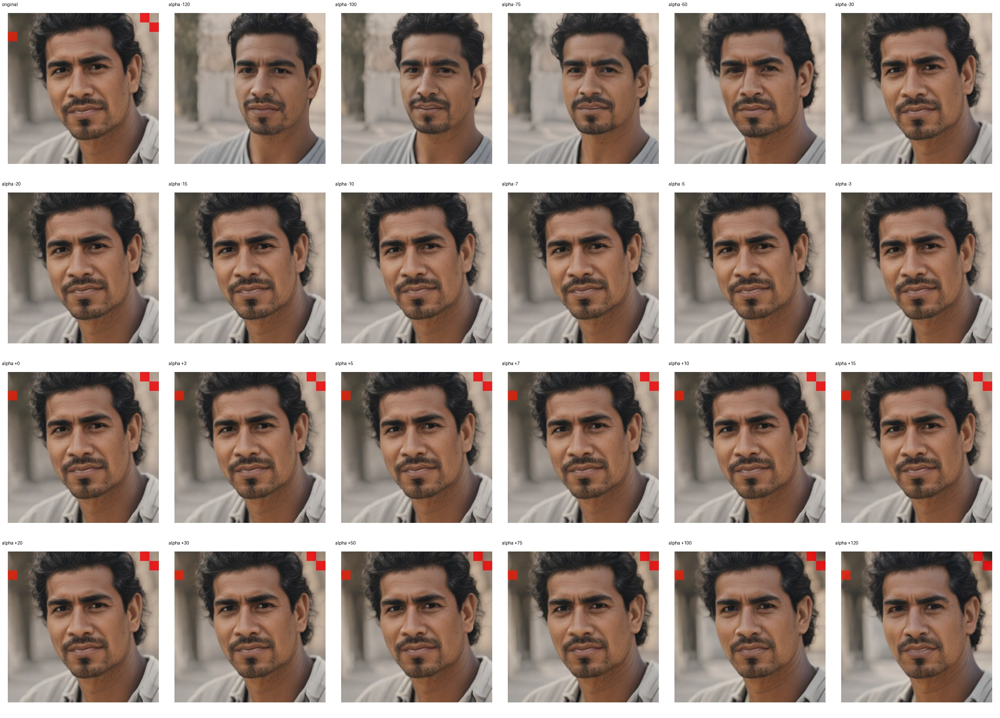

# Feature 3459 — Hispanic Man

Biased dataset; original prompt and seed replay for seeds 0–19. Values are means across 20 source images. The table reports the mean post-re-encoded activation of feature 3459, the active spatial fraction, mean RGB pixel MAE versus the original image (0–255 scale), and coefficient change magnitudes for each alpha.

## Activation graph

## Mean metrics by alpha

| Alpha | Mean post-reencoded feature 3459 activation | Active spatial fraction | Mean pixel change (MAE) | Mean absolute coefficient change | Mean absolute scaled coefficient |
|---:|---:|---:|---:|---:|---:|
| -120 | 0.000 | 0.000 | 11.623 | 10.760 | 10.671 |
| -100 | 0.000 | 0.000 | 10.636 | 8.981 | 8.892 |
| -75 | 0.000 | 0.000 | 8.865 | 6.758 | 6.669 |
| -50 | 0.000 | 0.000 | 6.454 | 4.535 | 4.446 |
| -30 | 0.000 | 0.000 | 3.496 | 2.757 | 2.668 |
| -20 | 0.000 | 0.000 | 2.150 | 1.867 | 1.778 |
| -15 | 0.000 | 0.000 | 1.537 | 1.423 | 1.334 |
| -10 | 0.000 | 0.000 | 1.025 | 0.978 | 0.889 |
| -7 | 0.000 | 0.000 | 0.779 | 0.711 | 0.622 |
| -5 | 0.000 | 0.000 | 0.635 | 0.534 | 0.445 |
| -3 | 0.000 | 0.000 | 0.500 | 0.356 | 0.267 |
| +0 | 0.000 | 0.000 | 0.316 | 0.089 | 0.000 |
| +3 | 0.250 | 0.011 | 0.370 | 0.178 | 0.267 |
| +5 | 0.411 | 0.011 | 0.529 | 0.356 | 0.445 |
| +7 | 0.572 | 0.011 | 0.707 | 0.534 | 0.622 |
| +10 | 0.814 | 0.011 | 1.027 | 0.800 | 0.889 |
| +15 | 1.216 | 0.011 | 1.757 | 1.245 | 1.334 |
| +20 | 1.619 | 0.011 | 2.735 | 1.690 | 1.778 |
| +30 | 2.424 | 0.011 | 4.401 | 2.579 | 2.668 |
| +50 | 4.035 | 0.011 | 6.153 | 4.357 | 4.446 |
| +75 | 6.048 | 0.011 | 7.629 | 6.580 | 6.669 |
| +100 | 8.061 | 0.011 | 9.267 | 8.803 | 8.892 |
| +120 | 9.672 | 0.011 | 10.424 | 10.582 | 10.671 |

## Per-seed grids

Each 4×6 sheet contains the original followed by the 23 alpha variants in ascending alpha order, from −120 through +120.

### Plain images

[All 20 plain-image grids](seed_sheets/)

### Signed coefficient overlays

[All 20 signed coefficient grids](signed_coefficient_overlays/)

### Post-re-encoded activation overlays

[All 20 post-activation grids](post_activation_overlays/)

### Intervention-footprint overlays

[All 20 intervention-footprint grids](intervention_footprint_overlays/)

Zero is transparent. Negative coefficient colors progress green through blue to purple; positive colors progress yellow through orange to red. Each map tile is normalized individually for visibility. The original and alpha-zero tiles show the pre-intervention feature map so its location remains visible.
