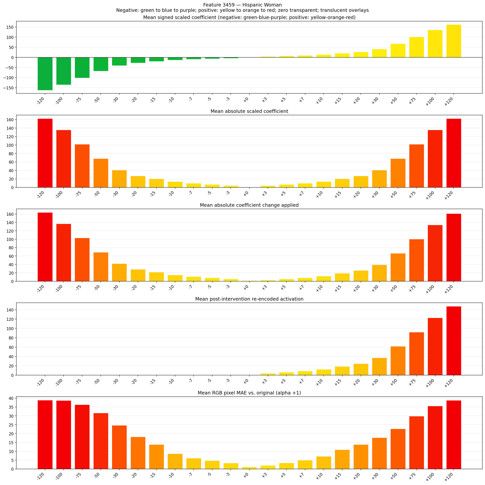
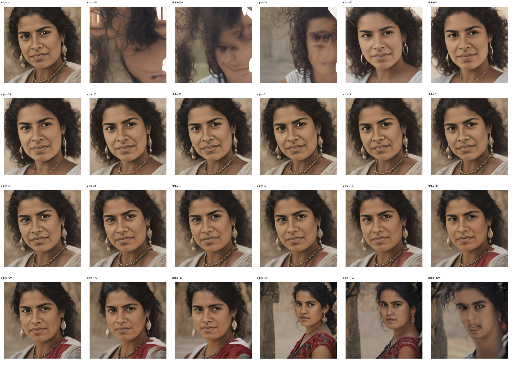
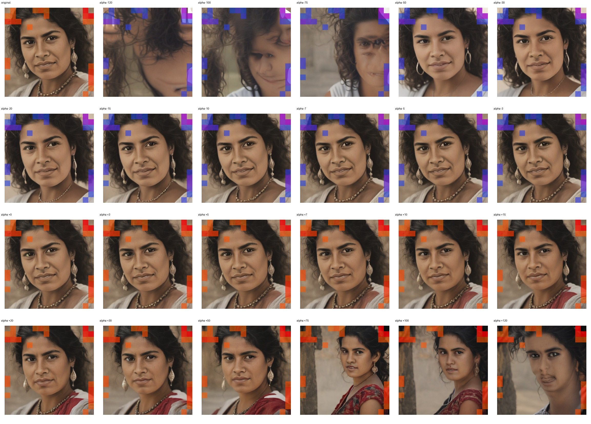
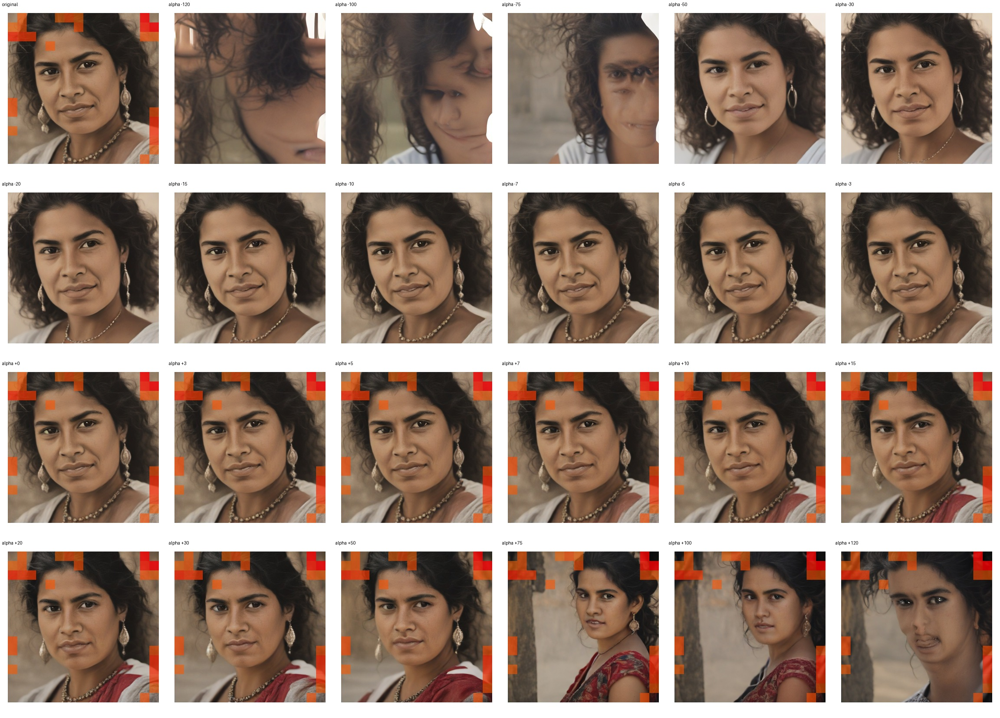

# Feature 3459 — Hispanic Woman

Biased dataset; original prompt and seed replay for seeds 0–19. Values are means across 20 source images. The table reports the mean post-re-encoded activation of feature 3459, the active spatial fraction, mean RGB pixel MAE versus the original image (0–255 scale), and coefficient change magnitudes for each alpha.

## Activation graph

## Mean metrics by alpha

| Alpha | Mean post-reencoded feature 3459 activation | Active spatial fraction | Mean pixel change (MAE) | Mean absolute coefficient change | Mean absolute scaled coefficient |
|---:|---:|---:|---:|---:|---:|
| -120 | 0.000 | 0.000 | 38.881 | 163.910 | 162.555 |
| -100 | 0.000 | 0.000 | 38.681 | 136.817 | 135.463 |
| -75 | 0.000 | 0.000 | 36.362 | 102.952 | 101.597 |
| -50 | 0.000 | 0.000 | 31.589 | 69.086 | 67.731 |
| -30 | 0.000 | 0.000 | 24.622 | 41.993 | 40.639 |
| -20 | 0.000 | 0.000 | 18.118 | 28.447 | 27.093 |
| -15 | 0.000 | 0.000 | 13.839 | 21.674 | 20.319 |
| -10 | 0.000 | 0.000 | 8.631 | 14.901 | 13.546 |
| -7 | 0.000 | 0.000 | 6.110 | 10.837 | 9.482 |
| -5 | 0.000 | 0.000 | 4.665 | 8.128 | 6.773 |
| -3 | 0.000 | 0.000 | 3.348 | 5.419 | 4.064 |
| +0 | 0.000 | 0.000 | 1.250 | 1.355 | 0.000 |
| +3 | 3.808 | 0.130 | 2.052 | 2.709 | 4.064 |
| +5 | 6.262 | 0.130 | 3.502 | 5.419 | 6.773 |
| +7 | 8.715 | 0.130 | 4.980 | 8.128 | 9.482 |
| +10 | 12.396 | 0.130 | 7.171 | 12.192 | 13.546 |
| +15 | 18.530 | 0.130 | 10.873 | 18.965 | 20.319 |
| +20 | 24.664 | 0.130 | 13.822 | 25.738 | 27.093 |
| +30 | 36.931 | 0.130 | 17.651 | 39.284 | 40.639 |
| +50 | 61.467 | 0.130 | 22.655 | 66.377 | 67.731 |
| +75 | 92.137 | 0.130 | 29.865 | 100.242 | 101.597 |
| +100 | 122.807 | 0.130 | 35.539 | 134.108 | 135.463 |
| +120 | 147.343 | 0.130 | 38.753 | 161.201 | 162.555 |

## Per-seed grids

Each 4×6 sheet contains the original followed by the 23 alpha variants in ascending alpha order, from −120 through +120.

### Plain images

[All 20 plain-image grids](seed_sheets/)

### Signed coefficient overlays

[All 20 signed coefficient grids](signed_coefficient_overlays/)

### Post-re-encoded activation overlays

[All 20 post-activation grids](post_activation_overlays/)

### Intervention-footprint overlays

[All 20 intervention-footprint grids](intervention_footprint_overlays/)

Zero is transparent. Negative coefficient colors progress green through blue to purple; positive colors progress yellow through orange to red. Each map tile is normalized individually for visibility. The original and alpha-zero tiles show the pre-intervention feature map so its location remains visible.
