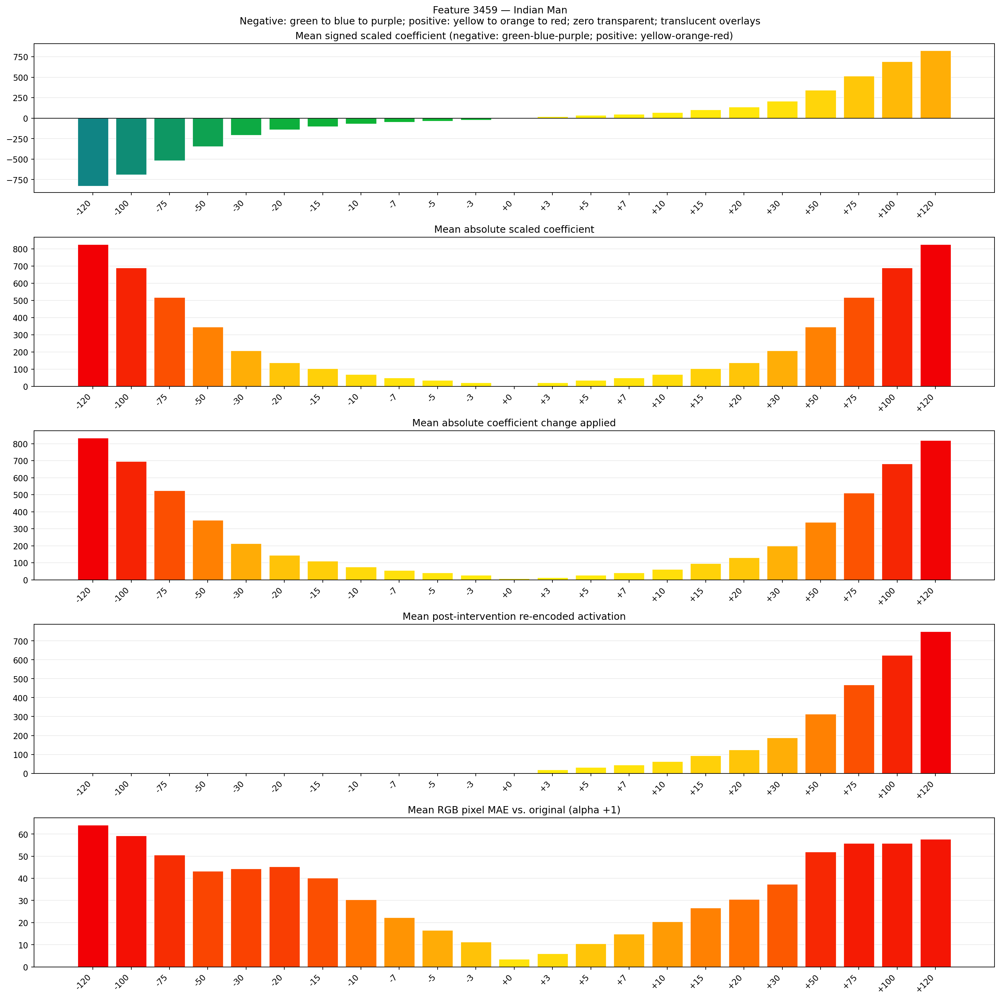
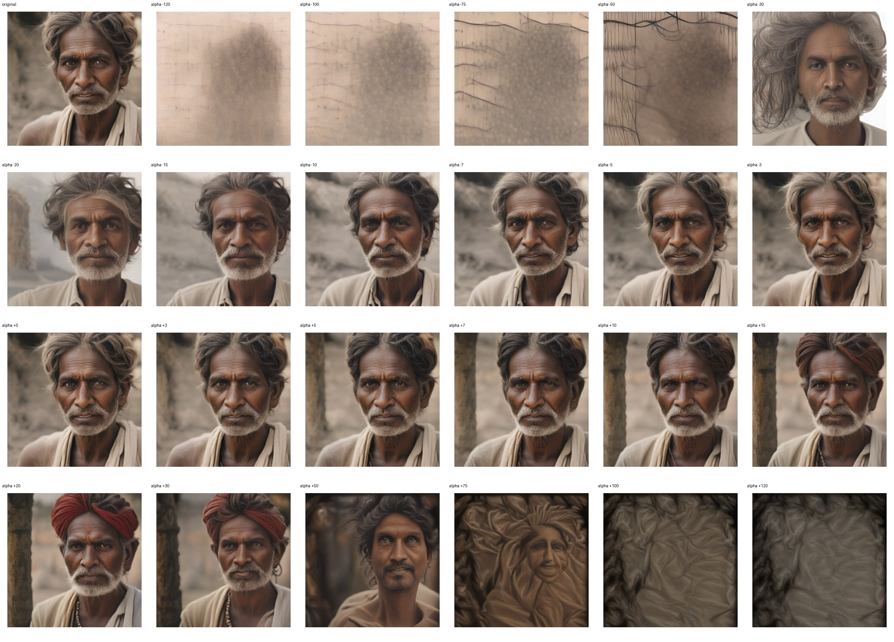
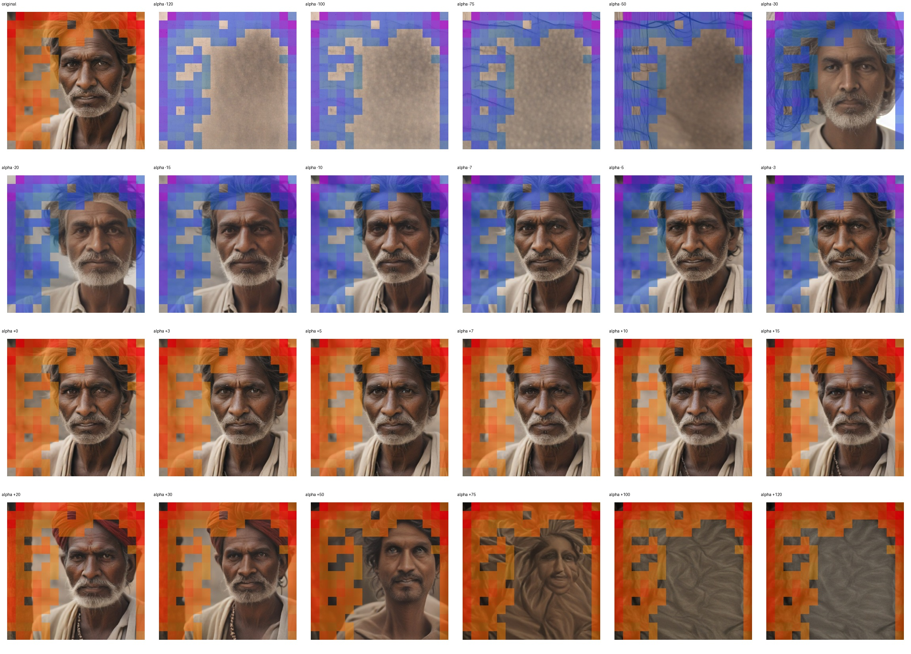
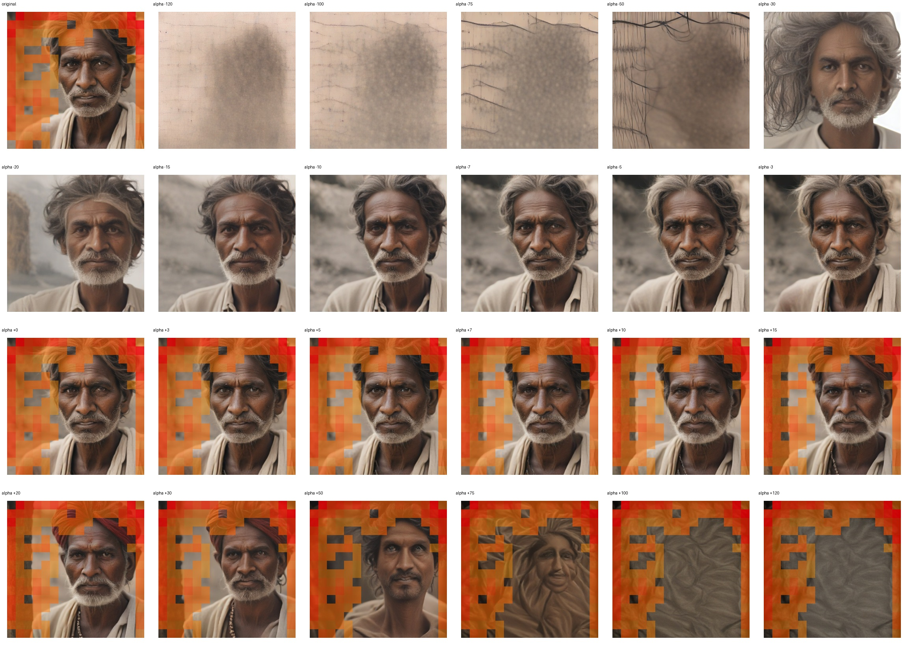

# Feature 3459 — Indian Man

Biased dataset; original prompt and seed replay for seeds 0–19. Values are means across 20 source images. The table reports the mean post-re-encoded activation of feature 3459, the active spatial fraction, mean RGB pixel MAE versus the original image (0–255 scale), and coefficient change magnitudes for each alpha.

## Activation graph

## Mean metrics by alpha

| Alpha | Mean post-reencoded feature 3459 activation | Active spatial fraction | Mean pixel change (MAE) | Mean absolute coefficient change | Mean absolute scaled coefficient |
|---:|---:|---:|---:|---:|---:|
| -120 | 0.000 | 0.000 | 64.077 | 833.990 | 827.098 |
| -100 | 0.000 | 0.000 | 59.291 | 696.141 | 689.248 |
| -75 | 0.000 | 0.000 | 50.570 | 523.829 | 516.936 |
| -50 | 0.000 | 0.000 | 43.287 | 351.517 | 344.624 |
| -30 | 0.000 | 0.000 | 44.295 | 213.667 | 206.774 |
| -20 | 0.000 | 0.000 | 45.328 | 144.742 | 137.850 |
| -15 | 0.000 | 0.000 | 40.240 | 110.280 | 103.387 |
| -10 | 0.000 | 0.000 | 30.354 | 75.817 | 68.925 |
| -7 | 0.000 | 0.000 | 22.334 | 55.140 | 48.247 |
| -5 | 0.000 | 0.000 | 16.595 | 41.355 | 34.462 |
| -3 | 0.000 | 0.000 | 11.228 | 27.570 | 20.677 |
| +0 | 0.000 | 0.000 | 3.501 | 6.892 | 0.000 |
| +3 | 19.377 | 0.426 | 5.954 | 13.785 | 20.677 |
| +5 | 31.861 | 0.426 | 10.513 | 27.570 | 34.462 |
| +7 | 44.345 | 0.426 | 14.863 | 41.355 | 48.247 |
| +10 | 63.071 | 0.426 | 20.504 | 62.032 | 68.925 |
| +15 | 94.281 | 0.426 | 26.662 | 96.495 | 103.387 |
| +20 | 125.491 | 0.426 | 30.496 | 130.957 | 137.850 |
| +30 | 187.911 | 0.426 | 37.440 | 199.882 | 206.774 |
| +50 | 312.752 | 0.426 | 51.979 | 337.732 | 344.624 |
| +75 | 468.802 | 0.426 | 55.795 | 510.044 | 516.936 |
| +100 | 624.853 | 0.426 | 55.771 | 682.356 | 689.248 |
| +120 | 749.694 | 0.426 | 57.729 | 820.205 | 827.098 |

## Per-seed grids

Each 4×6 sheet contains the original followed by the 23 alpha variants in ascending alpha order, from −120 through +120.

### Plain images

[All 20 plain-image grids](seed_sheets/)

### Signed coefficient overlays

[All 20 signed coefficient grids](signed_coefficient_overlays/)

### Post-re-encoded activation overlays

[All 20 post-activation grids](post_activation_overlays/)

### Intervention-footprint overlays

[All 20 intervention-footprint grids](intervention_footprint_overlays/)

Zero is transparent. Negative coefficient colors progress green through blue to purple; positive colors progress yellow through orange to red. Each map tile is normalized individually for visibility. The original and alpha-zero tiles show the pre-intervention feature map so its location remains visible.
