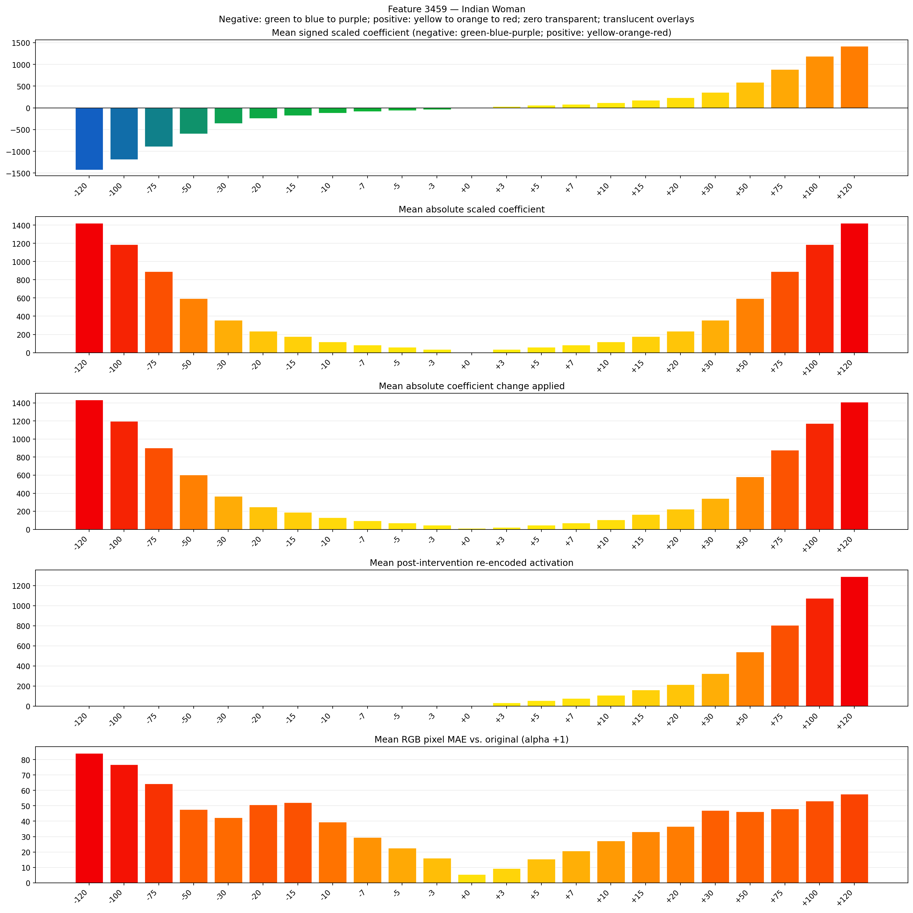
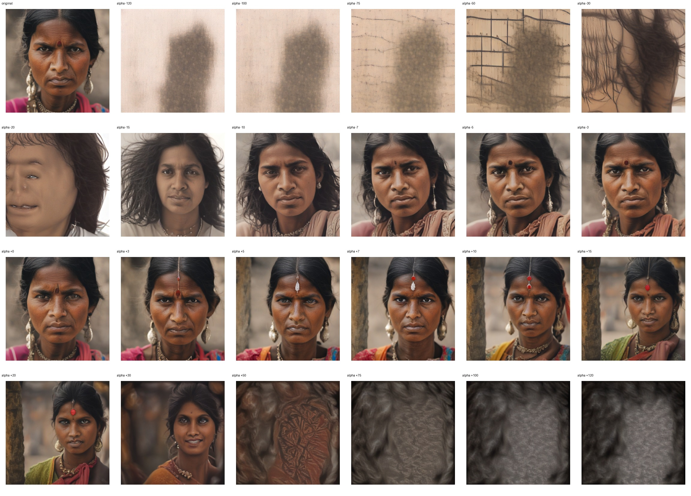
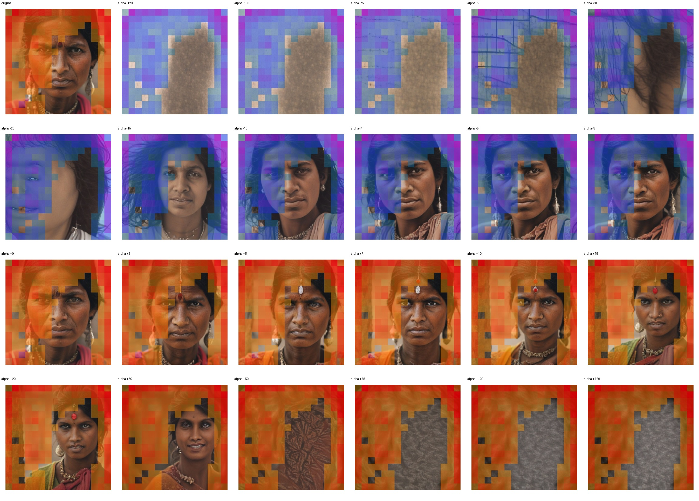
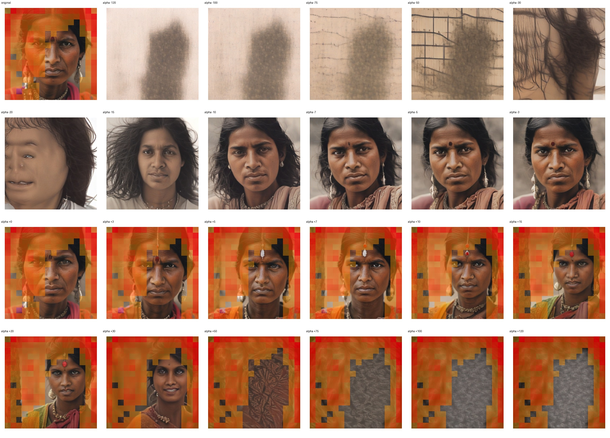

# Feature 3459 — Indian Woman

Biased dataset; original prompt and seed replay for seeds 0–19. Values are means across 20 source images. The table reports the mean post-re-encoded activation of feature 3459, the active spatial fraction, mean RGB pixel MAE versus the original image (0–255 scale), and coefficient change magnitudes for each alpha.

## Activation graph

## Mean metrics by alpha

| Alpha | Mean post-reencoded feature 3459 activation | Active spatial fraction | Mean pixel change (MAE) | Mean absolute coefficient change | Mean absolute scaled coefficient |
|---:|---:|---:|---:|---:|---:|
| -120 | 0.000 | 0.000 | 84.133 | 1434.636 | 1422.780 |
| -100 | 0.000 | 0.000 | 76.742 | 1197.506 | 1185.650 |
| -75 | 0.000 | 0.000 | 64.329 | 901.094 | 889.237 |
| -50 | 0.000 | 0.000 | 47.588 | 604.681 | 592.825 |
| -30 | 0.000 | 0.000 | 42.287 | 367.551 | 355.695 |
| -20 | 0.000 | 0.000 | 50.779 | 248.986 | 237.130 |
| -15 | 0.000 | 0.000 | 52.077 | 189.704 | 177.847 |
| -10 | 0.000 | 0.000 | 39.552 | 130.421 | 118.565 |
| -7 | 0.000 | 0.000 | 29.553 | 94.852 | 82.995 |
| -5 | 0.000 | 0.000 | 22.596 | 71.139 | 59.282 |
| -3 | 0.000 | 0.000 | 16.076 | 47.426 | 35.569 |
| +0 | 0.000 | 0.000 | 5.542 | 11.856 | 0.000 |
| +3 | 33.332 | 0.595 | 9.314 | 23.713 | 35.569 |
| +5 | 54.807 | 0.595 | 15.400 | 47.426 | 59.282 |
| +7 | 76.282 | 0.595 | 20.781 | 71.139 | 82.995 |
| +10 | 108.495 | 0.595 | 27.364 | 106.708 | 118.565 |
| +15 | 162.183 | 0.595 | 33.230 | 165.991 | 177.847 |
| +20 | 215.871 | 0.595 | 36.563 | 225.273 | 237.130 |
| +30 | 323.246 | 0.595 | 47.003 | 343.838 | 355.695 |
| +50 | 537.997 | 0.595 | 46.189 | 580.968 | 592.825 |
| +75 | 806.437 | 0.595 | 47.961 | 877.381 | 889.237 |
| +100 | 1074.878 | 0.595 | 53.166 | 1173.793 | 1185.650 |
| +120 | 1289.629 | 0.595 | 57.561 | 1410.923 | 1422.780 |

## Per-seed grids

Each 4×6 sheet contains the original followed by the 23 alpha variants in ascending alpha order, from −120 through +120.

### Plain images

[All 20 plain-image grids](seed_sheets/)

### Signed coefficient overlays

[All 20 signed coefficient grids](signed_coefficient_overlays/)

### Post-re-encoded activation overlays

[All 20 post-activation grids](post_activation_overlays/)

### Intervention-footprint overlays

[All 20 intervention-footprint grids](intervention_footprint_overlays/)

Zero is transparent. Negative coefficient colors progress green through blue to purple; positive colors progress yellow through orange to red. Each map tile is normalized individually for visibility. The original and alpha-zero tiles show the pre-intervention feature map so its location remains visible.
