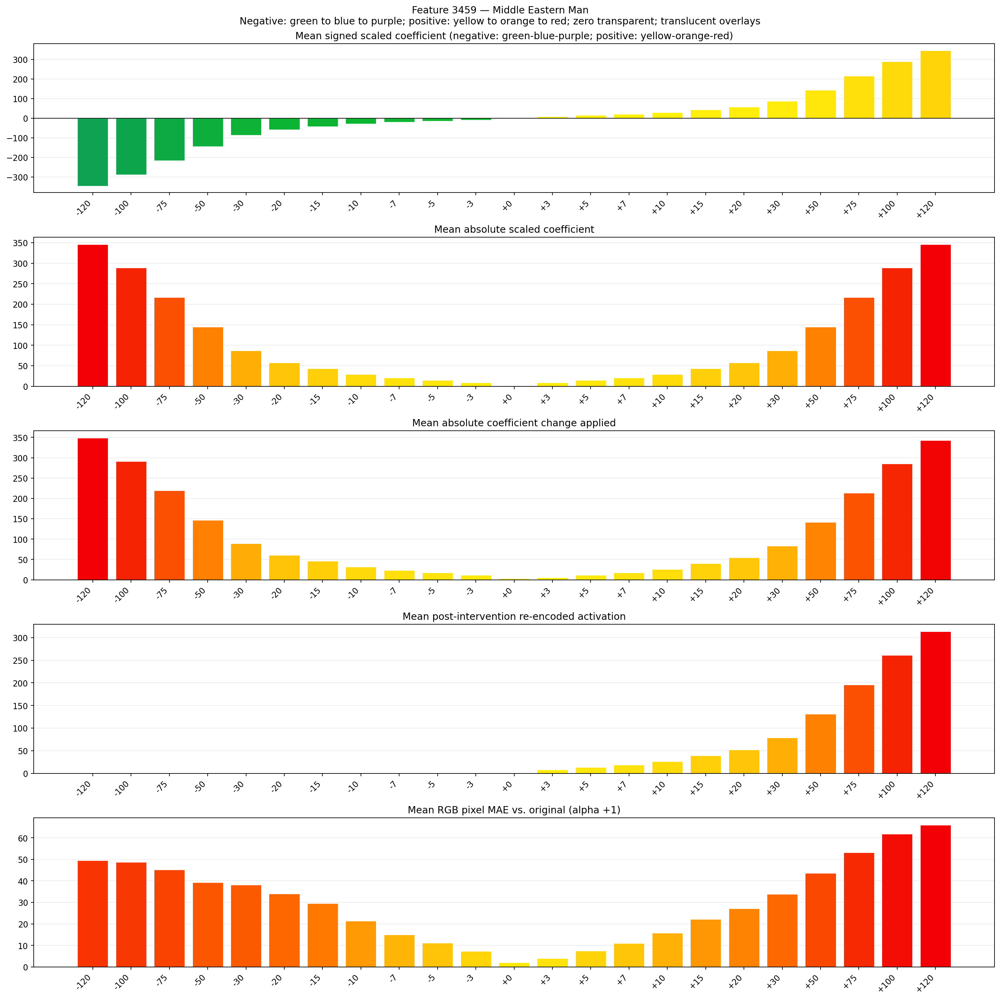
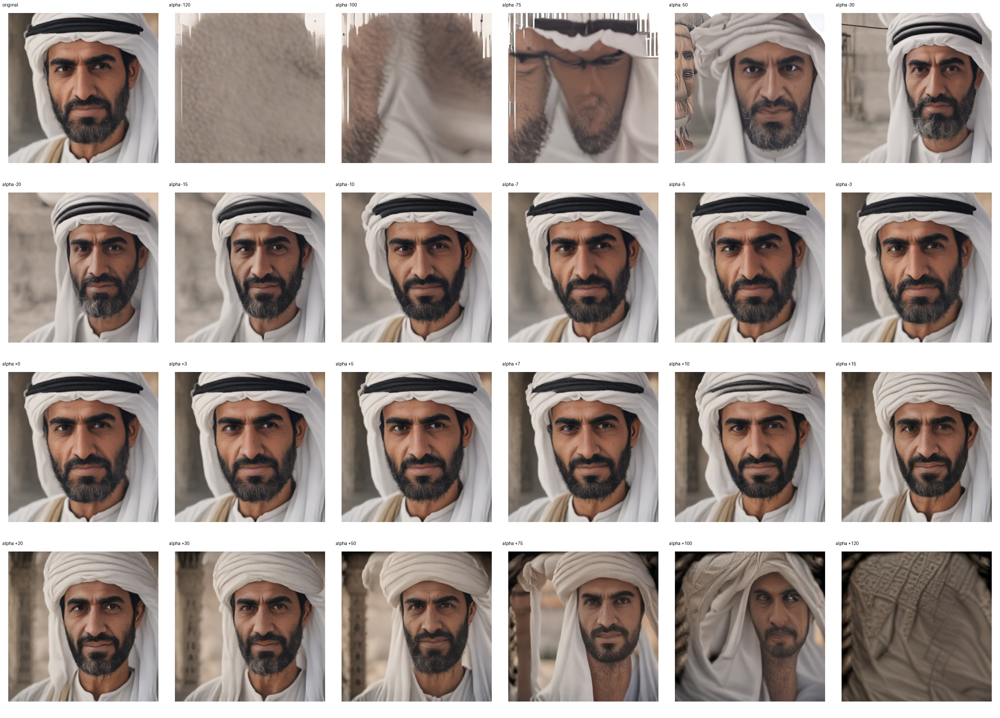
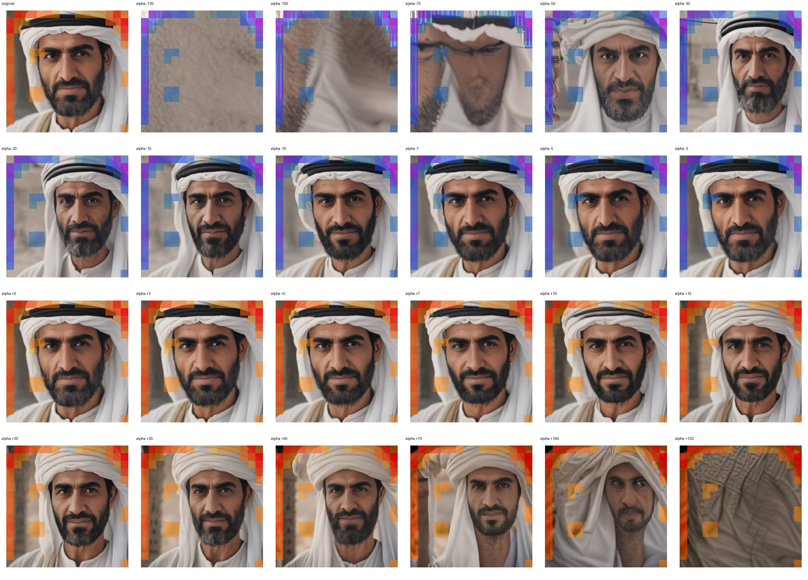
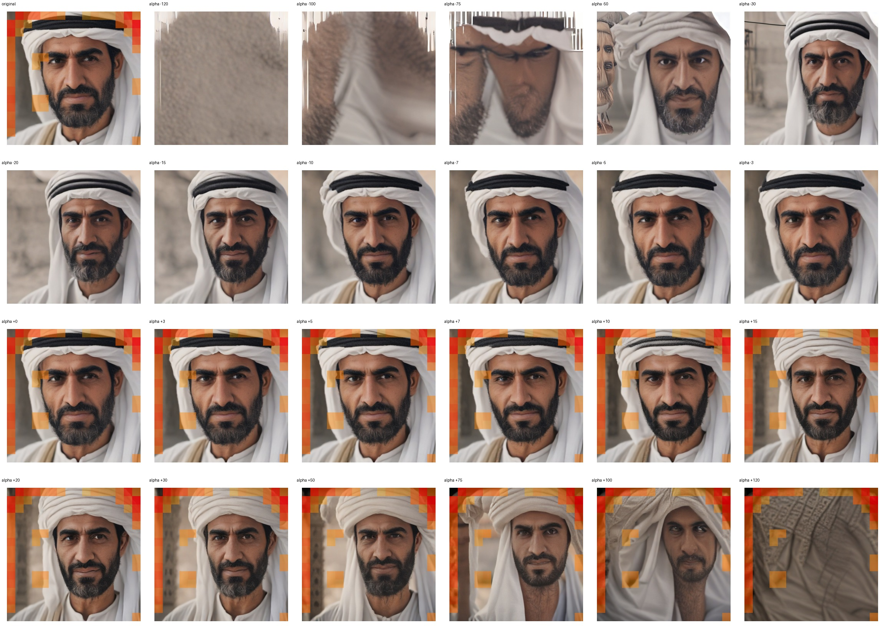

# Feature 3459 — Middle Eastern Man

Biased dataset; original prompt and seed replay for seeds 0–19. Values are means across 20 source images. The table reports the mean post-re-encoded activation of feature 3459, the active spatial fraction, mean RGB pixel MAE versus the original image (0–255 scale), and coefficient change magnitudes for each alpha.

## Activation graph

## Mean metrics by alpha

| Alpha | Mean post-reencoded feature 3459 activation | Active spatial fraction | Mean pixel change (MAE) | Mean absolute coefficient change | Mean absolute scaled coefficient |
|---:|---:|---:|---:|---:|---:|
| -120 | 0.000 | 0.000 | 49.524 | 348.966 | 346.082 |
| -100 | 0.000 | 0.000 | 48.675 | 291.286 | 288.402 |
| -75 | 0.000 | 0.000 | 45.149 | 219.185 | 216.301 |
| -50 | 0.000 | 0.000 | 39.223 | 147.085 | 144.201 |
| -30 | 0.000 | 0.000 | 38.217 | 89.405 | 86.521 |
| -20 | 0.000 | 0.000 | 34.068 | 60.564 | 57.680 |
| -15 | 0.000 | 0.000 | 29.450 | 46.144 | 43.260 |
| -10 | 0.000 | 0.000 | 21.372 | 31.724 | 28.840 |
| -7 | 0.000 | 0.000 | 14.918 | 23.072 | 20.188 |
| -5 | 0.000 | 0.000 | 11.127 | 17.304 | 14.420 |
| -3 | 0.000 | 0.000 | 7.372 | 11.536 | 8.652 |
| +0 | 0.000 | 0.000 | 2.084 | 2.884 | 0.000 |
| +3 | 8.108 | 0.218 | 3.887 | 5.768 | 8.652 |
| +5 | 13.331 | 0.218 | 7.396 | 11.536 | 14.420 |
| +7 | 18.555 | 0.218 | 10.917 | 17.304 | 20.188 |
| +10 | 26.391 | 0.218 | 15.717 | 25.956 | 28.840 |
| +15 | 39.450 | 0.218 | 22.198 | 40.376 | 43.260 |
| +20 | 52.509 | 0.218 | 27.046 | 54.796 | 57.680 |
| +30 | 78.628 | 0.218 | 33.899 | 83.637 | 86.521 |
| +50 | 130.865 | 0.218 | 43.642 | 141.317 | 144.201 |
| +75 | 196.161 | 0.218 | 53.181 | 213.417 | 216.301 |
| +100 | 261.457 | 0.218 | 61.732 | 285.518 | 288.402 |
| +120 | 313.694 | 0.218 | 65.954 | 343.198 | 346.082 |

## Per-seed grids

Each 4×6 sheet contains the original followed by the 23 alpha variants in ascending alpha order, from −120 through +120.

### Plain images

[All 20 plain-image grids](seed_sheets/)

### Signed coefficient overlays

[All 20 signed coefficient grids](signed_coefficient_overlays/)

### Post-re-encoded activation overlays

[All 20 post-activation grids](post_activation_overlays/)

### Intervention-footprint overlays

[All 20 intervention-footprint grids](intervention_footprint_overlays/)

Zero is transparent. Negative coefficient colors progress green through blue to purple; positive colors progress yellow through orange to red. Each map tile is normalized individually for visibility. The original and alpha-zero tiles show the pre-intervention feature map so its location remains visible.
