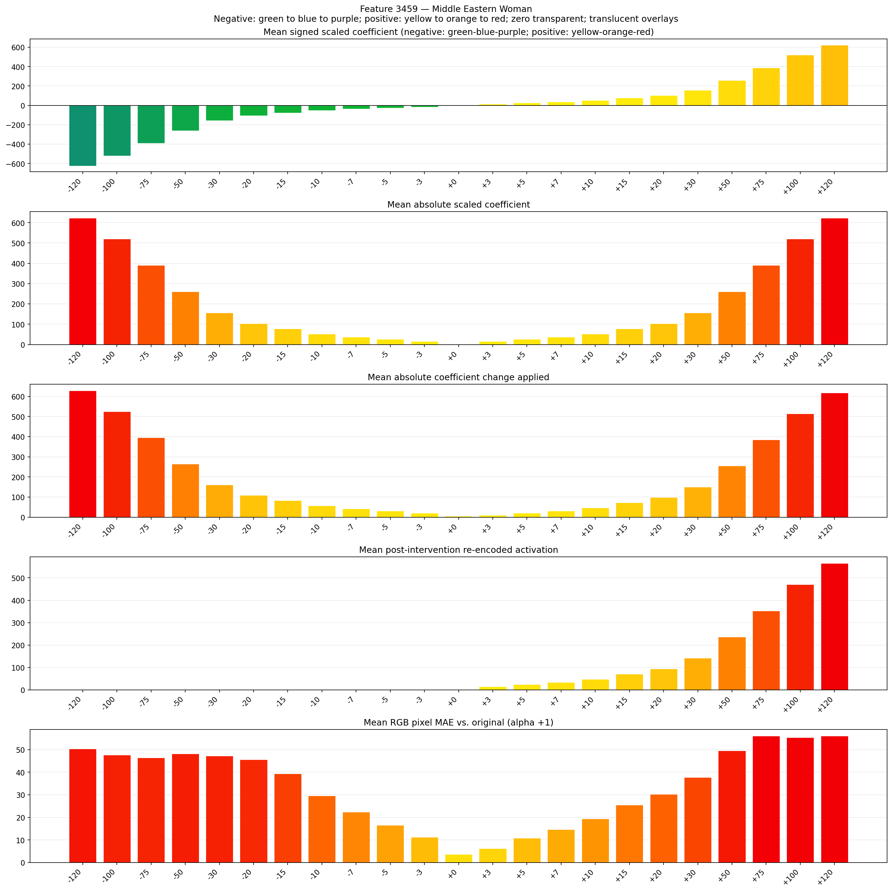
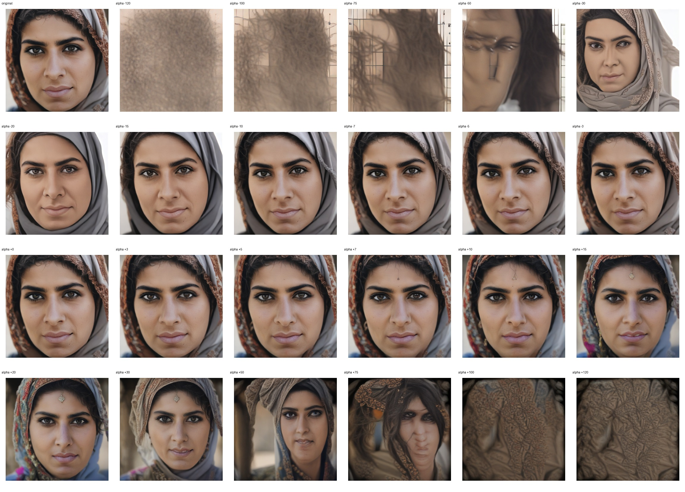
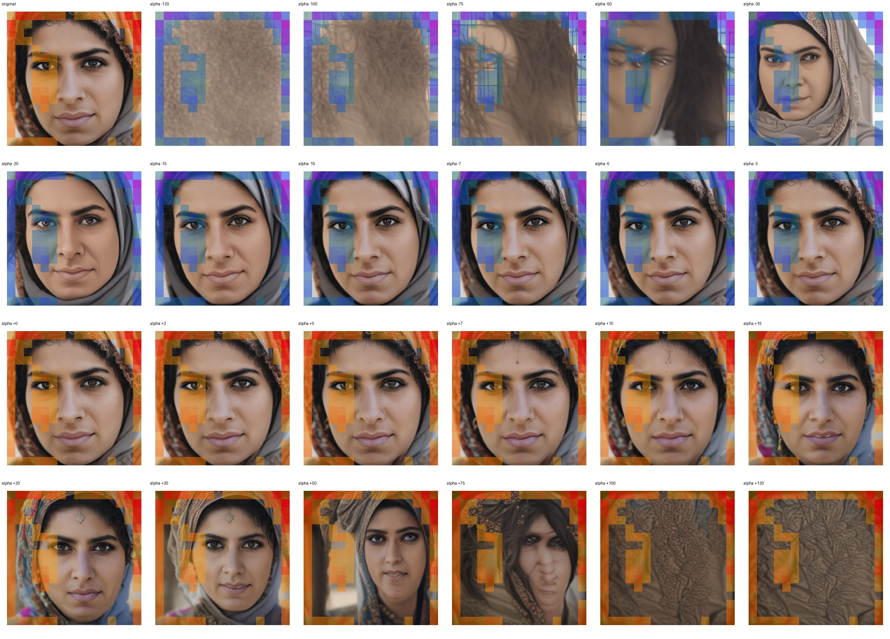
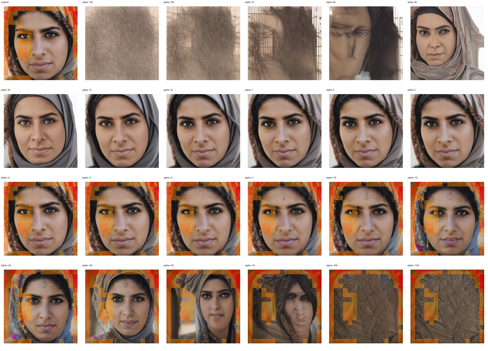

# Feature 3459 — Middle Eastern Woman

Biased dataset; original prompt and seed replay for seeds 0–19. Values are means across 20 source images. The table reports the mean post-re-encoded activation of feature 3459, the active spatial fraction, mean RGB pixel MAE versus the original image (0–255 scale), and coefficient change magnitudes for each alpha.

## Activation graph

## Mean metrics by alpha

| Alpha | Mean post-reencoded feature 3459 activation | Active spatial fraction | Mean pixel change (MAE) | Mean absolute coefficient change | Mean absolute scaled coefficient |
|---:|---:|---:|---:|---:|---:|
| -120 | 0.000 | 0.000 | 50.369 | 628.780 | 623.583 |
| -100 | 0.000 | 0.000 | 47.629 | 524.849 | 519.653 |
| -75 | 0.000 | 0.000 | 46.474 | 394.936 | 389.739 |
| -50 | 0.000 | 0.000 | 48.272 | 265.023 | 259.826 |
| -30 | 0.000 | 0.000 | 47.220 | 161.092 | 155.896 |
| -20 | 0.000 | 0.000 | 45.597 | 109.127 | 103.931 |
| -15 | 0.000 | 0.000 | 39.379 | 83.144 | 77.948 |
| -10 | 0.000 | 0.000 | 29.548 | 57.162 | 51.965 |
| -7 | 0.000 | 0.000 | 22.334 | 41.572 | 36.376 |
| -5 | 0.000 | 0.000 | 16.532 | 31.179 | 25.983 |
| -3 | 0.000 | 0.000 | 11.224 | 20.786 | 15.590 |
| +0 | 0.000 | 0.000 | 3.593 | 5.197 | 0.000 |
| +3 | 14.609 | 0.333 | 6.234 | 10.393 | 15.590 |
| +5 | 24.021 | 0.333 | 10.904 | 20.786 | 25.983 |
| +7 | 33.433 | 0.333 | 14.661 | 31.179 | 36.376 |
| +10 | 47.552 | 0.333 | 19.365 | 46.769 | 51.965 |
| +15 | 71.082 | 0.333 | 25.465 | 72.751 | 77.948 |
| +20 | 94.613 | 0.333 | 30.250 | 98.734 | 103.931 |
| +30 | 141.674 | 0.333 | 37.785 | 150.699 | 155.896 |
| +50 | 235.796 | 0.333 | 49.595 | 254.630 | 259.826 |
| +75 | 353.450 | 0.333 | 56.104 | 384.543 | 389.739 |
| +100 | 471.102 | 0.333 | 55.430 | 514.456 | 519.653 |
| +120 | 565.225 | 0.333 | 56.092 | 618.387 | 623.583 |

## Per-seed grids

Each 4×6 sheet contains the original followed by the 23 alpha variants in ascending alpha order, from −120 through +120.

### Plain images

[All 20 plain-image grids](seed_sheets/)

### Signed coefficient overlays

[All 20 signed coefficient grids](signed_coefficient_overlays/)

### Post-re-encoded activation overlays

[All 20 post-activation grids](post_activation_overlays/)

### Intervention-footprint overlays

[All 20 intervention-footprint grids](intervention_footprint_overlays/)

Zero is transparent. Negative coefficient colors progress green through blue to purple; positive colors progress yellow through orange to red. Each map tile is normalized individually for visibility. The original and alpha-zero tiles show the pre-intervention feature map so its location remains visible.
