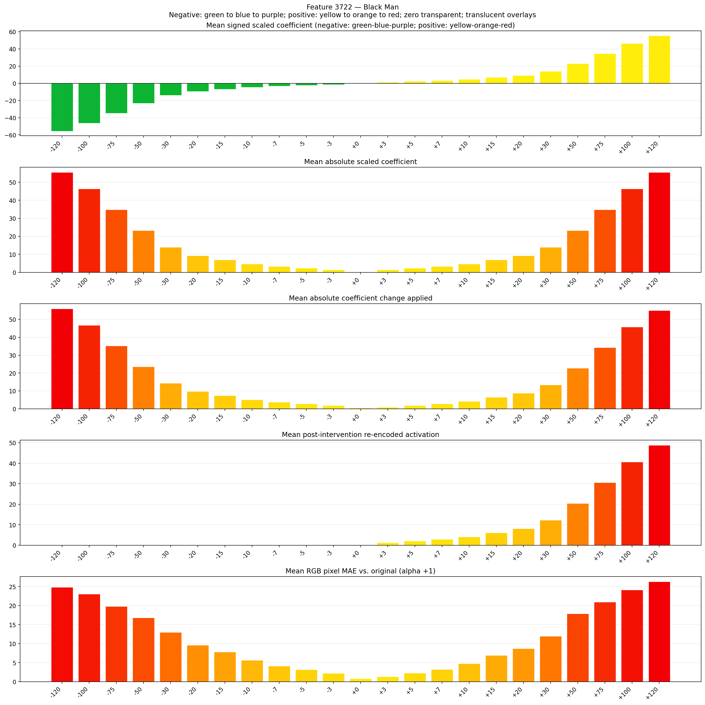
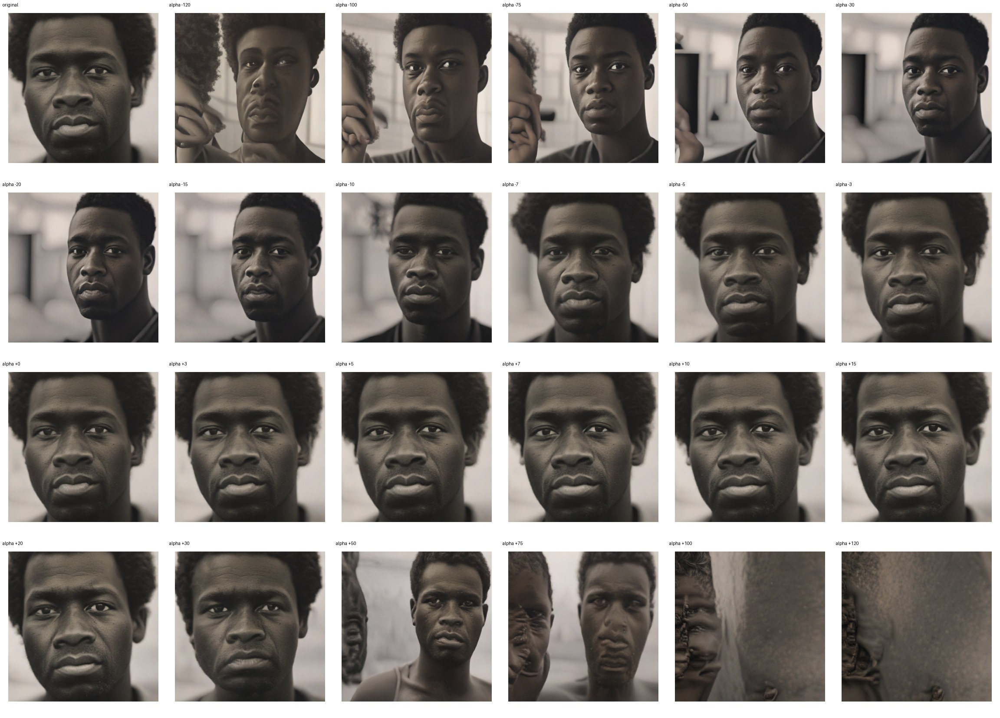
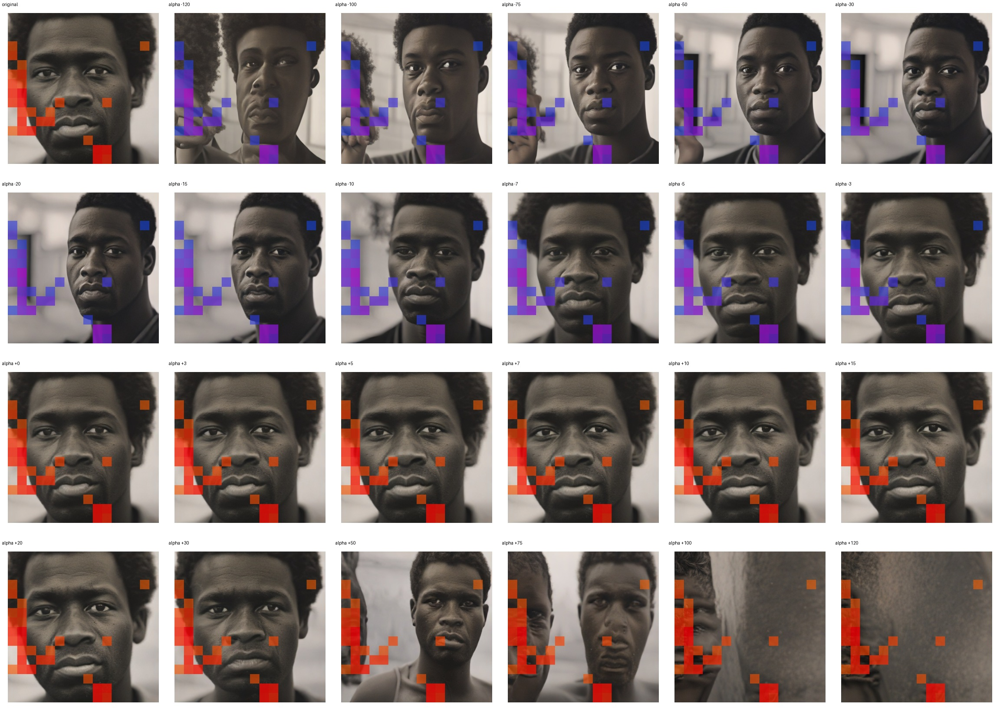
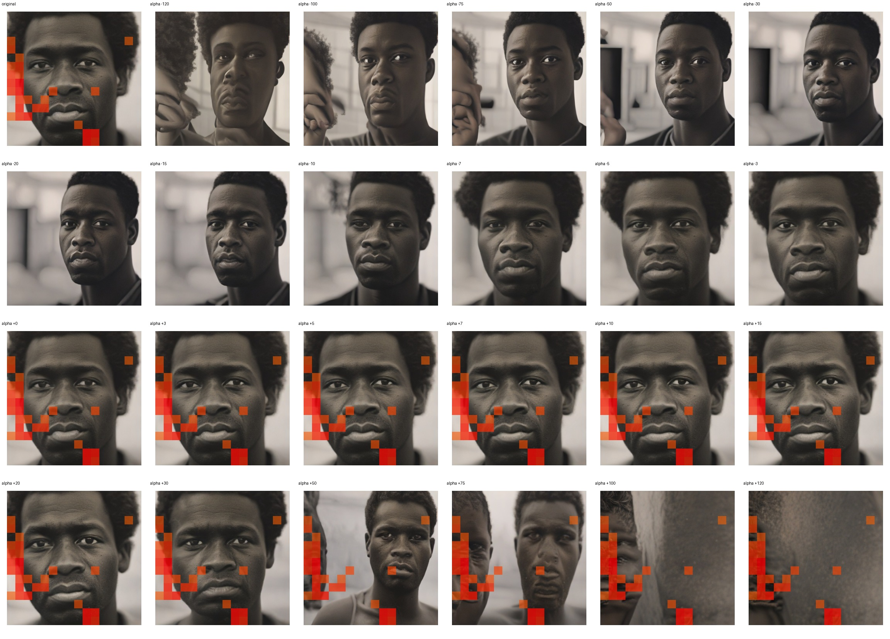

# Feature 3722 — Black Man

Biased dataset; original prompt and seed replay for seeds 0–19. Values are means across 20 source images. The table reports the mean post-re-encoded activation of feature 3722, the active spatial fraction, mean RGB pixel MAE versus the original image (0–255 scale), and coefficient change magnitudes for each alpha.

## Activation graph

## Mean metrics by alpha

| Alpha | Mean post-reencoded feature 3722 activation | Active spatial fraction | Mean pixel change (MAE) | Mean absolute coefficient change | Mean absolute scaled coefficient |
|---:|---:|---:|---:|---:|---:|
| -120 | 0.000 | 0.000 | 24.842 | 56.027 | 55.564 |
| -100 | 0.000 | 0.000 | 23.041 | 46.766 | 46.303 |
| -75 | 0.000 | 0.000 | 19.800 | 35.190 | 34.727 |
| -50 | 0.000 | 0.000 | 16.827 | 23.615 | 23.152 |
| -30 | 0.000 | 0.000 | 12.957 | 14.354 | 13.891 |
| -20 | 0.000 | 0.000 | 9.603 | 9.724 | 9.261 |
| -15 | 0.000 | 0.000 | 7.802 | 7.409 | 6.945 |
| -10 | 0.000 | 0.000 | 5.650 | 5.093 | 4.630 |
| -7 | 0.000 | 0.000 | 4.138 | 3.704 | 3.241 |
| -5 | 0.000 | 0.000 | 3.172 | 2.778 | 2.315 |
| -3 | 0.000 | 0.000 | 2.250 | 1.852 | 1.389 |
| +0 | 0.000 | 0.000 | 0.813 | 0.463 | 0.000 |
| +3 | 1.276 | 0.043 | 1.297 | 0.926 | 1.389 |
| +5 | 2.089 | 0.043 | 2.279 | 1.852 | 2.315 |
| +7 | 2.903 | 0.043 | 3.233 | 2.778 | 3.241 |
| +10 | 4.122 | 0.043 | 4.795 | 4.167 | 4.630 |
| +15 | 6.155 | 0.043 | 6.922 | 6.482 | 6.945 |
| +20 | 8.188 | 0.043 | 8.692 | 8.798 | 9.261 |
| +30 | 12.254 | 0.043 | 11.996 | 13.428 | 13.891 |
| +50 | 20.386 | 0.043 | 17.891 | 22.689 | 23.152 |
| +75 | 30.550 | 0.043 | 20.929 | 34.264 | 34.727 |
| +100 | 40.715 | 0.043 | 24.125 | 45.840 | 46.303 |
| +120 | 48.847 | 0.043 | 26.310 | 55.101 | 55.564 |

## Per-seed grids

Each 4×6 sheet contains the original followed by the 23 alpha variants in ascending alpha order, from −120 through +120.

### Plain images

[All 20 plain-image grids](seed_sheets/)

### Signed coefficient overlays

[All 20 signed coefficient grids](signed_coefficient_overlays/)

### Post-re-encoded activation overlays

[All 20 post-activation grids](post_activation_overlays/)

### Intervention-footprint overlays

[All 20 intervention-footprint grids](intervention_footprint_overlays/)

Zero is transparent. Negative coefficient colors progress green through blue to purple; positive colors progress yellow through orange to red. Each map tile is normalized individually for visibility. The original and alpha-zero tiles show the pre-intervention feature map so its location remains visible.
