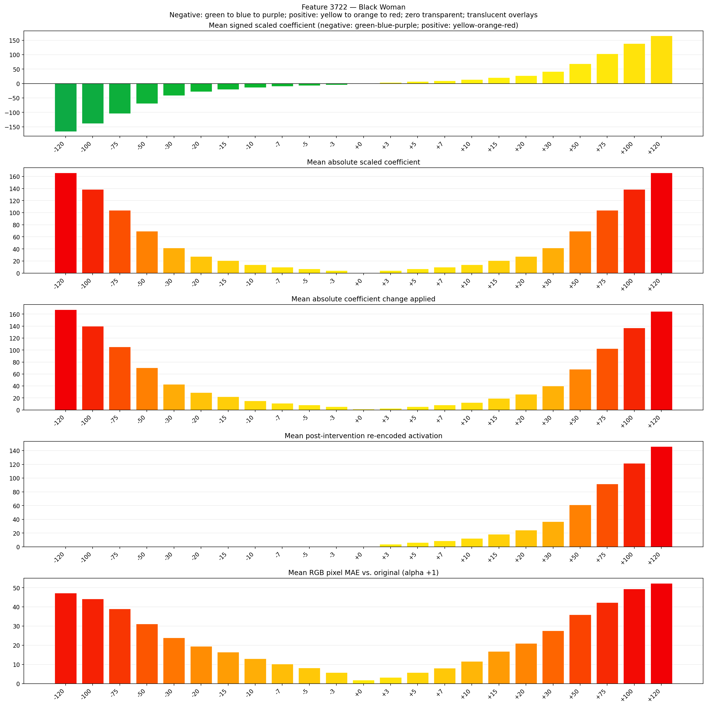
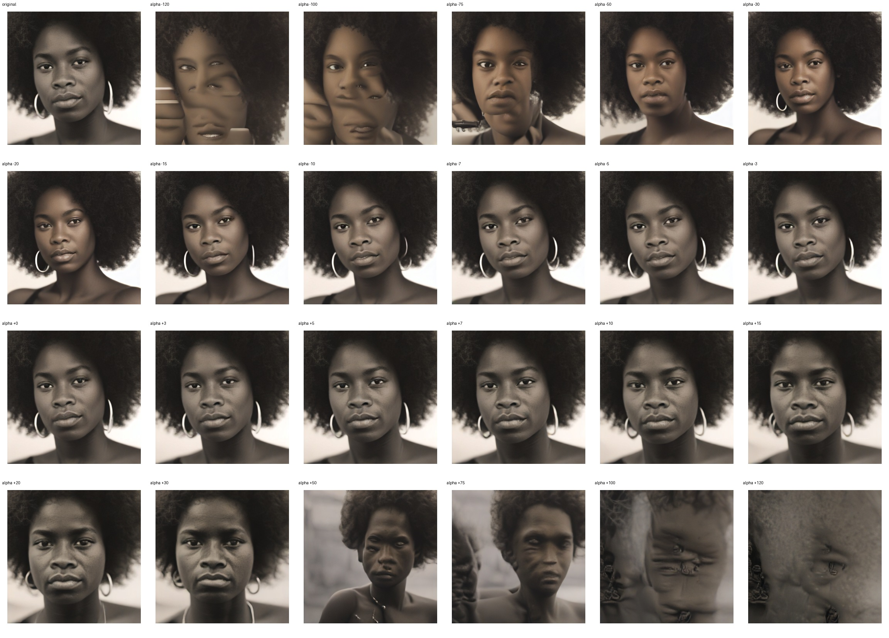
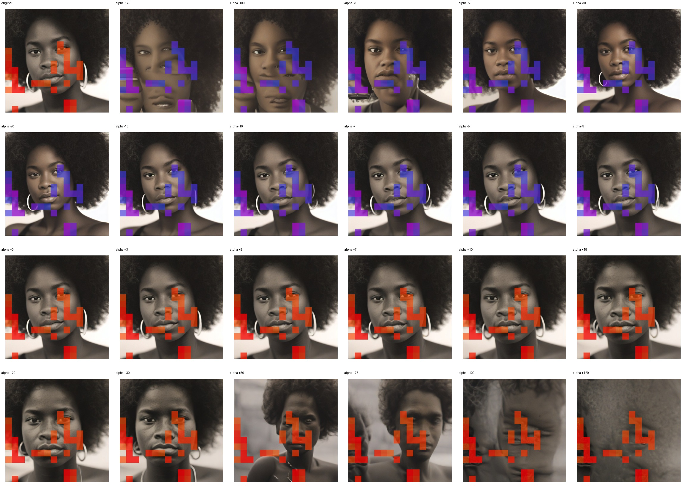
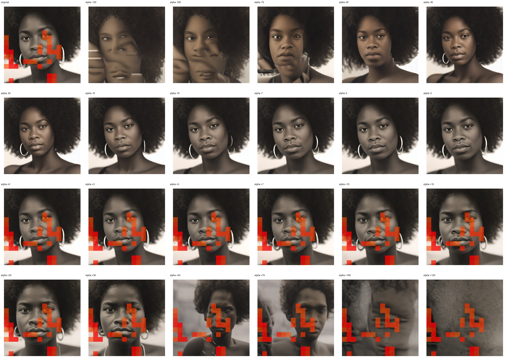

# Feature 3722 — Black Woman

Biased dataset; original prompt and seed replay for seeds 0–19. Values are means across 20 source images. The table reports the mean post-re-encoded activation of feature 3722, the active spatial fraction, mean RGB pixel MAE versus the original image (0–255 scale), and coefficient change magnitudes for each alpha.

## Activation graph

## Mean metrics by alpha

| Alpha | Mean post-reencoded feature 3722 activation | Active spatial fraction | Mean pixel change (MAE) | Mean absolute coefficient change | Mean absolute scaled coefficient |
|---:|---:|---:|---:|---:|---:|
| -120 | 0.000 | 0.000 | 47.186 | 167.605 | 166.220 |
| -100 | 0.000 | 0.000 | 44.159 | 139.902 | 138.517 |
| -75 | 0.000 | 0.000 | 38.979 | 105.273 | 103.887 |
| -50 | 0.000 | 0.000 | 31.141 | 70.643 | 69.258 |
| -30 | 0.000 | 0.000 | 23.868 | 42.940 | 41.555 |
| -20 | 0.000 | 0.000 | 19.529 | 29.088 | 27.703 |
| -15 | 0.000 | 0.000 | 16.478 | 22.163 | 20.777 |
| -10 | 0.000 | 0.000 | 13.089 | 15.237 | 13.852 |
| -7 | 0.000 | 0.000 | 10.247 | 11.081 | 9.696 |
| -5 | 0.000 | 0.000 | 8.149 | 8.311 | 6.926 |
| -3 | 0.000 | 0.000 | 5.833 | 5.541 | 4.155 |
| +0 | 0.000 | 0.000 | 1.859 | 1.385 | 0.000 |
| +3 | 3.818 | 0.116 | 3.229 | 2.770 | 4.155 |
| +5 | 6.250 | 0.116 | 5.747 | 5.541 | 6.926 |
| +7 | 8.683 | 0.116 | 8.141 | 8.311 | 9.696 |
| +10 | 12.332 | 0.116 | 11.634 | 12.466 | 13.852 |
| +15 | 18.413 | 0.116 | 16.830 | 19.392 | 20.777 |
| +20 | 24.495 | 0.116 | 21.048 | 26.318 | 27.703 |
| +30 | 36.658 | 0.116 | 27.648 | 40.170 | 41.555 |
| +50 | 60.984 | 0.116 | 35.908 | 67.873 | 69.258 |
| +75 | 91.392 | 0.116 | 42.252 | 102.502 | 103.887 |
| +100 | 121.800 | 0.116 | 49.428 | 137.131 | 138.517 |
| +120 | 146.126 | 0.116 | 52.325 | 164.835 | 166.220 |

## Per-seed grids

Each 4×6 sheet contains the original followed by the 23 alpha variants in ascending alpha order, from −120 through +120.

### Plain images

[All 20 plain-image grids](seed_sheets/)

### Signed coefficient overlays

[All 20 signed coefficient grids](signed_coefficient_overlays/)

### Post-re-encoded activation overlays

[All 20 post-activation grids](post_activation_overlays/)

### Intervention-footprint overlays

[All 20 intervention-footprint grids](intervention_footprint_overlays/)

Zero is transparent. Negative coefficient colors progress green through blue to purple; positive colors progress yellow through orange to red. Each map tile is normalized individually for visibility. The original and alpha-zero tiles show the pre-intervention feature map so its location remains visible.
