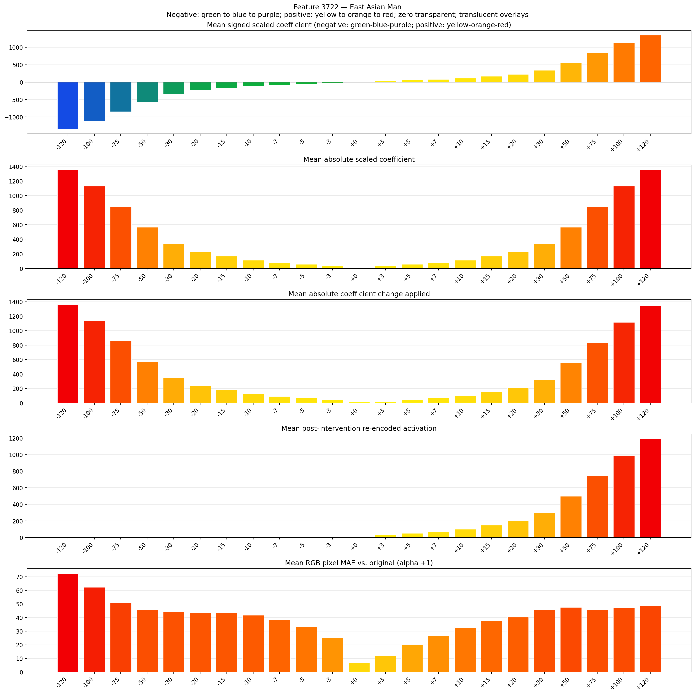
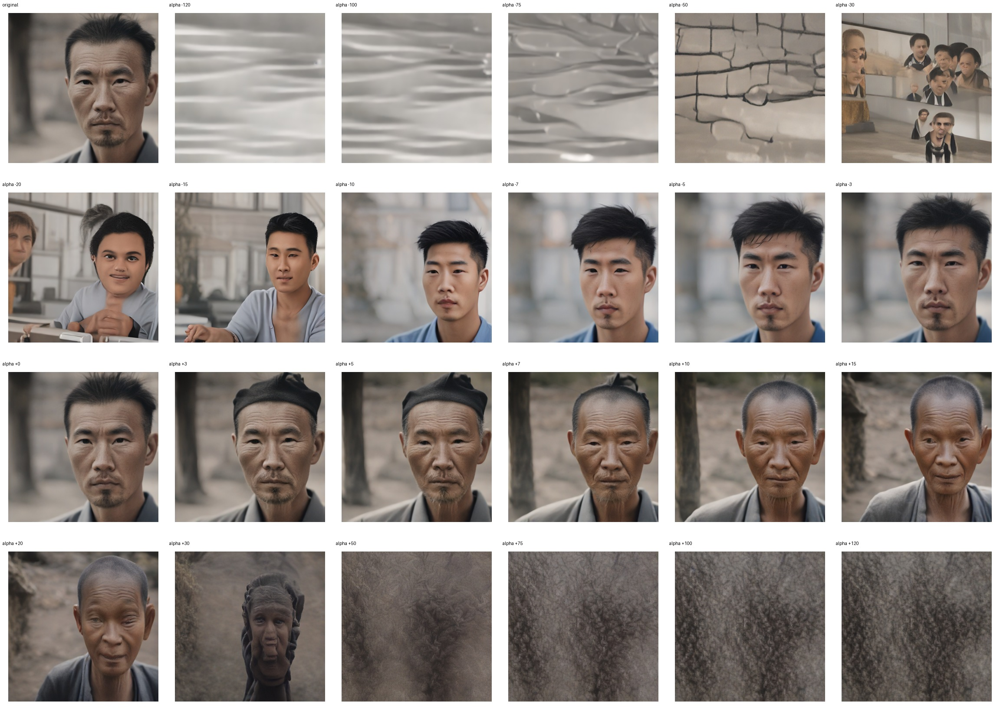
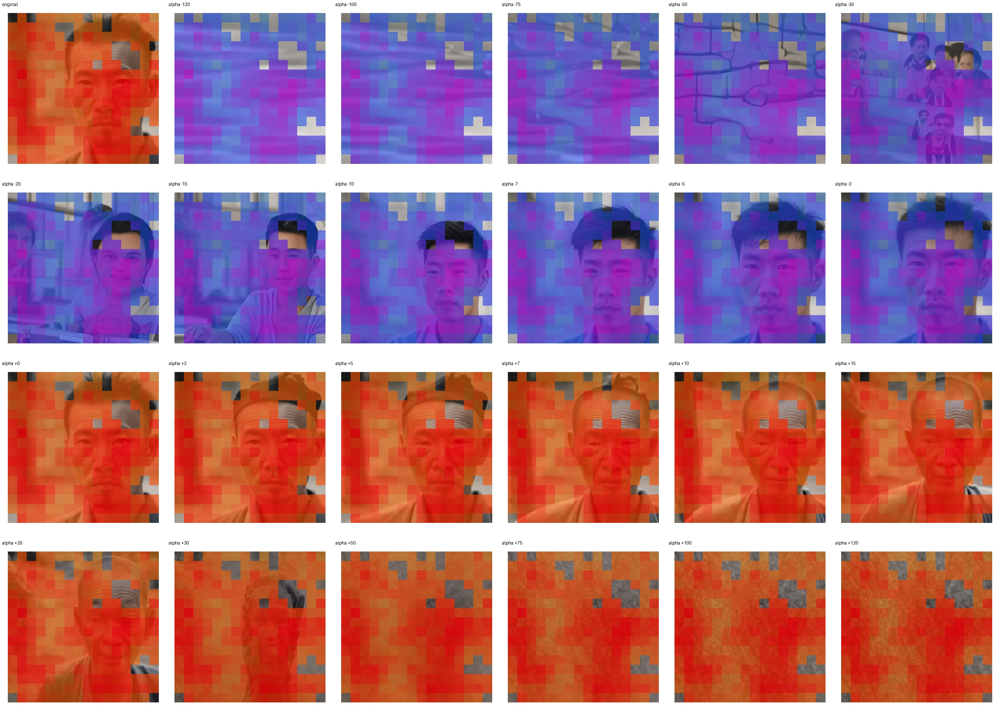
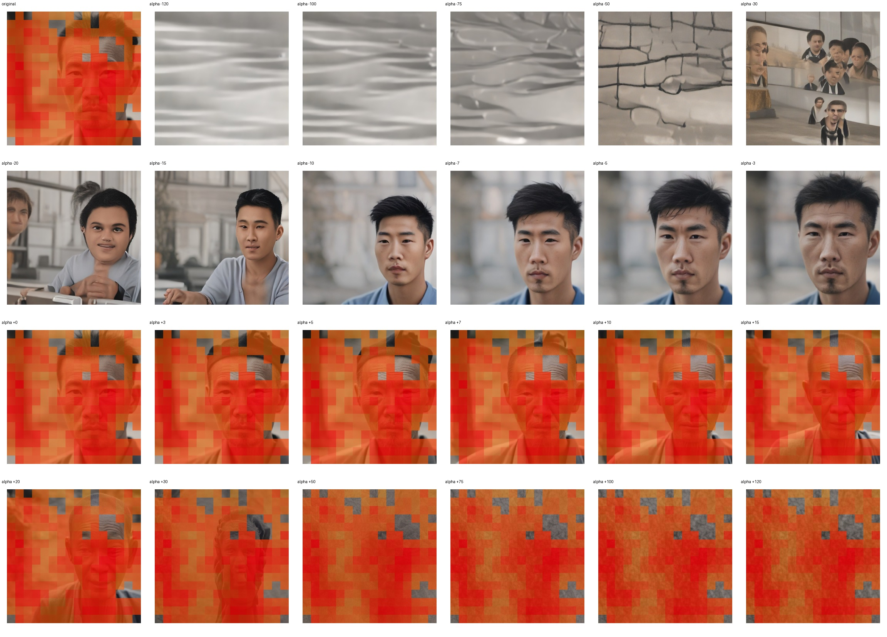

# Feature 3722 — East Asian Man

Biased dataset; original prompt and seed replay for seeds 0–19. Values are means across 20 source images. The table reports the mean post-re-encoded activation of feature 3722, the active spatial fraction, mean RGB pixel MAE versus the original image (0–255 scale), and coefficient change magnitudes for each alpha.

## Activation graph

## Mean metrics by alpha

| Alpha | Mean post-reencoded feature 3722 activation | Active spatial fraction | Mean pixel change (MAE) | Mean absolute coefficient change | Mean absolute scaled coefficient |
|---:|---:|---:|---:|---:|---:|
| -120 | 0.000 | 0.000 | 72.494 | 1364.437 | 1353.161 |
| -100 | 0.000 | 0.000 | 62.315 | 1138.910 | 1127.634 |
| -75 | 0.000 | 0.000 | 50.916 | 857.002 | 845.726 |
| -50 | 0.000 | 0.000 | 45.756 | 575.093 | 563.817 |
| -30 | 0.000 | 0.000 | 44.486 | 349.567 | 338.290 |
| -20 | 0.000 | 0.000 | 43.615 | 236.803 | 225.527 |
| -15 | 0.000 | 0.000 | 43.324 | 180.421 | 169.145 |
| -10 | 0.000 | 0.000 | 41.811 | 124.040 | 112.763 |
| -7 | 0.000 | 0.000 | 38.458 | 90.211 | 78.934 |
| -5 | 0.000 | 0.000 | 33.580 | 67.658 | 56.382 |
| -3 | 0.000 | 0.000 | 25.066 | 45.105 | 33.829 |
| +0 | 0.000 | 0.000 | 6.939 | 11.276 | 0.000 |
| +3 | 31.080 | 0.902 | 11.762 | 22.553 | 33.829 |
| +5 | 50.883 | 0.902 | 20.012 | 45.105 | 56.382 |
| +7 | 70.687 | 0.902 | 26.615 | 67.658 | 78.934 |
| +10 | 100.392 | 0.902 | 32.830 | 101.487 | 112.763 |
| +15 | 149.900 | 0.902 | 37.549 | 157.869 | 169.145 |
| +20 | 199.409 | 0.902 | 40.418 | 214.250 | 225.527 |
| +30 | 298.426 | 0.902 | 45.626 | 327.014 | 338.290 |
| +50 | 496.460 | 0.902 | 47.557 | 552.541 | 563.817 |
| +75 | 744.003 | 0.902 | 45.837 | 834.449 | 845.726 |
| +100 | 991.545 | 0.902 | 46.969 | 1116.358 | 1127.634 |
| +120 | 1189.580 | 0.902 | 48.840 | 1341.885 | 1353.161 |

## Per-seed grids

Each 4×6 sheet contains the original followed by the 23 alpha variants in ascending alpha order, from −120 through +120.

### Plain images

[All 20 plain-image grids](seed_sheets/)

### Signed coefficient overlays

[All 20 signed coefficient grids](signed_coefficient_overlays/)

### Post-re-encoded activation overlays

[All 20 post-activation grids](post_activation_overlays/)

### Intervention-footprint overlays

[All 20 intervention-footprint grids](intervention_footprint_overlays/)

Zero is transparent. Negative coefficient colors progress green through blue to purple; positive colors progress yellow through orange to red. Each map tile is normalized individually for visibility. The original and alpha-zero tiles show the pre-intervention feature map so its location remains visible.
