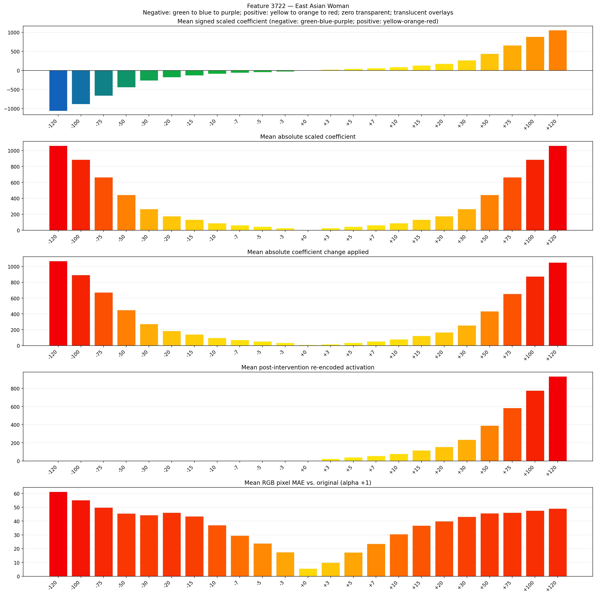
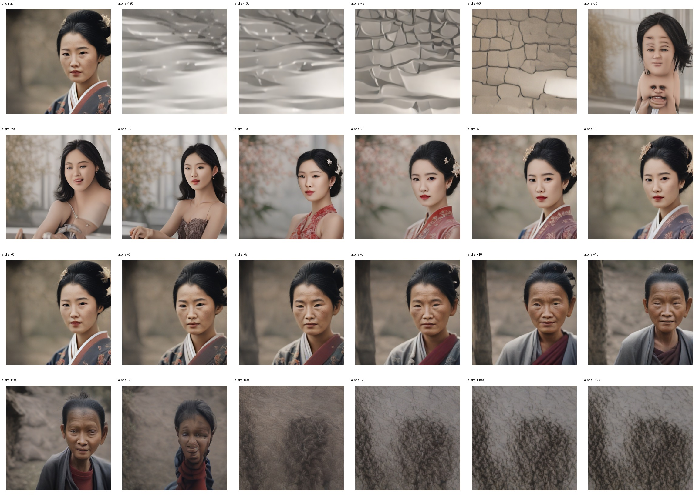
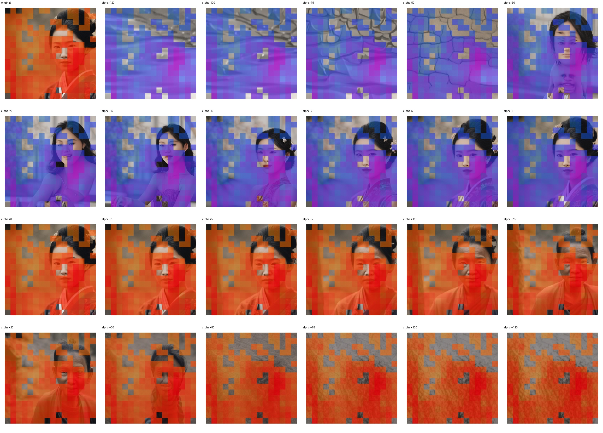
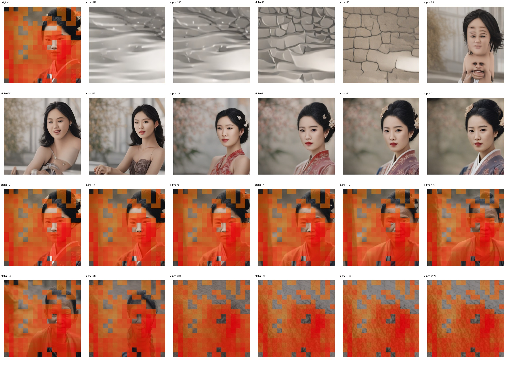

# Feature 3722 — East Asian Woman

Biased dataset; original prompt and seed replay for seeds 0–19. Values are means across 20 source images. The table reports the mean post-re-encoded activation of feature 3722, the active spatial fraction, mean RGB pixel MAE versus the original image (0–255 scale), and coefficient change magnitudes for each alpha.

## Activation graph

## Mean metrics by alpha

| Alpha | Mean post-reencoded feature 3722 activation | Active spatial fraction | Mean pixel change (MAE) | Mean absolute coefficient change | Mean absolute scaled coefficient |
|---:|---:|---:|---:|---:|---:|
| -120 | 0.000 | 0.000 | 61.271 | 1070.554 | 1061.707 |
| -100 | 0.000 | 0.000 | 55.239 | 893.603 | 884.756 |
| -75 | 0.000 | 0.000 | 49.774 | 672.414 | 663.567 |
| -50 | 0.000 | 0.000 | 45.498 | 451.225 | 442.378 |
| -30 | 0.000 | 0.000 | 44.393 | 274.274 | 265.427 |
| -20 | 0.000 | 0.000 | 46.088 | 185.799 | 176.951 |
| -15 | 0.000 | 0.000 | 43.467 | 141.561 | 132.713 |
| -10 | 0.000 | 0.000 | 37.072 | 97.323 | 88.476 |
| -7 | 0.000 | 0.000 | 29.570 | 70.780 | 61.933 |
| -5 | 0.000 | 0.000 | 23.853 | 53.085 | 44.238 |
| -3 | 0.000 | 0.000 | 17.478 | 35.390 | 26.543 |
| +0 | 0.000 | 0.000 | 5.612 | 8.848 | 0.000 |
| +3 | 24.386 | 0.691 | 9.864 | 17.695 | 26.543 |
| +5 | 39.924 | 0.691 | 17.405 | 35.390 | 44.238 |
| +7 | 55.462 | 0.691 | 23.620 | 53.085 | 61.933 |
| +10 | 78.769 | 0.691 | 30.506 | 79.628 | 88.476 |
| +15 | 117.614 | 0.691 | 36.732 | 123.866 | 132.713 |
| +20 | 156.459 | 0.691 | 39.843 | 168.104 | 176.951 |
| +30 | 234.149 | 0.691 | 43.140 | 256.579 | 265.427 |
| +50 | 389.529 | 0.691 | 45.740 | 433.530 | 442.378 |
| +75 | 583.754 | 0.691 | 46.188 | 654.719 | 663.567 |
| +100 | 777.979 | 0.691 | 47.543 | 875.908 | 884.756 |
| +120 | 933.358 | 0.691 | 49.156 | 1052.859 | 1061.707 |

## Per-seed grids

Each 4×6 sheet contains the original followed by the 23 alpha variants in ascending alpha order, from −120 through +120.

### Plain images

[All 20 plain-image grids](seed_sheets/)

### Signed coefficient overlays

[All 20 signed coefficient grids](signed_coefficient_overlays/)

### Post-re-encoded activation overlays

[All 20 post-activation grids](post_activation_overlays/)

### Intervention-footprint overlays

[All 20 intervention-footprint grids](intervention_footprint_overlays/)

Zero is transparent. Negative coefficient colors progress green through blue to purple; positive colors progress yellow through orange to red. Each map tile is normalized individually for visibility. The original and alpha-zero tiles show the pre-intervention feature map so its location remains visible.
