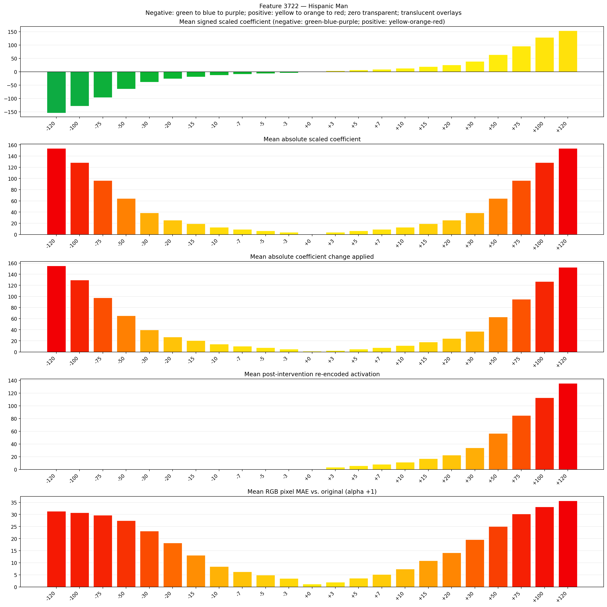
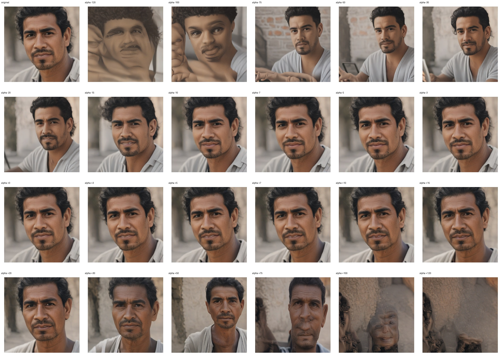
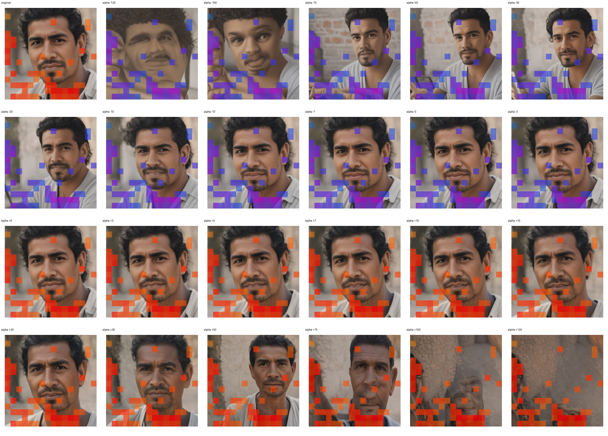
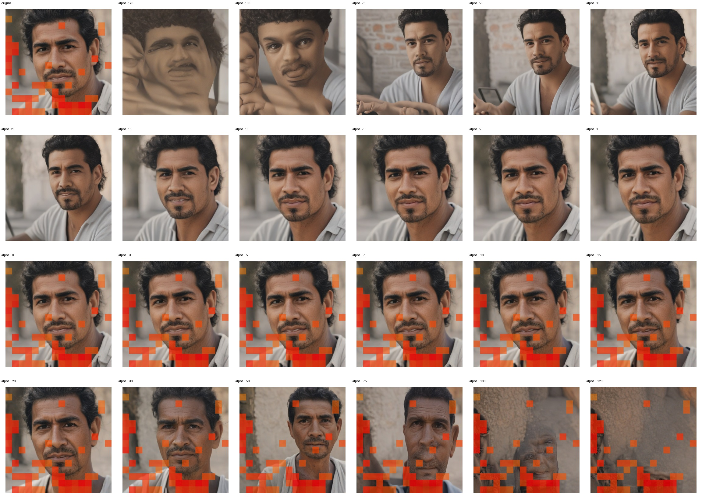

# Feature 3722 — Hispanic Man

Biased dataset; original prompt and seed replay for seeds 0–19. Values are means across 20 source images. The table reports the mean post-re-encoded activation of feature 3722, the active spatial fraction, mean RGB pixel MAE versus the original image (0–255 scale), and coefficient change magnitudes for each alpha.

## Activation graph

## Mean metrics by alpha

| Alpha | Mean post-reencoded feature 3722 activation | Active spatial fraction | Mean pixel change (MAE) | Mean absolute coefficient change | Mean absolute scaled coefficient |
|---:|---:|---:|---:|---:|---:|
| -120 | 0.000 | 0.000 | 31.333 | 155.254 | 153.971 |
| -100 | 0.000 | 0.000 | 30.708 | 129.592 | 128.309 |
| -75 | 0.000 | 0.000 | 29.726 | 97.515 | 96.232 |
| -50 | 0.000 | 0.000 | 27.451 | 65.438 | 64.155 |
| -30 | 0.000 | 0.000 | 23.137 | 39.776 | 38.493 |
| -20 | 0.000 | 0.000 | 18.175 | 26.945 | 25.662 |
| -15 | 0.000 | 0.000 | 13.110 | 20.529 | 19.246 |
| -10 | 0.000 | 0.000 | 8.473 | 14.114 | 12.831 |
| -7 | 0.000 | 0.000 | 6.246 | 10.265 | 8.982 |
| -5 | 0.000 | 0.000 | 4.889 | 7.699 | 6.415 |
| -3 | 0.000 | 0.000 | 3.491 | 5.132 | 3.849 |
| +0 | 0.000 | 0.000 | 1.180 | 1.283 | 0.000 |
| +3 | 3.536 | 0.134 | 2.012 | 2.566 | 3.849 |
| +5 | 5.790 | 0.134 | 3.602 | 5.132 | 6.415 |
| +7 | 8.043 | 0.134 | 5.165 | 7.699 | 8.982 |
| +10 | 11.423 | 0.134 | 7.447 | 11.548 | 12.831 |
| +15 | 17.057 | 0.134 | 10.901 | 17.963 | 19.246 |
| +20 | 22.690 | 0.134 | 14.165 | 24.379 | 25.662 |
| +30 | 33.957 | 0.134 | 19.579 | 37.210 | 38.493 |
| +50 | 56.490 | 0.134 | 25.050 | 62.872 | 64.155 |
| +75 | 84.657 | 0.134 | 30.167 | 94.949 | 96.232 |
| +100 | 112.824 | 0.134 | 33.127 | 127.026 | 128.309 |
| +120 | 135.358 | 0.134 | 35.660 | 152.688 | 153.971 |

## Per-seed grids

Each 4×6 sheet contains the original followed by the 23 alpha variants in ascending alpha order, from −120 through +120.

### Plain images

[All 20 plain-image grids](seed_sheets/)

### Signed coefficient overlays

[All 20 signed coefficient grids](signed_coefficient_overlays/)

### Post-re-encoded activation overlays

[All 20 post-activation grids](post_activation_overlays/)

### Intervention-footprint overlays

[All 20 intervention-footprint grids](intervention_footprint_overlays/)

Zero is transparent. Negative coefficient colors progress green through blue to purple; positive colors progress yellow through orange to red. Each map tile is normalized individually for visibility. The original and alpha-zero tiles show the pre-intervention feature map so its location remains visible.
