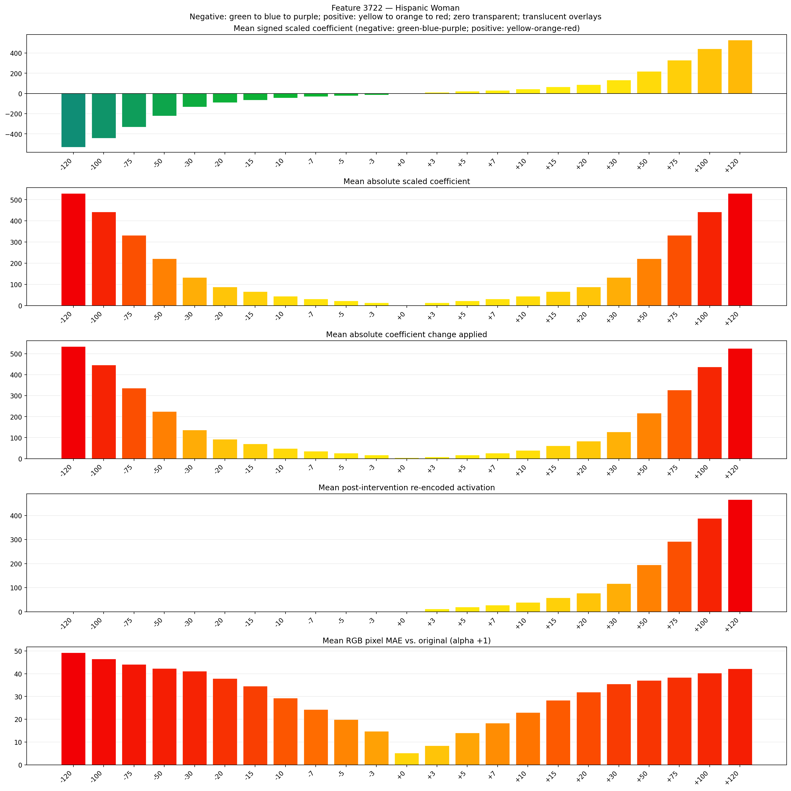
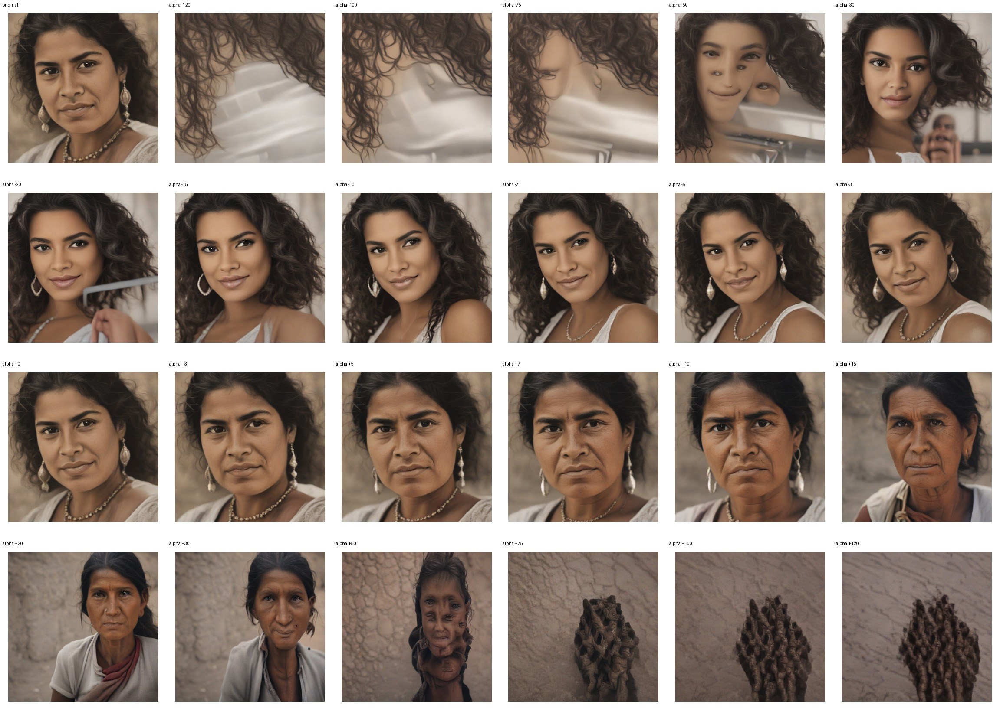
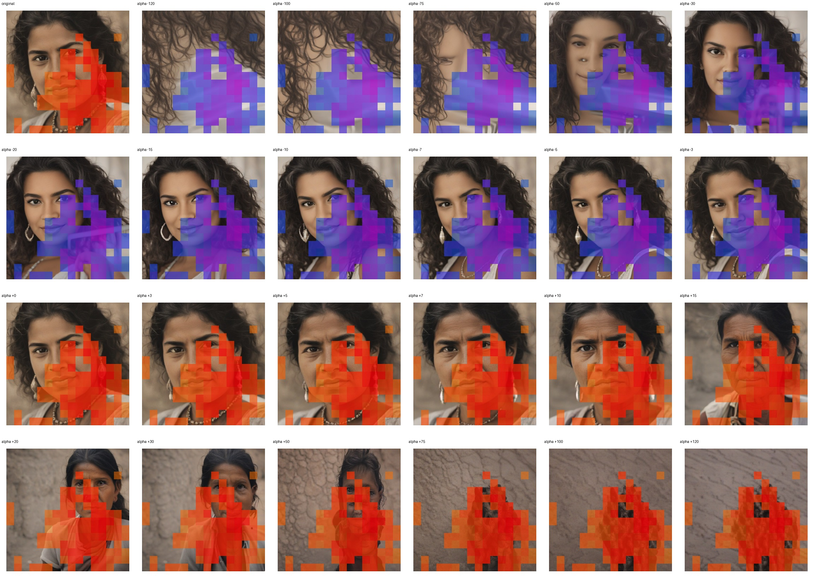
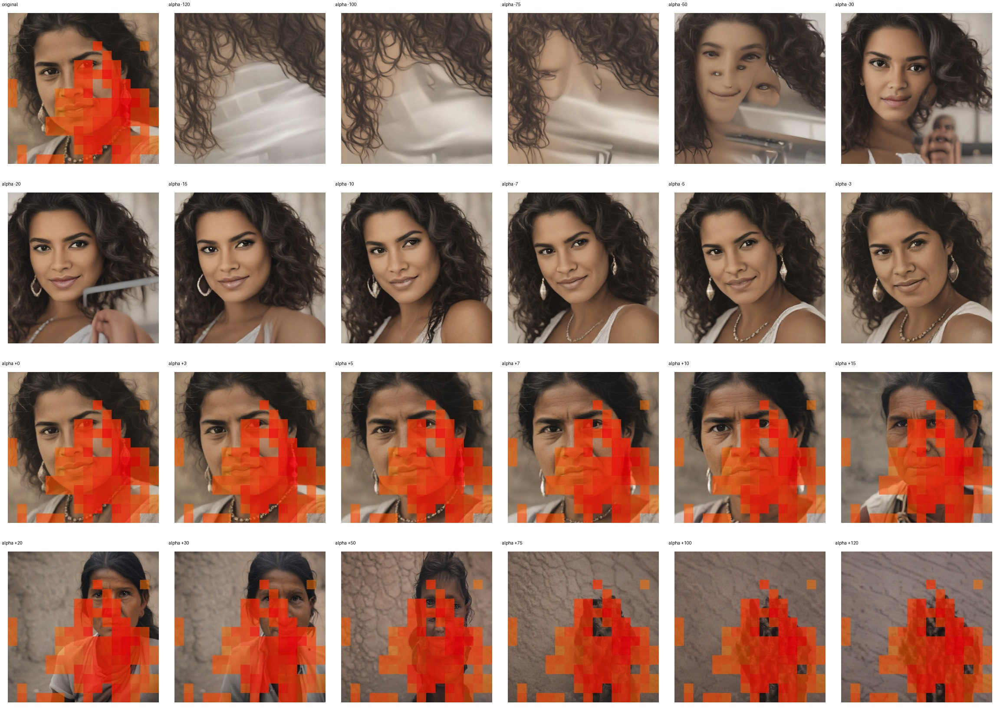

# Feature 3722 — Hispanic Woman

Biased dataset; original prompt and seed replay for seeds 0–19. Values are means across 20 source images. The table reports the mean post-re-encoded activation of feature 3722, the active spatial fraction, mean RGB pixel MAE versus the original image (0–255 scale), and coefficient change magnitudes for each alpha.

## Activation graph

## Mean metrics by alpha

| Alpha | Mean post-reencoded feature 3722 activation | Active spatial fraction | Mean pixel change (MAE) | Mean absolute coefficient change | Mean absolute scaled coefficient |
|---:|---:|---:|---:|---:|---:|
| -120 | 0.000 | 0.000 | 49.260 | 534.840 | 530.420 |
| -100 | 0.000 | 0.000 | 46.514 | 446.437 | 442.017 |
| -75 | 0.000 | 0.000 | 44.135 | 335.933 | 331.513 |
| -50 | 0.000 | 0.000 | 42.296 | 225.429 | 221.008 |
| -30 | 0.000 | 0.000 | 41.172 | 137.025 | 132.605 |
| -20 | 0.000 | 0.000 | 37.875 | 92.824 | 88.403 |
| -15 | 0.000 | 0.000 | 34.627 | 70.723 | 66.303 |
| -10 | 0.000 | 0.000 | 29.368 | 48.622 | 44.202 |
| -7 | 0.000 | 0.000 | 24.333 | 35.361 | 30.941 |
| -5 | 0.000 | 0.000 | 19.898 | 26.521 | 22.101 |
| -3 | 0.000 | 0.000 | 14.784 | 17.681 | 13.261 |
| +0 | 0.000 | 0.000 | 5.214 | 4.420 | 0.000 |
| +3 | 12.183 | 0.354 | 8.395 | 8.840 | 13.261 |
| +5 | 19.946 | 0.354 | 14.049 | 17.681 | 22.101 |
| +7 | 27.708 | 0.354 | 18.347 | 26.521 | 30.941 |
| +10 | 39.352 | 0.354 | 23.002 | 39.782 | 44.202 |
| +15 | 58.759 | 0.354 | 28.411 | 61.882 | 66.303 |
| +20 | 78.165 | 0.354 | 31.972 | 83.983 | 88.403 |
| +30 | 116.979 | 0.354 | 35.506 | 128.185 | 132.605 |
| +50 | 194.605 | 0.354 | 37.068 | 216.588 | 221.008 |
| +75 | 291.639 | 0.354 | 38.432 | 327.092 | 331.513 |
| +100 | 388.672 | 0.354 | 40.285 | 437.597 | 442.017 |
| +120 | 466.299 | 0.354 | 42.243 | 526.000 | 530.420 |

## Per-seed grids

Each 4×6 sheet contains the original followed by the 23 alpha variants in ascending alpha order, from −120 through +120.

### Plain images

[All 20 plain-image grids](seed_sheets/)

### Signed coefficient overlays

[All 20 signed coefficient grids](signed_coefficient_overlays/)

### Post-re-encoded activation overlays

[All 20 post-activation grids](post_activation_overlays/)

### Intervention-footprint overlays

[All 20 intervention-footprint grids](intervention_footprint_overlays/)

Zero is transparent. Negative coefficient colors progress green through blue to purple; positive colors progress yellow through orange to red. Each map tile is normalized individually for visibility. The original and alpha-zero tiles show the pre-intervention feature map so its location remains visible.
