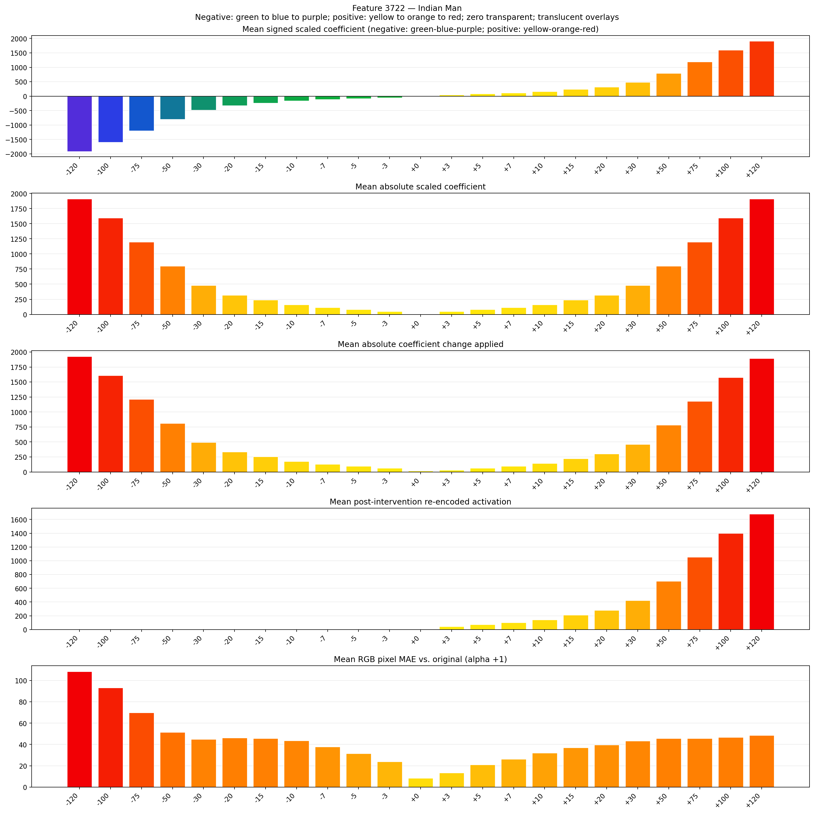
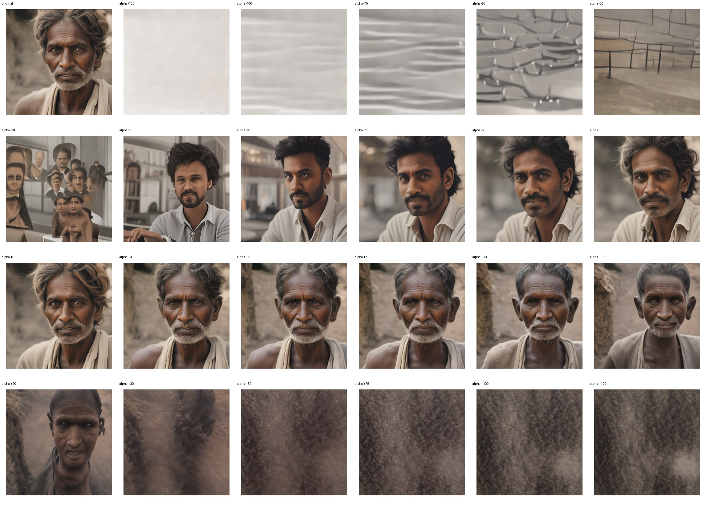
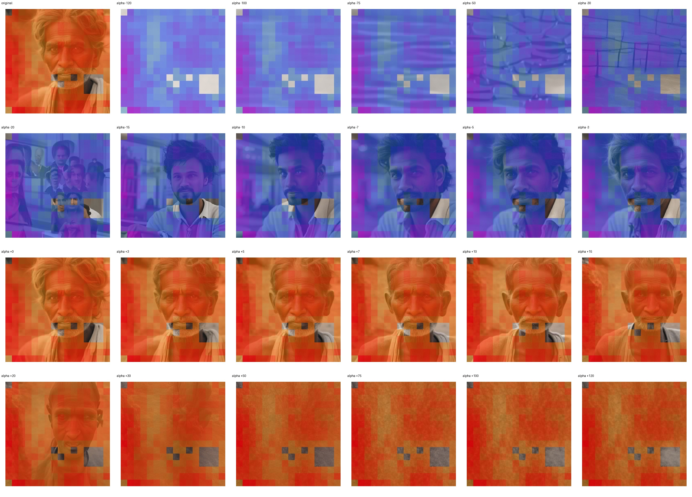
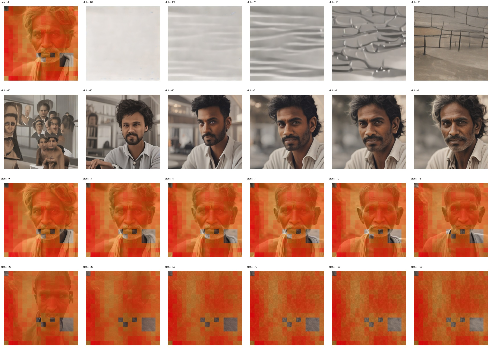

# Feature 3722 — Indian Man

Biased dataset; original prompt and seed replay for seeds 0–19. Values are means across 20 source images. The table reports the mean post-re-encoded activation of feature 3722, the active spatial fraction, mean RGB pixel MAE versus the original image (0–255 scale), and coefficient change magnitudes for each alpha.

## Activation graph

## Mean metrics by alpha

| Alpha | Mean post-reencoded feature 3722 activation | Active spatial fraction | Mean pixel change (MAE) | Mean absolute coefficient change | Mean absolute scaled coefficient |
|---:|---:|---:|---:|---:|---:|
| -120 | 0.000 | 0.000 | 108.360 | 1926.404 | 1910.484 |
| -100 | 0.000 | 0.000 | 93.167 | 1607.991 | 1592.070 |
| -75 | 0.000 | 0.000 | 69.796 | 1209.973 | 1194.052 |
| -50 | 0.000 | 0.000 | 51.490 | 811.956 | 796.035 |
| -30 | 0.000 | 0.000 | 44.707 | 493.542 | 477.621 |
| -20 | 0.000 | 0.000 | 46.050 | 334.335 | 318.414 |
| -15 | 0.000 | 0.000 | 45.492 | 254.731 | 238.810 |
| -10 | 0.000 | 0.000 | 43.522 | 175.128 | 159.207 |
| -7 | 0.000 | 0.000 | 37.735 | 127.366 | 111.445 |
| -5 | 0.000 | 0.000 | 31.472 | 95.524 | 79.603 |
| -3 | 0.000 | 0.000 | 23.793 | 63.683 | 47.762 |
| +0 | 0.000 | 0.000 | 8.275 | 15.921 | 0.000 |
| +3 | 43.880 | 0.947 | 13.321 | 31.841 | 47.762 |
| +5 | 71.840 | 0.947 | 20.946 | 63.683 | 79.603 |
| +7 | 99.800 | 0.947 | 26.297 | 95.524 | 111.445 |
| +10 | 141.740 | 0.947 | 31.864 | 143.286 | 159.207 |
| +15 | 211.639 | 0.947 | 36.857 | 222.890 | 238.810 |
| +20 | 281.539 | 0.947 | 39.604 | 302.493 | 318.414 |
| +30 | 421.338 | 0.947 | 43.303 | 461.700 | 477.621 |
| +50 | 700.936 | 0.947 | 45.687 | 780.114 | 796.035 |
| +75 | 1050.434 | 0.947 | 45.632 | 1178.132 | 1194.052 |
| +100 | 1399.931 | 0.947 | 46.727 | 1576.149 | 1592.070 |
| +120 | 1679.529 | 0.947 | 48.413 | 1894.563 | 1910.484 |

## Per-seed grids

Each 4×6 sheet contains the original followed by the 23 alpha variants in ascending alpha order, from −120 through +120.

### Plain images

[All 20 plain-image grids](seed_sheets/)

### Signed coefficient overlays

[All 20 signed coefficient grids](signed_coefficient_overlays/)

### Post-re-encoded activation overlays

[All 20 post-activation grids](post_activation_overlays/)

### Intervention-footprint overlays

[All 20 intervention-footprint grids](intervention_footprint_overlays/)

Zero is transparent. Negative coefficient colors progress green through blue to purple; positive colors progress yellow through orange to red. Each map tile is normalized individually for visibility. The original and alpha-zero tiles show the pre-intervention feature map so its location remains visible.
