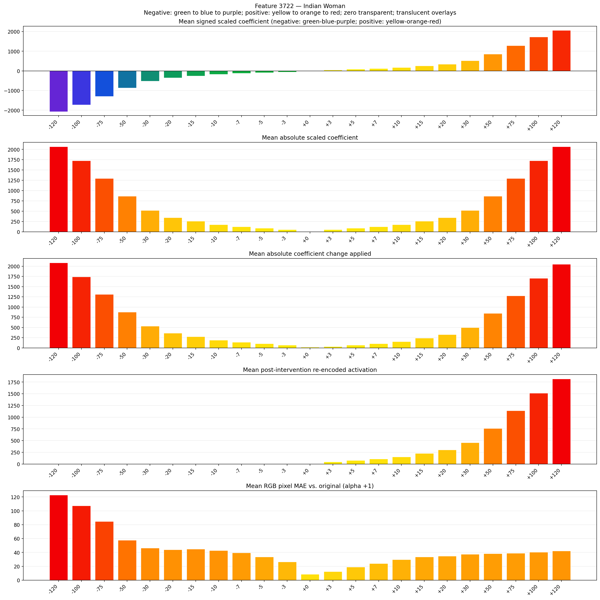
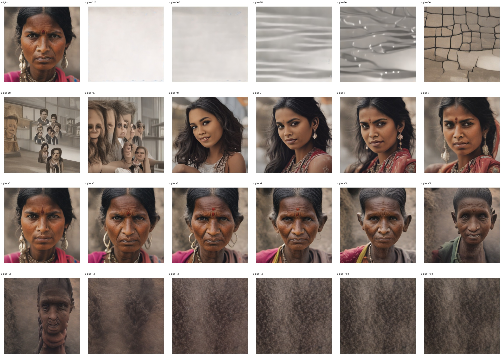
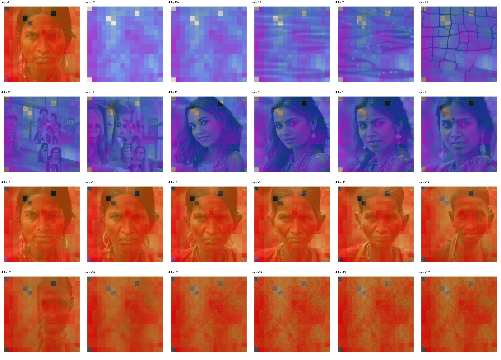
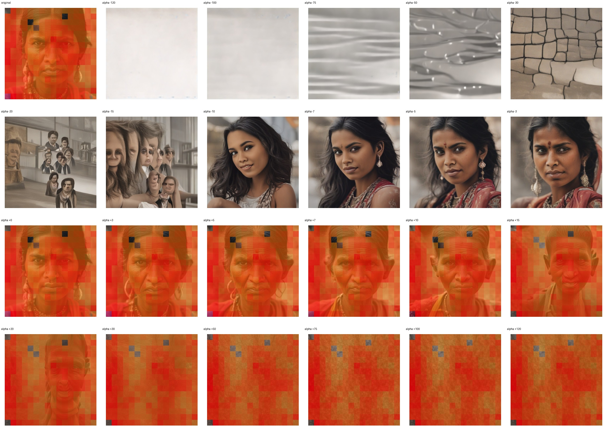

# Feature 3722 — Indian Woman

Biased dataset; original prompt and seed replay for seeds 0–19. Values are means across 20 source images. The table reports the mean post-re-encoded activation of feature 3722, the active spatial fraction, mean RGB pixel MAE versus the original image (0–255 scale), and coefficient change magnitudes for each alpha.

## Activation graph

## Mean metrics by alpha

| Alpha | Mean post-reencoded feature 3722 activation | Active spatial fraction | Mean pixel change (MAE) | Mean absolute coefficient change | Mean absolute scaled coefficient |
|---:|---:|---:|---:|---:|---:|
| -120 | 0.000 | 0.000 | 122.839 | 2085.308 | 2068.074 |
| -100 | 0.000 | 0.000 | 107.365 | 1740.629 | 1723.395 |
| -75 | 0.000 | 0.000 | 84.649 | 1309.780 | 1292.547 |
| -50 | 0.000 | 0.000 | 57.789 | 878.932 | 861.698 |
| -30 | 0.000 | 0.000 | 46.212 | 534.253 | 517.019 |
| -20 | 0.000 | 0.000 | 44.095 | 361.913 | 344.679 |
| -15 | 0.000 | 0.000 | 44.932 | 275.743 | 258.509 |
| -10 | 0.000 | 0.000 | 42.882 | 189.573 | 172.340 |
| -7 | 0.000 | 0.000 | 39.435 | 137.872 | 120.638 |
| -5 | 0.000 | 0.000 | 33.596 | 103.404 | 86.170 |
| -3 | 0.000 | 0.000 | 26.310 | 68.936 | 51.702 |
| +0 | 0.000 | 0.000 | 8.527 | 17.234 | 0.000 |
| +3 | 47.500 | 0.967 | 12.453 | 34.468 | 51.702 |
| +5 | 77.766 | 0.967 | 19.049 | 68.936 | 86.170 |
| +7 | 108.032 | 0.967 | 24.187 | 103.404 | 120.638 |
| +10 | 153.431 | 0.967 | 29.606 | 155.106 | 172.340 |
| +15 | 229.097 | 0.967 | 33.614 | 241.275 | 258.509 |
| +20 | 304.762 | 0.967 | 34.852 | 327.445 | 344.679 |
| +30 | 456.093 | 0.967 | 37.504 | 499.785 | 517.019 |
| +50 | 758.754 | 0.967 | 38.293 | 844.464 | 861.698 |
| +75 | 1137.081 | 0.967 | 39.061 | 1275.313 | 1292.547 |
| +100 | 1515.408 | 0.967 | 40.492 | 1706.161 | 1723.395 |
| +120 | 1818.068 | 0.967 | 42.265 | 2050.840 | 2068.074 |

## Per-seed grids

Each 4×6 sheet contains the original followed by the 23 alpha variants in ascending alpha order, from −120 through +120.

### Plain images

[All 20 plain-image grids](seed_sheets/)

### Signed coefficient overlays

[All 20 signed coefficient grids](signed_coefficient_overlays/)

### Post-re-encoded activation overlays

[All 20 post-activation grids](post_activation_overlays/)

### Intervention-footprint overlays

[All 20 intervention-footprint grids](intervention_footprint_overlays/)

Zero is transparent. Negative coefficient colors progress green through blue to purple; positive colors progress yellow through orange to red. Each map tile is normalized individually for visibility. The original and alpha-zero tiles show the pre-intervention feature map so its location remains visible.
