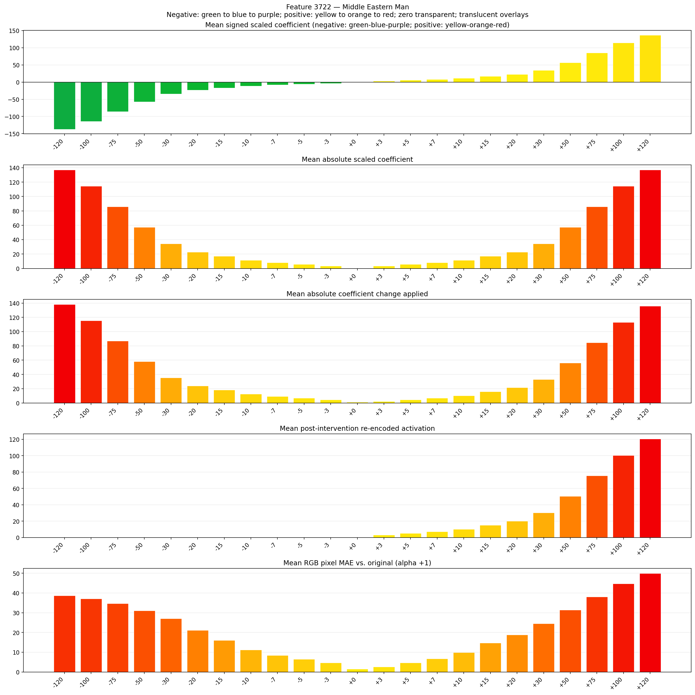
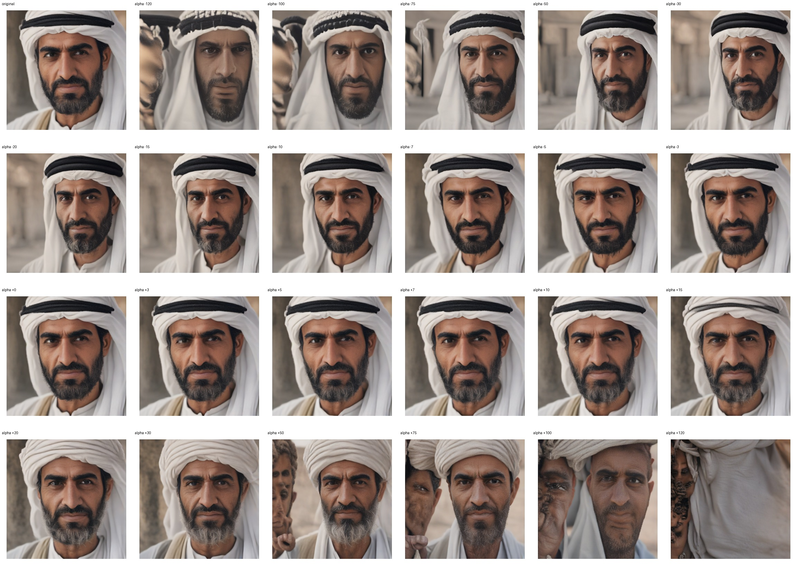
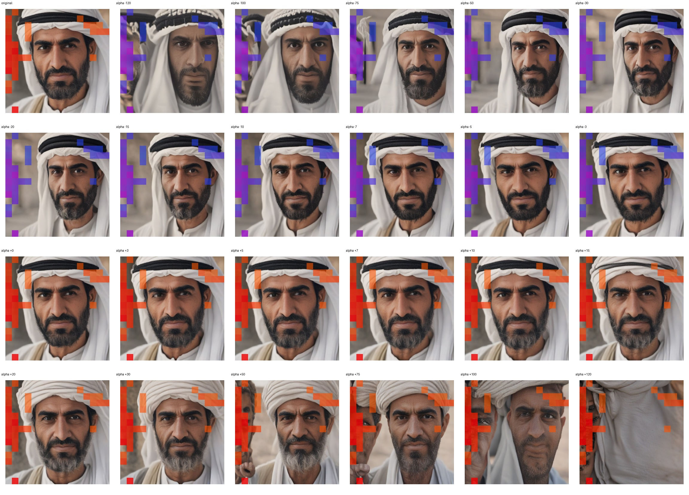
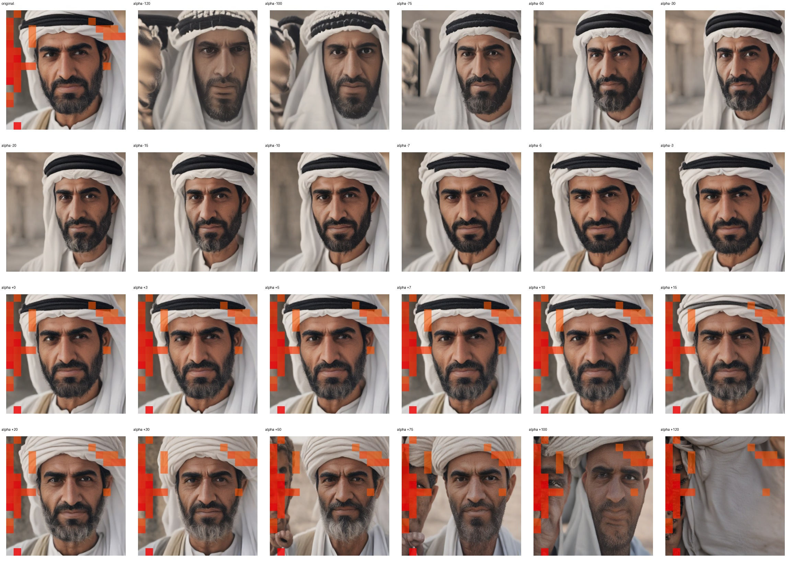

# Feature 3722 — Middle Eastern Man

Biased dataset; original prompt and seed replay for seeds 0–19. Values are means across 20 source images. The table reports the mean post-re-encoded activation of feature 3722, the active spatial fraction, mean RGB pixel MAE versus the original image (0–255 scale), and coefficient change magnitudes for each alpha.

## Activation graph

## Mean metrics by alpha

| Alpha | Mean post-reencoded feature 3722 activation | Active spatial fraction | Mean pixel change (MAE) | Mean absolute coefficient change | Mean absolute scaled coefficient |
|---:|---:|---:|---:|---:|---:|
| -120 | 0.000 | 0.000 | 38.628 | 138.268 | 137.126 |
| -100 | 0.000 | 0.000 | 37.119 | 115.414 | 114.271 |
| -75 | 0.000 | 0.000 | 34.686 | 86.846 | 85.703 |
| -50 | 0.000 | 0.000 | 31.089 | 58.278 | 57.136 |
| -30 | 0.000 | 0.000 | 27.068 | 35.424 | 34.281 |
| -20 | 0.000 | 0.000 | 21.086 | 23.997 | 22.854 |
| -15 | 0.000 | 0.000 | 16.053 | 18.283 | 17.141 |
| -10 | 0.000 | 0.000 | 11.276 | 12.570 | 11.427 |
| -7 | 0.000 | 0.000 | 8.430 | 9.142 | 7.999 |
| -5 | 0.000 | 0.000 | 6.542 | 6.856 | 5.714 |
| -3 | 0.000 | 0.000 | 4.637 | 4.571 | 3.428 |
| +0 | 0.000 | 0.000 | 1.529 | 1.143 | 0.000 |
| +3 | 3.150 | 0.126 | 2.644 | 2.285 | 3.428 |
| +5 | 5.156 | 0.126 | 4.736 | 4.571 | 5.714 |
| +7 | 7.163 | 0.126 | 6.797 | 6.856 | 7.999 |
| +10 | 10.173 | 0.126 | 9.863 | 10.284 | 11.427 |
| +15 | 15.190 | 0.126 | 14.753 | 15.998 | 17.141 |
| +20 | 20.208 | 0.126 | 18.785 | 21.712 | 22.854 |
| +30 | 30.242 | 0.126 | 24.531 | 33.139 | 34.281 |
| +50 | 50.310 | 0.126 | 31.469 | 55.993 | 57.136 |
| +75 | 75.395 | 0.126 | 38.044 | 84.561 | 85.703 |
| +100 | 100.480 | 0.126 | 44.720 | 113.129 | 114.271 |
| +120 | 120.549 | 0.126 | 49.938 | 135.983 | 137.126 |

## Per-seed grids

Each 4×6 sheet contains the original followed by the 23 alpha variants in ascending alpha order, from −120 through +120.

### Plain images

[All 20 plain-image grids](seed_sheets/)

### Signed coefficient overlays

[All 20 signed coefficient grids](signed_coefficient_overlays/)

### Post-re-encoded activation overlays

[All 20 post-activation grids](post_activation_overlays/)

### Intervention-footprint overlays

[All 20 intervention-footprint grids](intervention_footprint_overlays/)

Zero is transparent. Negative coefficient colors progress green through blue to purple; positive colors progress yellow through orange to red. Each map tile is normalized individually for visibility. The original and alpha-zero tiles show the pre-intervention feature map so its location remains visible.
