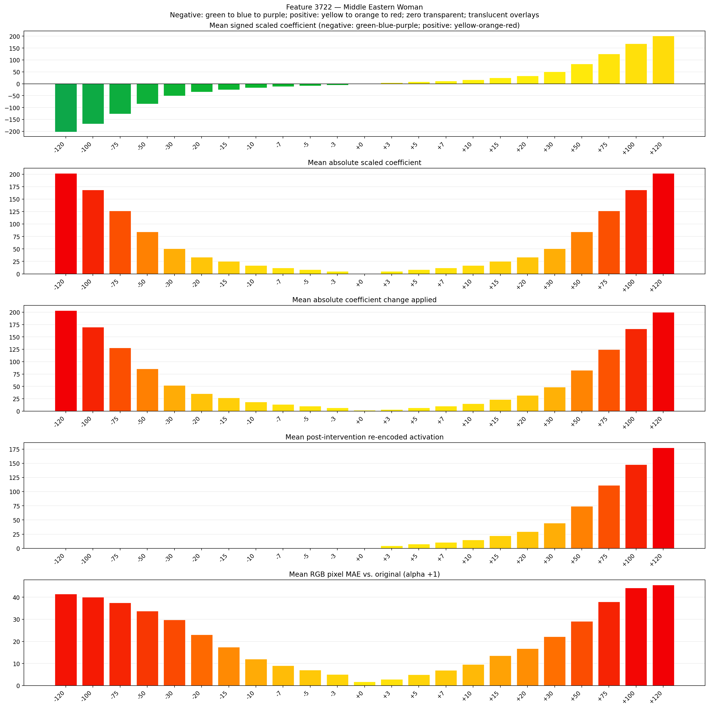
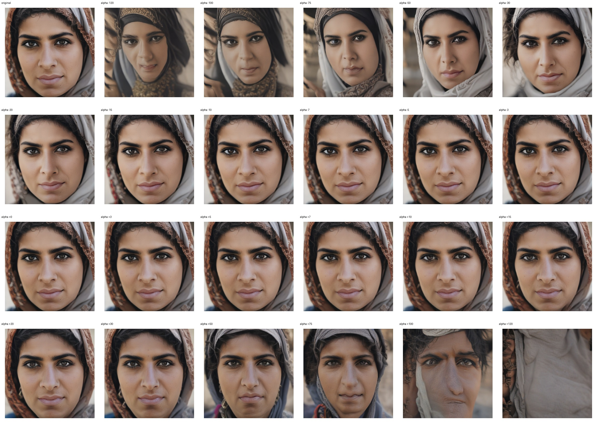
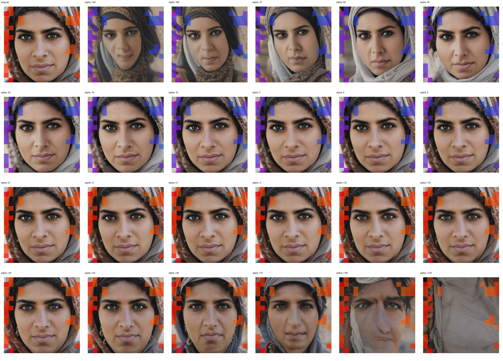
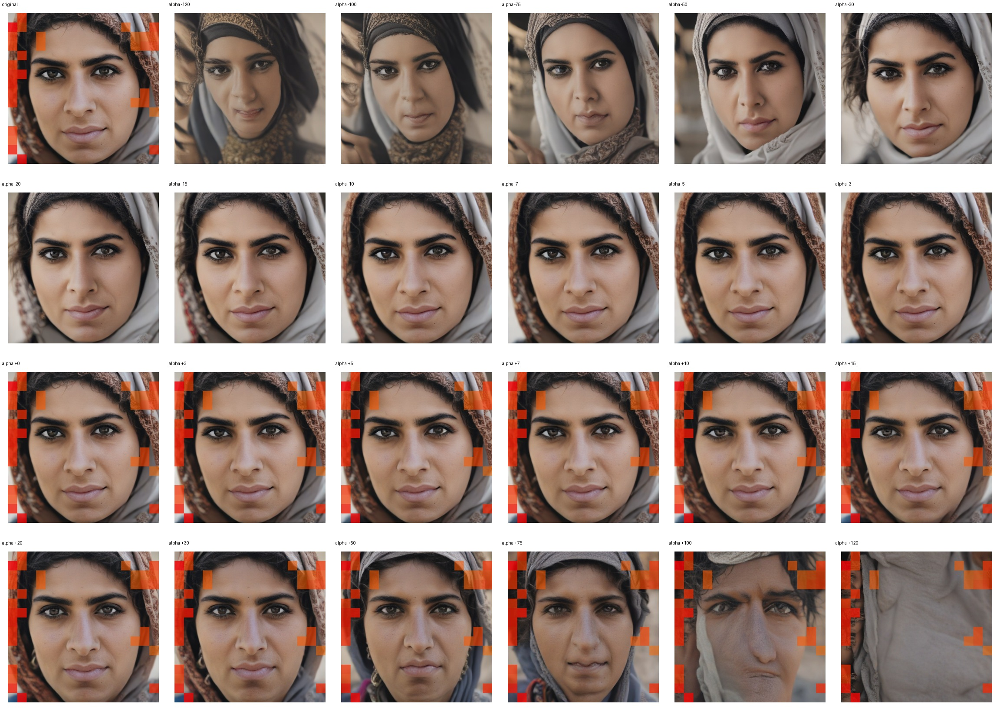

# Feature 3722 — Middle Eastern Woman

Biased dataset; original prompt and seed replay for seeds 0–19. Values are means across 20 source images. The table reports the mean post-re-encoded activation of feature 3722, the active spatial fraction, mean RGB pixel MAE versus the original image (0–255 scale), and coefficient change magnitudes for each alpha.

## Activation graph

## Mean metrics by alpha

| Alpha | Mean post-reencoded feature 3722 activation | Active spatial fraction | Mean pixel change (MAE) | Mean absolute coefficient change | Mean absolute scaled coefficient |
|---:|---:|---:|---:|---:|---:|
| -120 | 0.000 | 0.000 | 41.498 | 203.595 | 201.912 |
| -100 | 0.000 | 0.000 | 40.029 | 169.943 | 168.260 |
| -75 | 0.000 | 0.000 | 37.551 | 127.878 | 126.195 |
| -50 | 0.000 | 0.000 | 33.791 | 85.813 | 84.130 |
| -30 | 0.000 | 0.000 | 29.817 | 52.161 | 50.478 |
| -20 | 0.000 | 0.000 | 23.056 | 35.335 | 33.652 |
| -15 | 0.000 | 0.000 | 17.406 | 26.922 | 25.239 |
| -10 | 0.000 | 0.000 | 11.972 | 18.509 | 16.826 |
| -7 | 0.000 | 0.000 | 8.997 | 13.461 | 11.778 |
| -5 | 0.000 | 0.000 | 7.035 | 10.096 | 8.413 |
| -3 | 0.000 | 0.000 | 5.026 | 6.730 | 5.048 |
| +0 | 0.000 | 0.000 | 1.714 | 1.683 | 0.000 |
| +3 | 4.638 | 0.185 | 2.862 | 3.365 | 5.048 |
| +5 | 7.593 | 0.185 | 4.965 | 6.730 | 8.413 |
| +7 | 10.548 | 0.185 | 6.950 | 10.096 | 11.778 |
| +10 | 14.980 | 0.185 | 9.610 | 15.143 | 16.826 |
| +15 | 22.367 | 0.185 | 13.499 | 23.556 | 25.239 |
| +20 | 29.755 | 0.185 | 16.808 | 31.969 | 33.652 |
| +30 | 44.530 | 0.185 | 22.113 | 48.796 | 50.478 |
| +50 | 74.080 | 0.185 | 29.098 | 82.448 | 84.130 |
| +75 | 111.017 | 0.185 | 37.971 | 124.513 | 126.195 |
| +100 | 147.954 | 0.185 | 44.195 | 166.578 | 168.260 |
| +120 | 177.504 | 0.185 | 45.568 | 200.230 | 201.912 |

## Per-seed grids

Each 4×6 sheet contains the original followed by the 23 alpha variants in ascending alpha order, from −120 through +120.

### Plain images

[All 20 plain-image grids](seed_sheets/)

### Signed coefficient overlays

[All 20 signed coefficient grids](signed_coefficient_overlays/)

### Post-re-encoded activation overlays

[All 20 post-activation grids](post_activation_overlays/)

### Intervention-footprint overlays

[All 20 intervention-footprint grids](intervention_footprint_overlays/)

Zero is transparent. Negative coefficient colors progress green through blue to purple; positive colors progress yellow through orange to red. Each map tile is normalized individually for visibility. The original and alpha-zero tiles show the pre-intervention feature map so its location remains visible.
