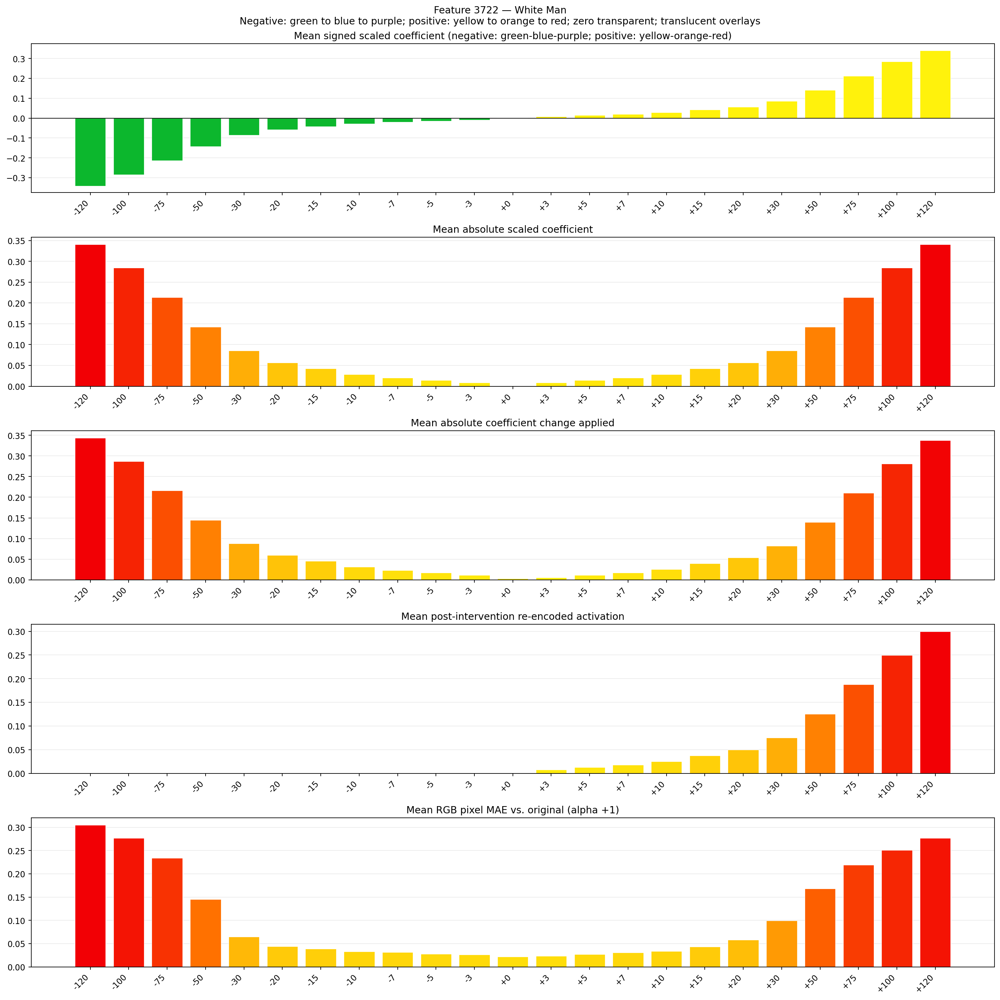
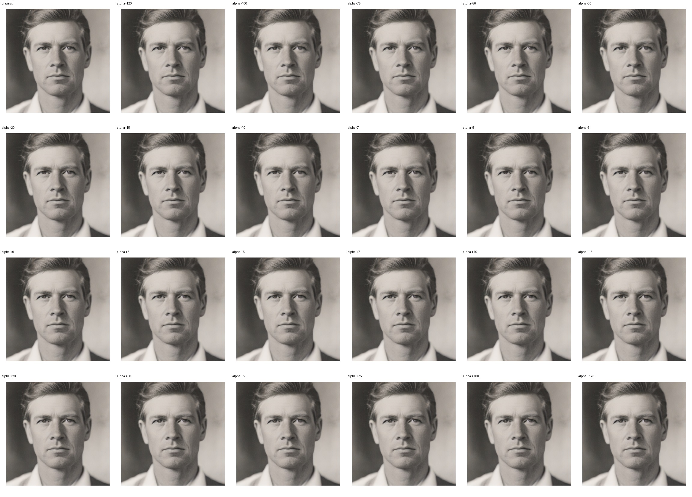
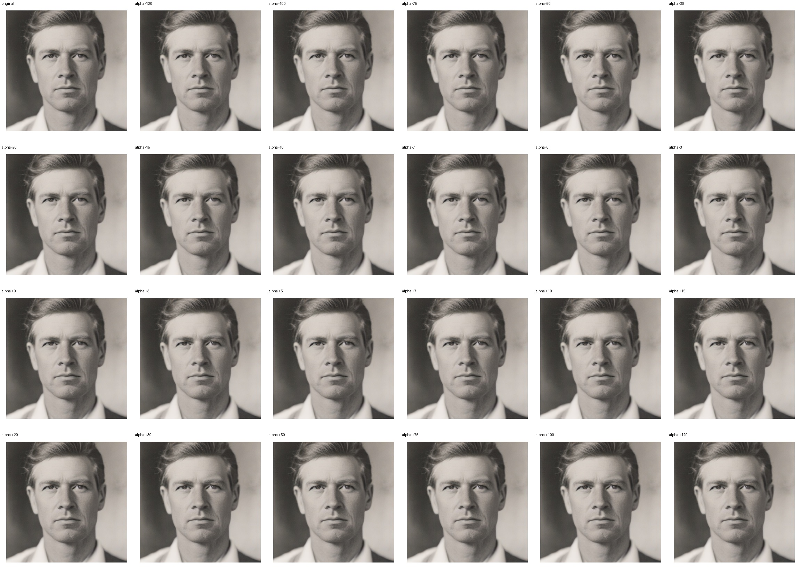

# Feature 3722 — White Man

Biased dataset; original prompt and seed replay for seeds 0–19. Values are means across 20 source images. The table reports the mean post-re-encoded activation of feature 3722, the active spatial fraction, mean RGB pixel MAE versus the original image (0–255 scale), and coefficient change magnitudes for each alpha.

## Activation graph

## Mean metrics by alpha

| Alpha | Mean post-reencoded feature 3722 activation | Active spatial fraction | Mean pixel change (MAE) | Mean absolute coefficient change | Mean absolute scaled coefficient |
|---:|---:|---:|---:|---:|---:|
| -120 | 0.000 | 0.000 | 0.305 | 0.344 | 0.341 |
| -100 | 0.000 | 0.000 | 0.276 | 0.287 | 0.284 |
| -75 | 0.000 | 0.000 | 0.234 | 0.216 | 0.213 |
| -50 | 0.000 | 0.000 | 0.145 | 0.145 | 0.142 |
| -30 | 0.000 | 0.000 | 0.065 | 0.088 | 0.085 |
| -20 | 0.000 | 0.000 | 0.044 | 0.060 | 0.057 |
| -15 | 0.000 | 0.000 | 0.039 | 0.045 | 0.043 |
| -10 | 0.000 | 0.000 | 0.033 | 0.031 | 0.028 |
| -7 | 0.000 | 0.000 | 0.032 | 0.023 | 0.020 |
| -5 | 0.000 | 0.000 | 0.028 | 0.017 | 0.014 |
| -3 | 0.000 | 0.000 | 0.026 | 0.011 | 0.009 |
| +0 | 0.000 | 0.000 | 0.022 | 0.003 | 0.000 |
| +3 | 0.008 | 0.000 | 0.024 | 0.006 | 0.009 |
| +5 | 0.013 | 0.000 | 0.027 | 0.011 | 0.014 |
| +7 | 0.018 | 0.000 | 0.031 | 0.017 | 0.020 |
| +10 | 0.025 | 0.000 | 0.034 | 0.026 | 0.028 |
| +15 | 0.038 | 0.000 | 0.043 | 0.040 | 0.043 |
| +20 | 0.050 | 0.000 | 0.058 | 0.054 | 0.057 |
| +30 | 0.075 | 0.000 | 0.099 | 0.082 | 0.085 |
| +50 | 0.125 | 0.000 | 0.168 | 0.139 | 0.142 |
| +75 | 0.188 | 0.000 | 0.219 | 0.210 | 0.213 |
| +100 | 0.250 | 0.000 | 0.251 | 0.281 | 0.284 |
| +120 | 0.300 | 0.000 | 0.277 | 0.338 | 0.341 |

## Per-seed grids

Each 4×6 sheet contains the original followed by the 23 alpha variants in ascending alpha order, from −120 through +120.

### Plain images

[All 20 plain-image grids](seed_sheets/)

### Signed coefficient overlays

[All 20 signed coefficient grids](signed_coefficient_overlays/)

### Post-re-encoded activation overlays

[All 20 post-activation grids](post_activation_overlays/)

### Intervention-footprint overlays

[All 20 intervention-footprint grids](intervention_footprint_overlays/)

Zero is transparent. Negative coefficient colors progress green through blue to purple; positive colors progress yellow through orange to red. Each map tile is normalized individually for visibility. The original and alpha-zero tiles show the pre-intervention feature map so its location remains visible.
