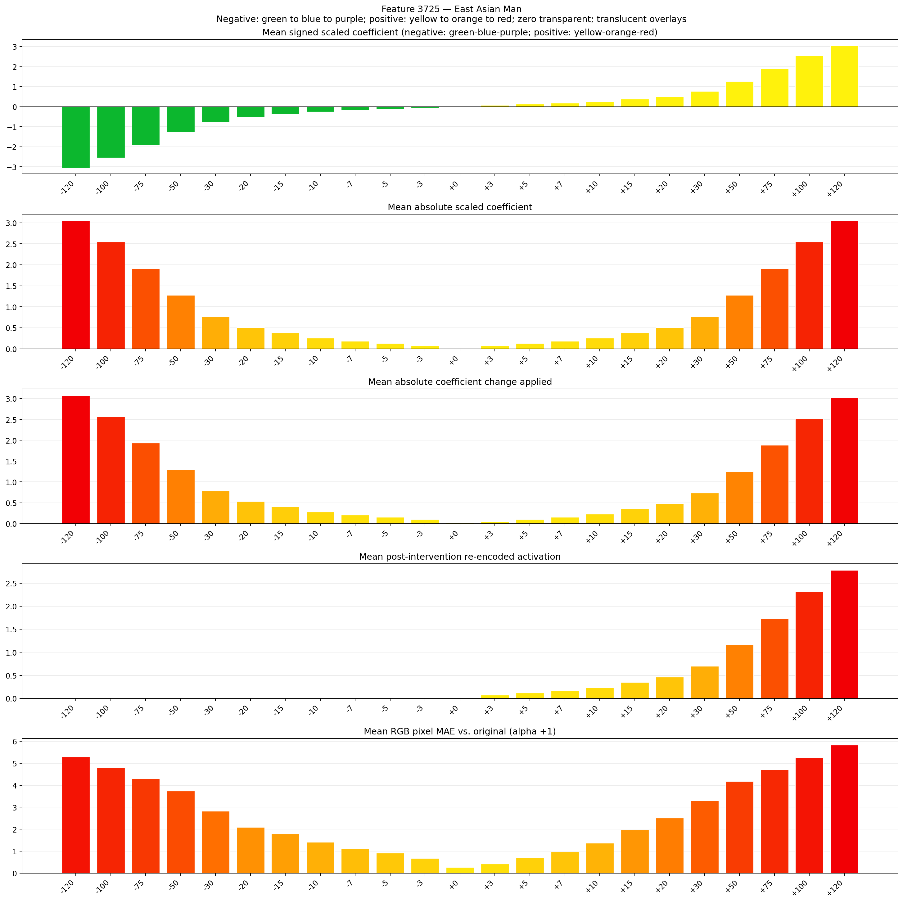
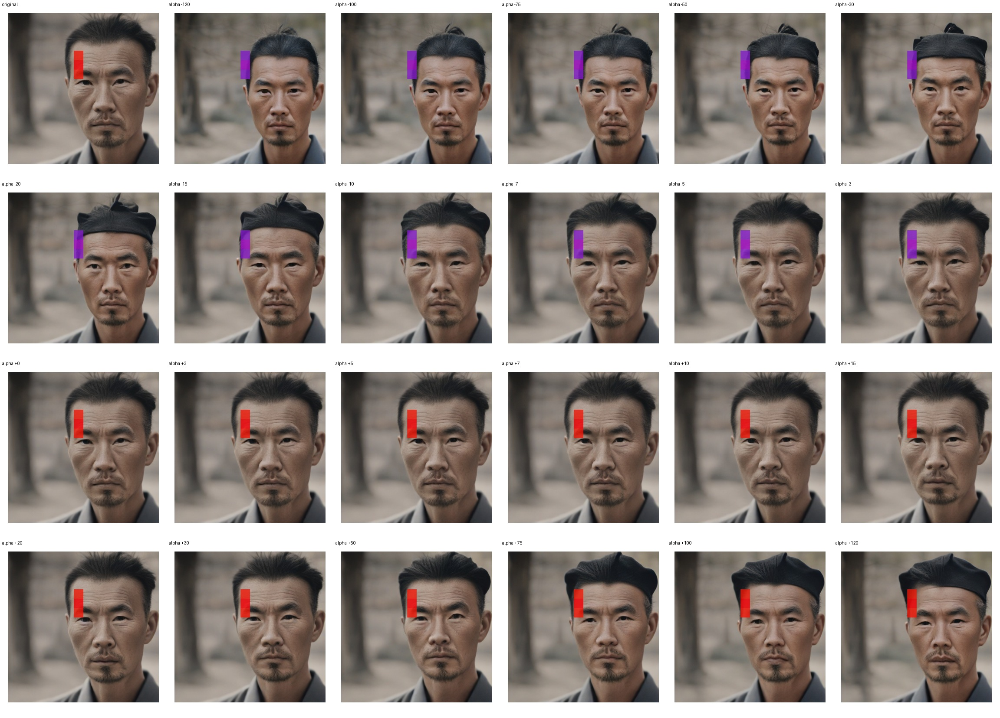
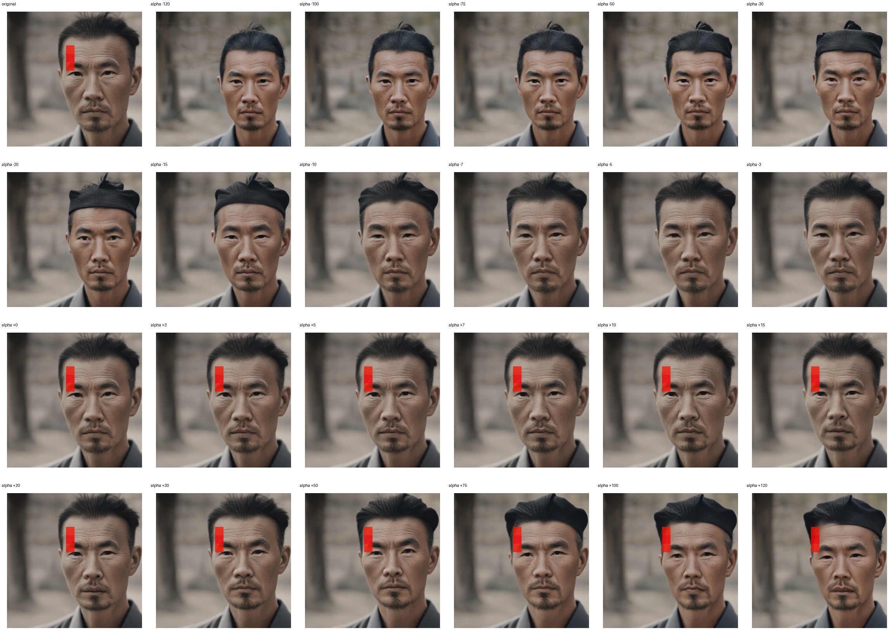

# Feature 3725 — East Asian Man

Biased dataset; original prompt and seed replay for seeds 0–19. Values are means across 20 source images. The table reports the mean post-re-encoded activation of feature 3725, the active spatial fraction, mean RGB pixel MAE versus the original image (0–255 scale), and coefficient change magnitudes for each alpha.

## Activation graph

## Mean metrics by alpha

| Alpha | Mean post-reencoded feature 3725 activation | Active spatial fraction | Mean pixel change (MAE) | Mean absolute coefficient change | Mean absolute scaled coefficient |
|---:|---:|---:|---:|---:|---:|
| -120 | 0.000 | 0.000 | 5.300 | 3.077 | 3.052 |
| -100 | 0.000 | 0.000 | 4.812 | 2.569 | 2.543 |
| -75 | 0.000 | 0.000 | 4.304 | 1.933 | 1.907 |
| -50 | 0.000 | 0.000 | 3.737 | 1.297 | 1.272 |
| -30 | 0.000 | 0.000 | 2.818 | 0.788 | 0.763 |
| -20 | 0.000 | 0.000 | 2.083 | 0.534 | 0.509 |
| -15 | 0.000 | 0.000 | 1.787 | 0.407 | 0.381 |
| -10 | 0.000 | 0.000 | 1.416 | 0.280 | 0.254 |
| -7 | 0.000 | 0.000 | 1.116 | 0.203 | 0.178 |
| -5 | 0.000 | 0.000 | 0.909 | 0.153 | 0.127 |
| -3 | 0.000 | 0.000 | 0.676 | 0.102 | 0.076 |
| +0 | 0.000 | 0.000 | 0.263 | 0.025 | 0.000 |
| +3 | 0.072 | 0.003 | 0.414 | 0.051 | 0.076 |
| +5 | 0.118 | 0.003 | 0.700 | 0.102 | 0.127 |
| +7 | 0.164 | 0.003 | 0.974 | 0.153 | 0.178 |
| +10 | 0.234 | 0.003 | 1.365 | 0.229 | 0.254 |
| +15 | 0.350 | 0.003 | 1.979 | 0.356 | 0.381 |
| +20 | 0.466 | 0.003 | 2.514 | 0.483 | 0.509 |
| +30 | 0.697 | 0.003 | 3.307 | 0.738 | 0.763 |
| +50 | 1.160 | 0.003 | 4.182 | 1.246 | 1.272 |
| +75 | 1.739 | 0.003 | 4.722 | 1.882 | 1.907 |
| +100 | 2.319 | 0.003 | 5.265 | 2.518 | 2.543 |
| +120 | 2.782 | 0.003 | 5.834 | 3.027 | 3.052 |

## Per-seed grids

Each 4×6 sheet contains the original followed by the 23 alpha variants in ascending alpha order, from −120 through +120.

### Plain images

[All 20 plain-image grids](seed_sheets/)

### Signed coefficient overlays

[All 20 signed coefficient grids](signed_coefficient_overlays/)

### Post-re-encoded activation overlays

[All 20 post-activation grids](post_activation_overlays/)

### Intervention-footprint overlays

[All 20 intervention-footprint grids](intervention_footprint_overlays/)

Zero is transparent. Negative coefficient colors progress green through blue to purple; positive colors progress yellow through orange to red. Each map tile is normalized individually for visibility. The original and alpha-zero tiles show the pre-intervention feature map so its location remains visible.
