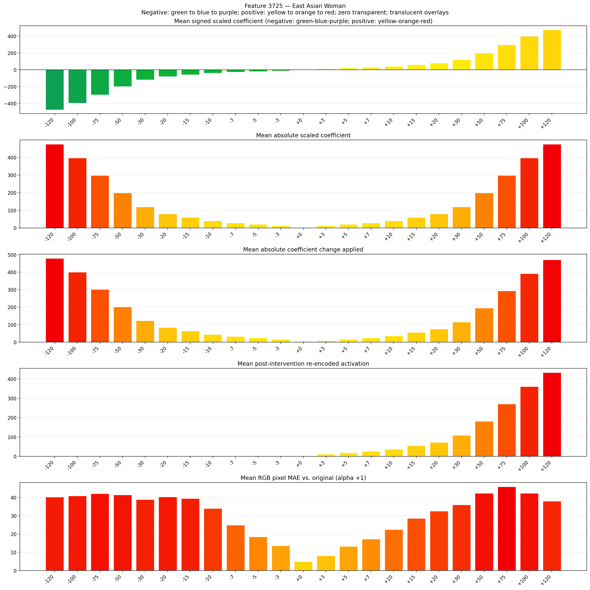
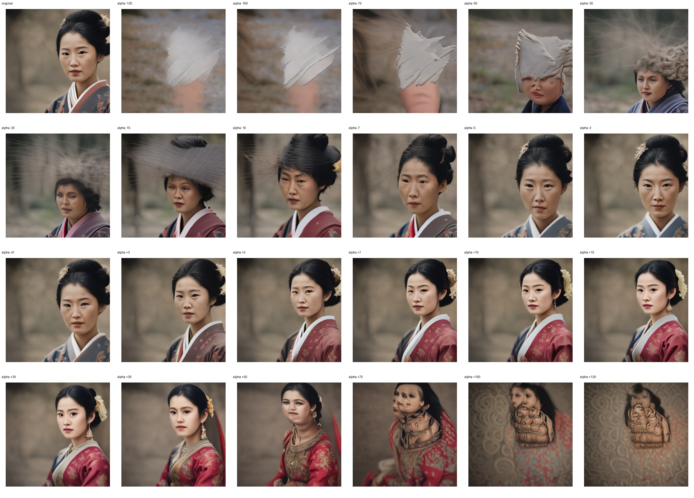
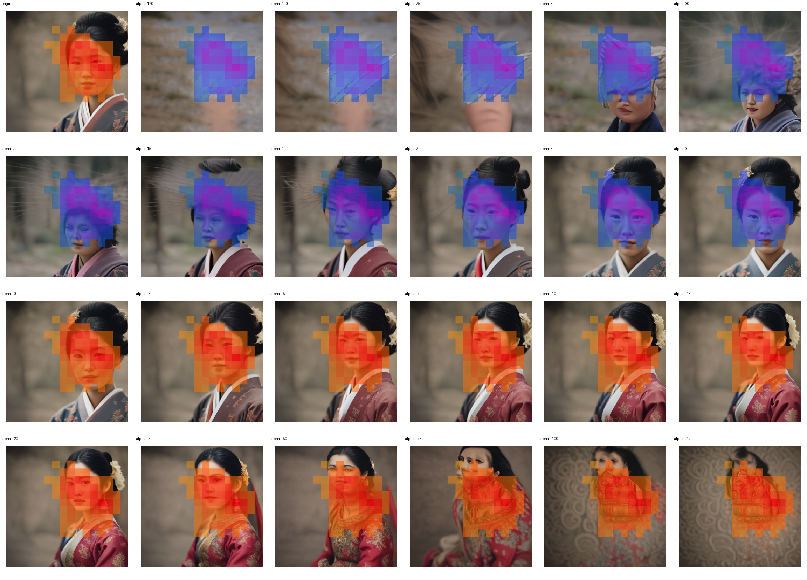
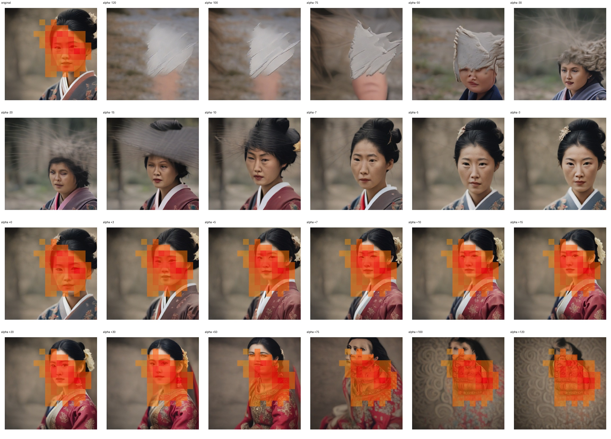

# Feature 3725 — East Asian Woman

Biased dataset; original prompt and seed replay for seeds 0–19. Values are means across 20 source images. The table reports the mean post-re-encoded activation of feature 3725, the active spatial fraction, mean RGB pixel MAE versus the original image (0–255 scale), and coefficient change magnitudes for each alpha.

## Activation graph

## Mean metrics by alpha

| Alpha | Mean post-reencoded feature 3725 activation | Active spatial fraction | Mean pixel change (MAE) | Mean absolute coefficient change | Mean absolute scaled coefficient |
|---:|---:|---:|---:|---:|---:|
| -120 | 0.000 | 0.000 | 40.231 | 478.638 | 474.683 |
| -100 | 0.000 | 0.000 | 40.917 | 399.525 | 395.569 |
| -75 | 0.000 | 0.000 | 42.112 | 300.632 | 296.677 |
| -50 | 0.000 | 0.000 | 41.435 | 201.740 | 197.784 |
| -30 | 0.000 | 0.000 | 38.828 | 122.626 | 118.671 |
| -20 | 0.000 | 0.000 | 40.319 | 83.069 | 79.114 |
| -15 | 0.000 | 0.000 | 39.390 | 63.291 | 59.335 |
| -10 | 0.000 | 0.000 | 33.949 | 43.513 | 39.557 |
| -7 | 0.000 | 0.000 | 24.826 | 31.646 | 27.690 |
| -5 | 0.000 | 0.000 | 18.426 | 23.734 | 19.778 |
| -3 | 0.000 | 0.000 | 13.501 | 15.823 | 11.867 |
| +0 | 0.000 | 0.000 | 4.824 | 3.956 | 0.000 |
| +3 | 11.161 | 0.270 | 8.102 | 7.911 | 11.867 |
| +5 | 18.366 | 0.270 | 13.147 | 15.823 | 19.778 |
| +7 | 25.572 | 0.270 | 17.250 | 23.734 | 27.690 |
| +10 | 36.380 | 0.270 | 22.445 | 35.601 | 39.557 |
| +15 | 54.393 | 0.270 | 28.550 | 55.380 | 59.335 |
| +20 | 72.407 | 0.270 | 32.522 | 75.158 | 79.114 |
| +30 | 108.433 | 0.270 | 35.943 | 114.715 | 118.671 |
| +50 | 180.487 | 0.270 | 42.360 | 193.829 | 197.784 |
| +75 | 270.554 | 0.270 | 45.880 | 292.721 | 296.677 |
| +100 | 360.620 | 0.270 | 42.316 | 391.613 | 395.569 |
| +120 | 432.674 | 0.270 | 37.954 | 470.727 | 474.683 |

## Per-seed grids

Each 4×6 sheet contains the original followed by the 23 alpha variants in ascending alpha order, from −120 through +120.

### Plain images

[All 20 plain-image grids](seed_sheets/)

### Signed coefficient overlays

[All 20 signed coefficient grids](signed_coefficient_overlays/)

### Post-re-encoded activation overlays

[All 20 post-activation grids](post_activation_overlays/)

### Intervention-footprint overlays

[All 20 intervention-footprint grids](intervention_footprint_overlays/)

Zero is transparent. Negative coefficient colors progress green through blue to purple; positive colors progress yellow through orange to red. Each map tile is normalized individually for visibility. The original and alpha-zero tiles show the pre-intervention feature map so its location remains visible.
