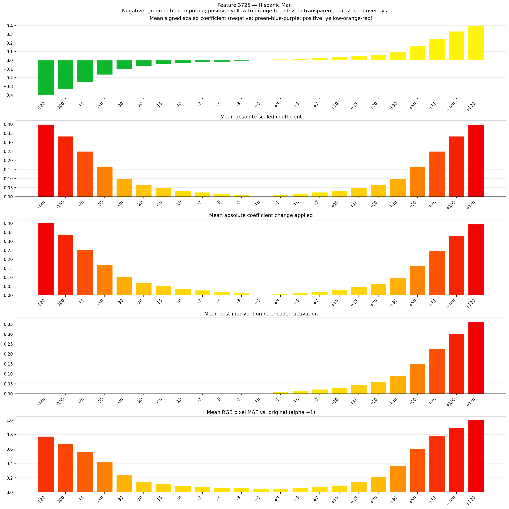
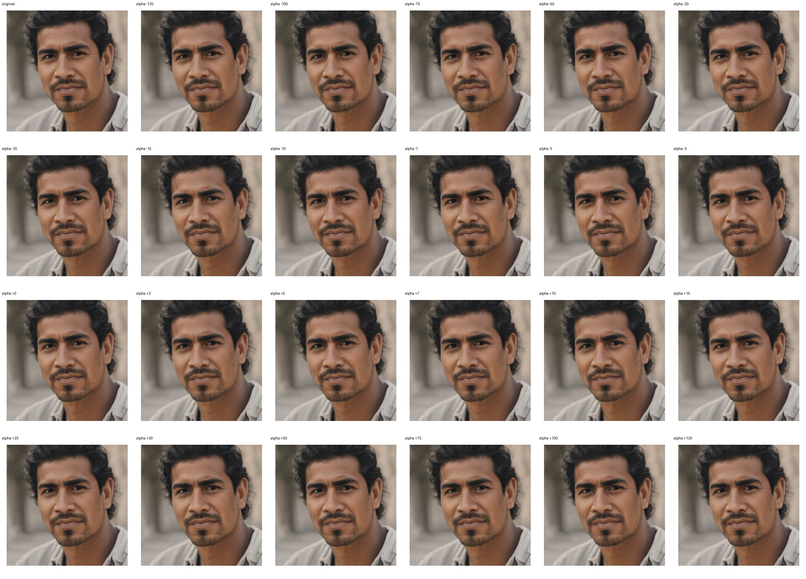
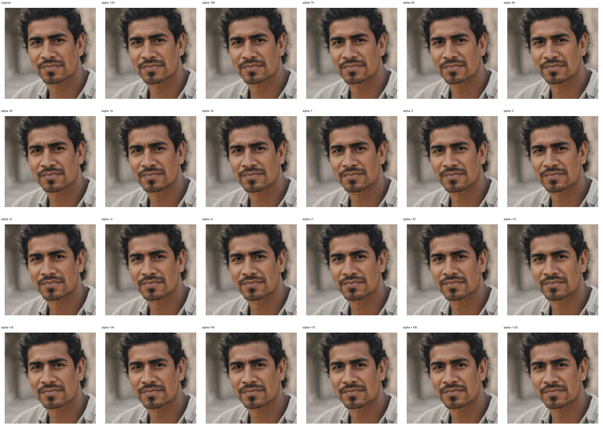

# Feature 3725 — Hispanic Man

Biased dataset; original prompt and seed replay for seeds 0–19. Values are means across 20 source images. The table reports the mean post-re-encoded activation of feature 3725, the active spatial fraction, mean RGB pixel MAE versus the original image (0–255 scale), and coefficient change magnitudes for each alpha.

## Activation graph

## Mean metrics by alpha

| Alpha | Mean post-reencoded feature 3725 activation | Active spatial fraction | Mean pixel change (MAE) | Mean absolute coefficient change | Mean absolute scaled coefficient |
|---:|---:|---:|---:|---:|---:|
| -120 | 0.000 | 0.000 | 0.775 | 0.401 | 0.398 |
| -100 | 0.000 | 0.000 | 0.673 | 0.335 | 0.332 |
| -75 | 0.000 | 0.000 | 0.557 | 0.252 | 0.249 |
| -50 | 0.000 | 0.000 | 0.419 | 0.169 | 0.166 |
| -30 | 0.000 | 0.000 | 0.236 | 0.103 | 0.099 |
| -20 | 0.000 | 0.000 | 0.140 | 0.070 | 0.066 |
| -15 | 0.000 | 0.000 | 0.112 | 0.053 | 0.050 |
| -10 | 0.000 | 0.000 | 0.090 | 0.036 | 0.033 |
| -7 | 0.000 | 0.000 | 0.075 | 0.027 | 0.023 |
| -5 | 0.000 | 0.000 | 0.066 | 0.020 | 0.017 |
| -3 | 0.000 | 0.000 | 0.055 | 0.013 | 0.010 |
| +0 | 0.000 | 0.000 | 0.049 | 0.003 | 0.000 |
| +3 | 0.009 | 0.000 | 0.048 | 0.007 | 0.010 |
| +5 | 0.015 | 0.000 | 0.059 | 0.013 | 0.017 |
| +7 | 0.021 | 0.000 | 0.071 | 0.020 | 0.023 |
| +10 | 0.030 | 0.000 | 0.094 | 0.030 | 0.033 |
| +15 | 0.046 | 0.000 | 0.144 | 0.046 | 0.050 |
| +20 | 0.061 | 0.000 | 0.211 | 0.063 | 0.066 |
| +30 | 0.091 | 0.000 | 0.366 | 0.096 | 0.099 |
| +50 | 0.151 | 0.000 | 0.605 | 0.162 | 0.166 |
| +75 | 0.227 | 0.000 | 0.777 | 0.245 | 0.249 |
| +100 | 0.302 | 0.000 | 0.893 | 0.328 | 0.332 |
| +120 | 0.363 | 0.000 | 1.002 | 0.395 | 0.398 |

## Per-seed grids

Each 4×6 sheet contains the original followed by the 23 alpha variants in ascending alpha order, from −120 through +120.

### Plain images

[All 20 plain-image grids](seed_sheets/)

### Signed coefficient overlays

[All 20 signed coefficient grids](signed_coefficient_overlays/)

### Post-re-encoded activation overlays

[All 20 post-activation grids](post_activation_overlays/)

### Intervention-footprint overlays

[All 20 intervention-footprint grids](intervention_footprint_overlays/)

Zero is transparent. Negative coefficient colors progress green through blue to purple; positive colors progress yellow through orange to red. Each map tile is normalized individually for visibility. The original and alpha-zero tiles show the pre-intervention feature map so its location remains visible.
