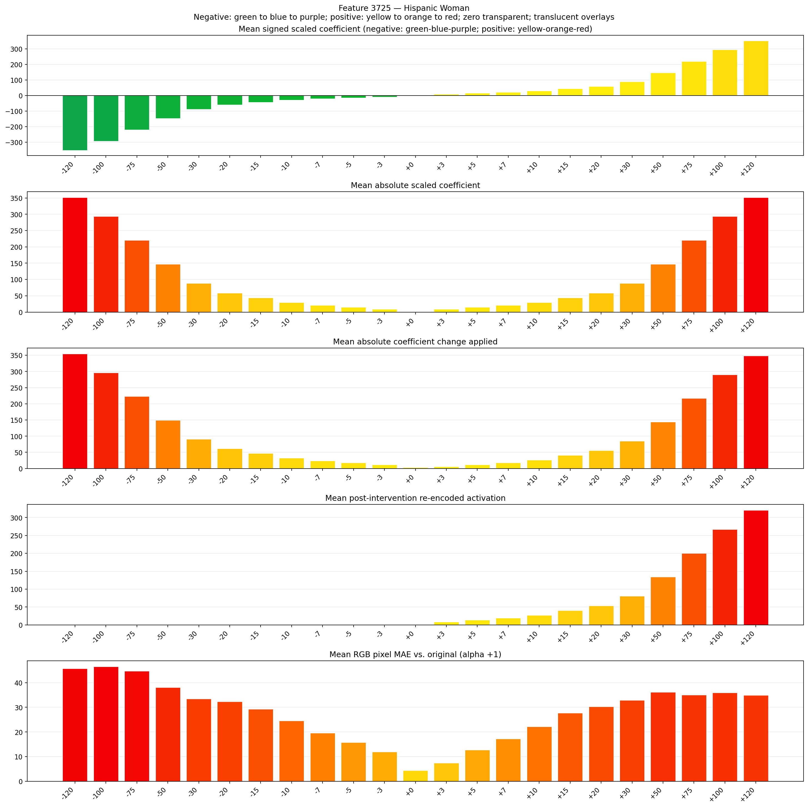
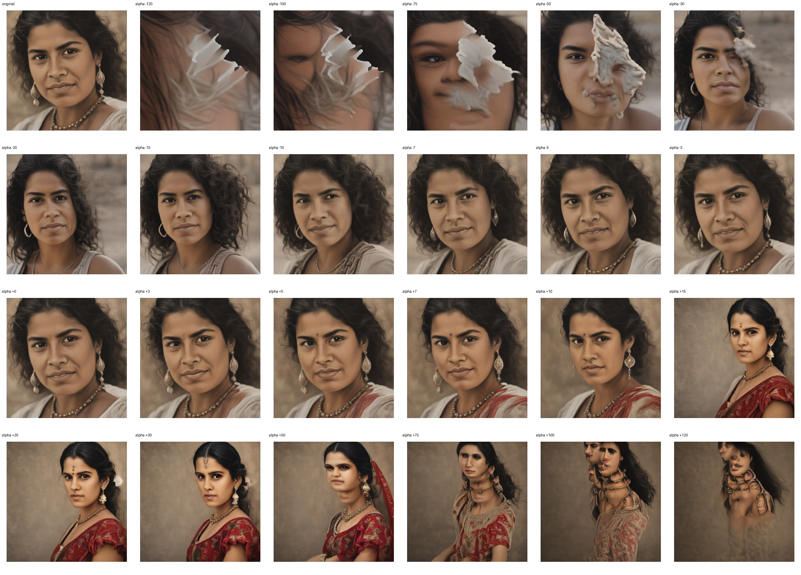
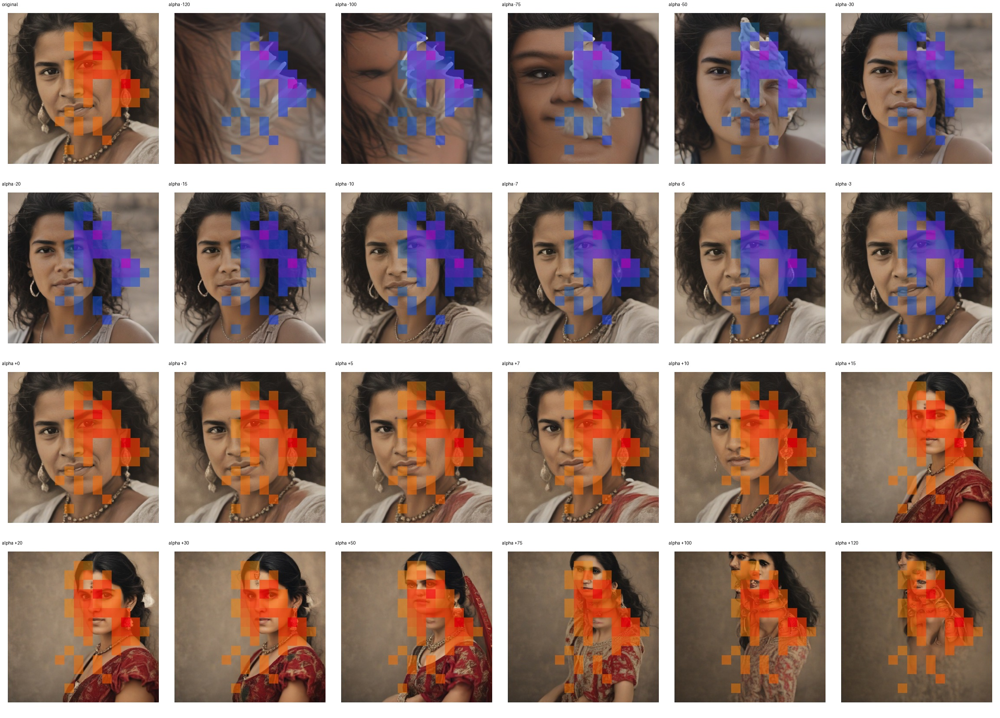
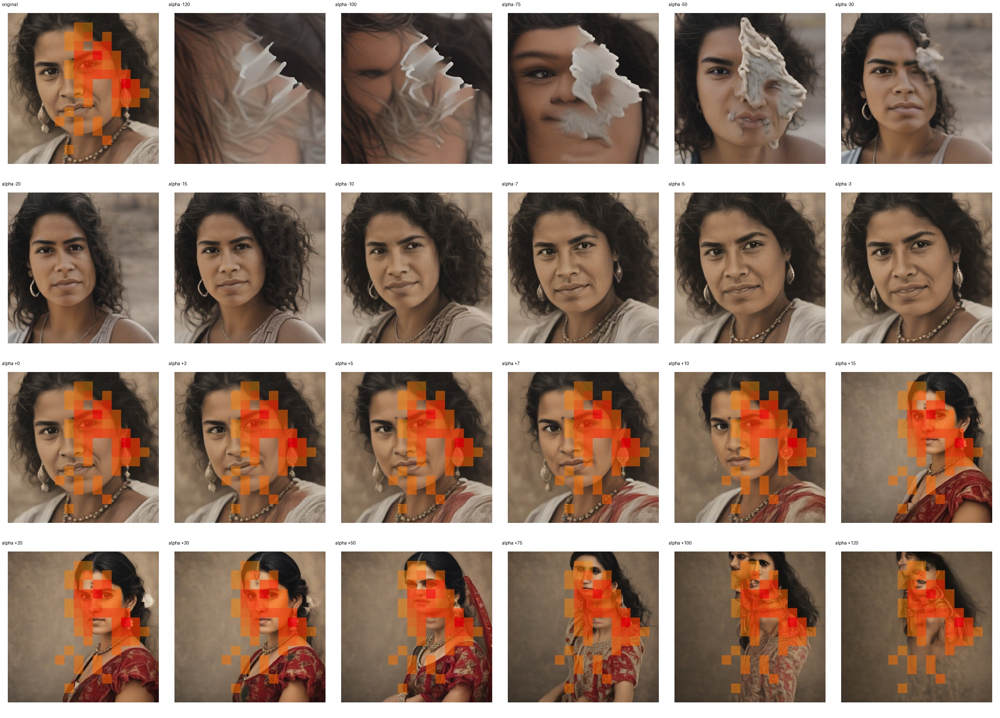

# Feature 3725 — Hispanic Woman

Biased dataset; original prompt and seed replay for seeds 0–19. Values are means across 20 source images. The table reports the mean post-re-encoded activation of feature 3725, the active spatial fraction, mean RGB pixel MAE versus the original image (0–255 scale), and coefficient change magnitudes for each alpha.

## Activation graph

## Mean metrics by alpha

| Alpha | Mean post-reencoded feature 3725 activation | Active spatial fraction | Mean pixel change (MAE) | Mean absolute coefficient change | Mean absolute scaled coefficient |
|---:|---:|---:|---:|---:|---:|
| -120 | 0.000 | 0.000 | 45.704 | 354.628 | 351.697 |
| -100 | 0.000 | 0.000 | 46.509 | 296.012 | 293.081 |
| -75 | 0.000 | 0.000 | 44.690 | 222.742 | 219.811 |
| -50 | 0.000 | 0.000 | 38.099 | 149.471 | 146.541 |
| -30 | 0.000 | 0.000 | 33.447 | 90.855 | 87.924 |
| -20 | 0.000 | 0.000 | 32.339 | 61.547 | 58.616 |
| -15 | 0.000 | 0.000 | 29.316 | 46.893 | 43.962 |
| -10 | 0.000 | 0.000 | 24.576 | 32.239 | 29.308 |
| -7 | 0.000 | 0.000 | 19.614 | 23.446 | 20.516 |
| -5 | 0.000 | 0.000 | 15.771 | 17.585 | 14.654 |
| -3 | 0.000 | 0.000 | 11.915 | 11.723 | 8.792 |
| +0 | 0.000 | 0.000 | 4.364 | 2.931 | 0.000 |
| +3 | 8.269 | 0.211 | 7.445 | 5.862 | 8.792 |
| +5 | 13.608 | 0.211 | 12.708 | 11.723 | 14.654 |
| +7 | 18.946 | 0.211 | 17.213 | 17.585 | 20.516 |
| +10 | 26.954 | 0.211 | 22.201 | 26.377 | 29.308 |
| +15 | 40.300 | 0.211 | 27.692 | 41.031 | 43.962 |
| +20 | 53.647 | 0.211 | 30.269 | 55.685 | 58.616 |
| +30 | 80.339 | 0.211 | 32.816 | 84.994 | 87.924 |
| +50 | 133.724 | 0.211 | 36.088 | 143.610 | 146.541 |
| +75 | 200.456 | 0.211 | 35.061 | 216.880 | 219.811 |
| +100 | 267.187 | 0.211 | 35.963 | 290.150 | 293.081 |
| +120 | 320.573 | 0.211 | 34.918 | 348.767 | 351.697 |

## Per-seed grids

Each 4×6 sheet contains the original followed by the 23 alpha variants in ascending alpha order, from −120 through +120.

### Plain images

[All 20 plain-image grids](seed_sheets/)

### Signed coefficient overlays

[All 20 signed coefficient grids](signed_coefficient_overlays/)

### Post-re-encoded activation overlays

[All 20 post-activation grids](post_activation_overlays/)

### Intervention-footprint overlays

[All 20 intervention-footprint grids](intervention_footprint_overlays/)

Zero is transparent. Negative coefficient colors progress green through blue to purple; positive colors progress yellow through orange to red. Each map tile is normalized individually for visibility. The original and alpha-zero tiles show the pre-intervention feature map so its location remains visible.
