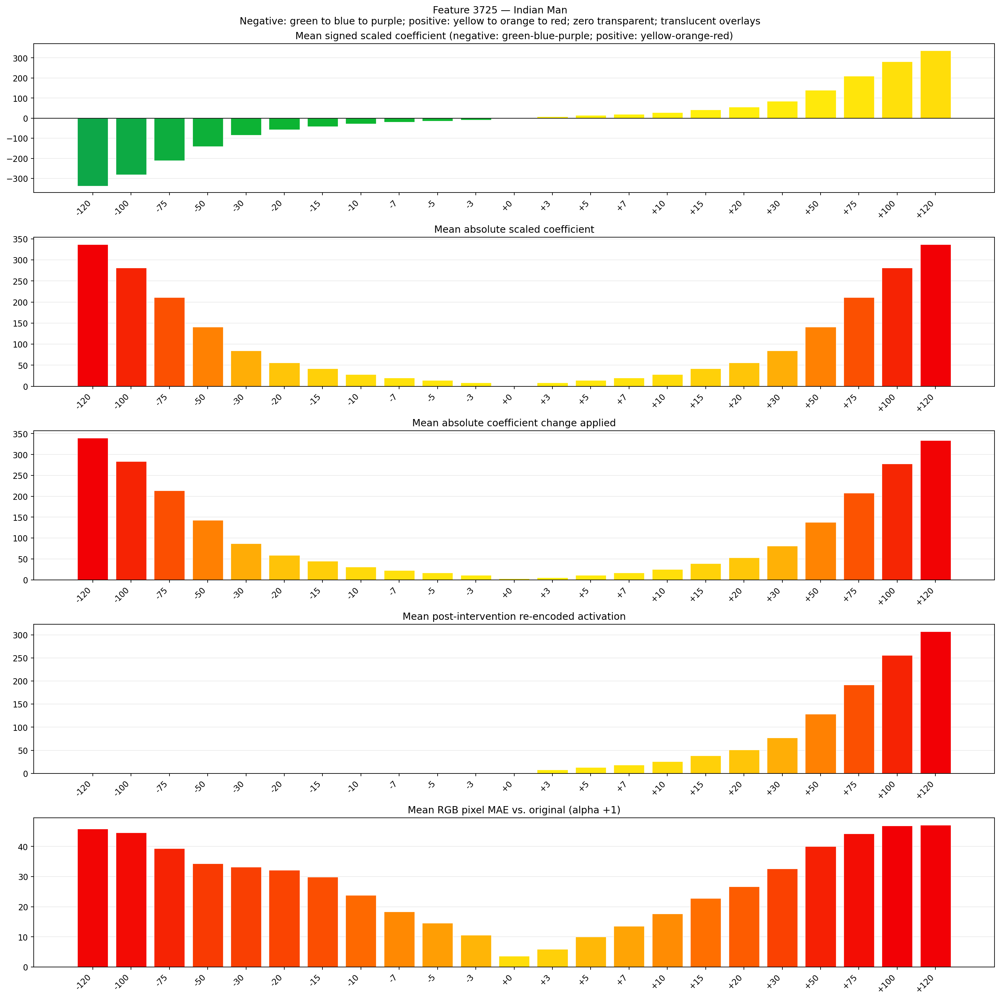
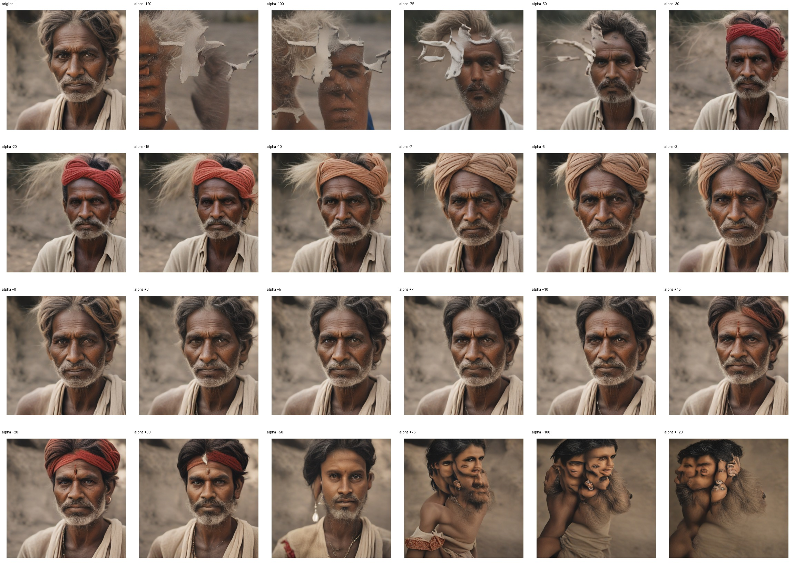
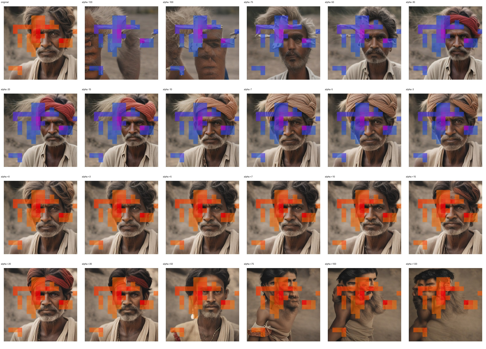
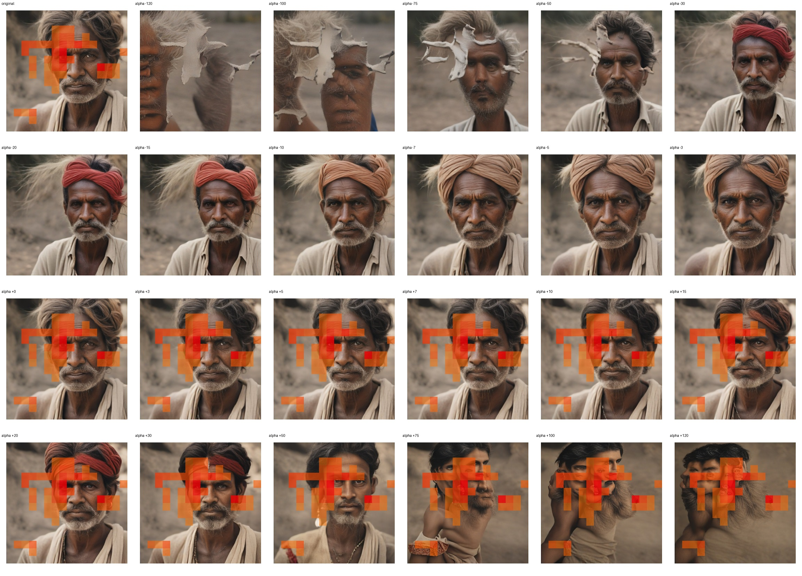

# Feature 3725 — Indian Man

Biased dataset; original prompt and seed replay for seeds 0–19. Values are means across 20 source images. The table reports the mean post-re-encoded activation of feature 3725, the active spatial fraction, mean RGB pixel MAE versus the original image (0–255 scale), and coefficient change magnitudes for each alpha.

## Activation graph

## Mean metrics by alpha

| Alpha | Mean post-reencoded feature 3725 activation | Active spatial fraction | Mean pixel change (MAE) | Mean absolute coefficient change | Mean absolute scaled coefficient |
|---:|---:|---:|---:|---:|---:|
| -120 | 0.000 | 0.000 | 45.897 | 339.890 | 337.081 |
| -100 | 0.000 | 0.000 | 44.573 | 283.709 | 280.900 |
| -75 | 0.000 | 0.000 | 39.329 | 213.484 | 210.675 |
| -50 | 0.000 | 0.000 | 34.278 | 143.259 | 140.450 |
| -30 | 0.000 | 0.000 | 33.213 | 87.079 | 84.270 |
| -20 | 0.000 | 0.000 | 32.113 | 58.989 | 56.180 |
| -15 | 0.000 | 0.000 | 29.823 | 44.944 | 42.135 |
| -10 | 0.000 | 0.000 | 23.870 | 30.899 | 28.090 |
| -7 | 0.000 | 0.000 | 18.322 | 22.472 | 19.663 |
| -5 | 0.000 | 0.000 | 14.615 | 16.854 | 14.045 |
| -3 | 0.000 | 0.000 | 10.592 | 11.236 | 8.427 |
| +0 | 0.000 | 0.000 | 3.591 | 2.809 | 0.000 |
| +3 | 7.926 | 0.209 | 5.855 | 5.618 | 8.427 |
| +5 | 13.042 | 0.209 | 9.997 | 11.236 | 14.045 |
| +7 | 18.159 | 0.209 | 13.527 | 16.854 | 19.663 |
| +10 | 25.834 | 0.209 | 17.694 | 25.281 | 28.090 |
| +15 | 38.626 | 0.209 | 22.826 | 39.326 | 42.135 |
| +20 | 51.417 | 0.209 | 26.692 | 53.371 | 56.180 |
| +30 | 77.000 | 0.209 | 32.643 | 81.461 | 84.270 |
| +50 | 128.167 | 0.209 | 40.020 | 137.641 | 140.450 |
| +75 | 192.125 | 0.209 | 44.234 | 207.866 | 210.675 |
| +100 | 256.083 | 0.209 | 46.927 | 278.091 | 280.900 |
| +120 | 307.249 | 0.209 | 47.117 | 334.272 | 337.081 |

## Per-seed grids

Each 4×6 sheet contains the original followed by the 23 alpha variants in ascending alpha order, from −120 through +120.

### Plain images

[All 20 plain-image grids](seed_sheets/)

### Signed coefficient overlays

[All 20 signed coefficient grids](signed_coefficient_overlays/)

### Post-re-encoded activation overlays

[All 20 post-activation grids](post_activation_overlays/)

### Intervention-footprint overlays

[All 20 intervention-footprint grids](intervention_footprint_overlays/)

Zero is transparent. Negative coefficient colors progress green through blue to purple; positive colors progress yellow through orange to red. Each map tile is normalized individually for visibility. The original and alpha-zero tiles show the pre-intervention feature map so its location remains visible.
