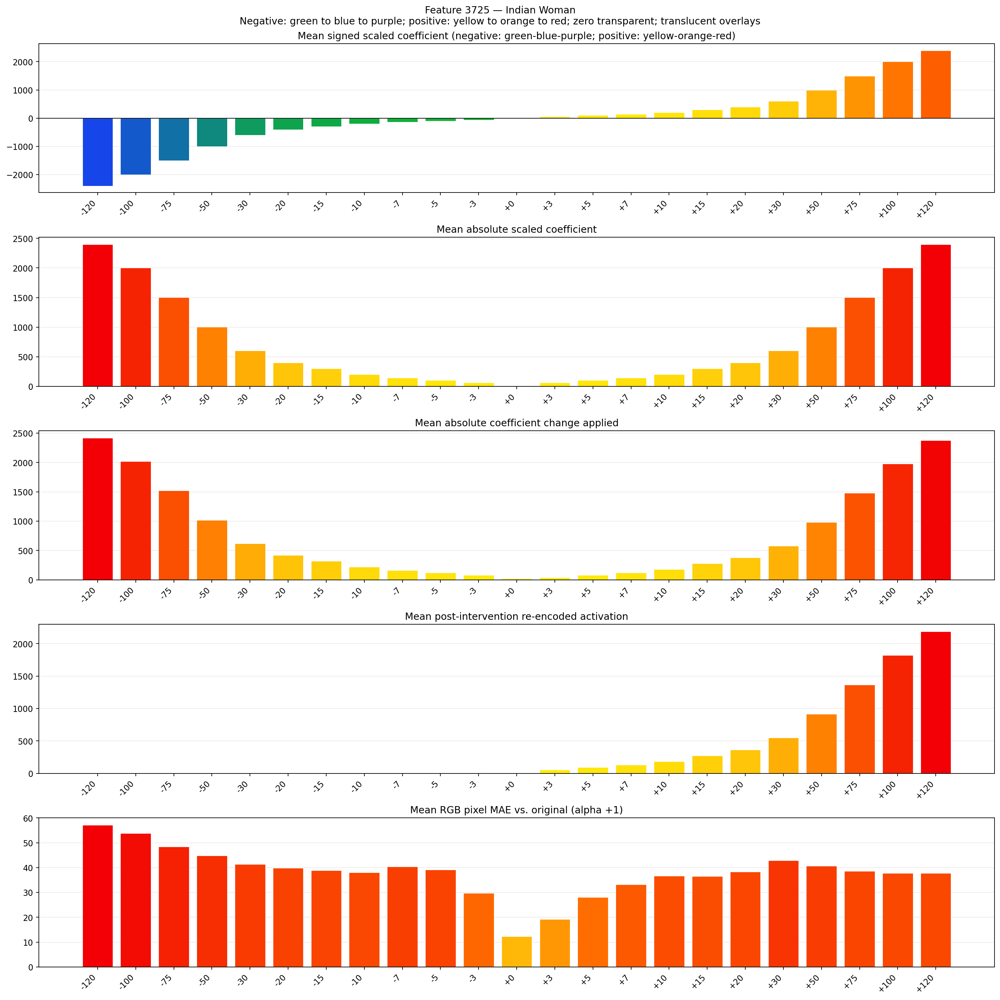
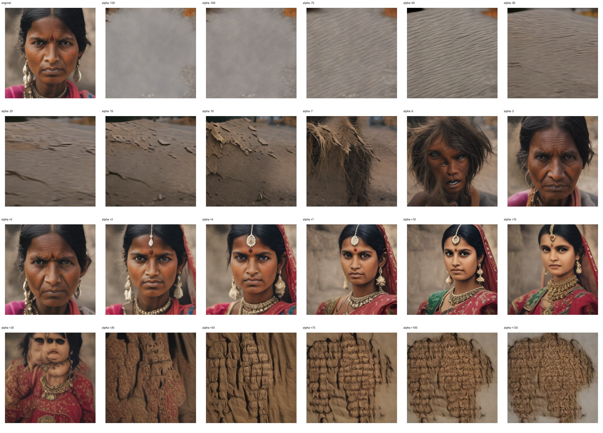
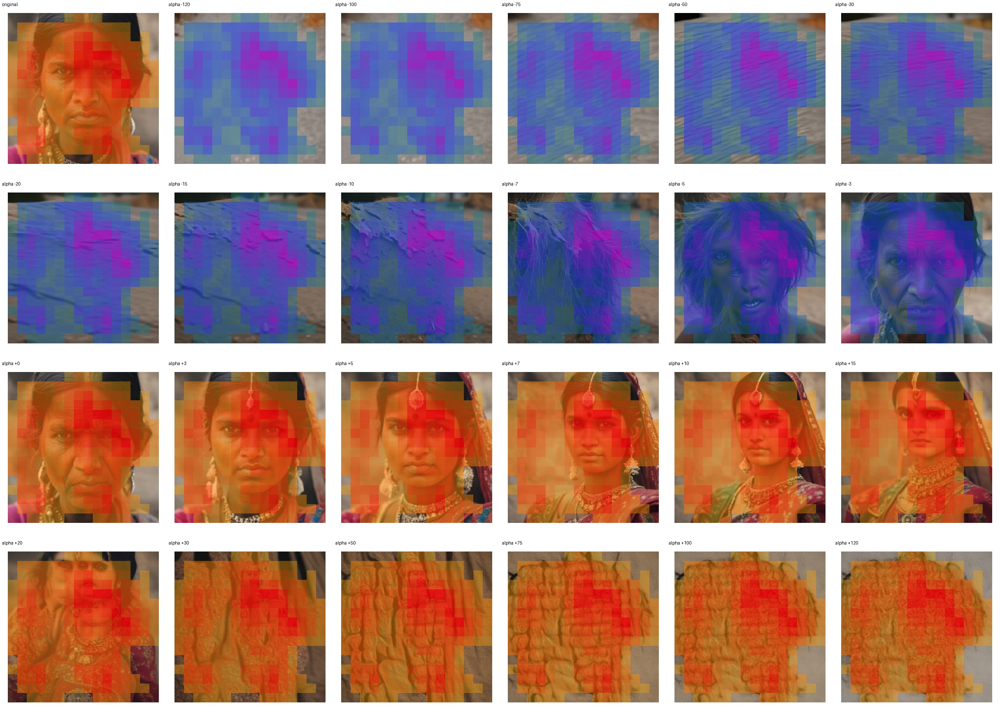
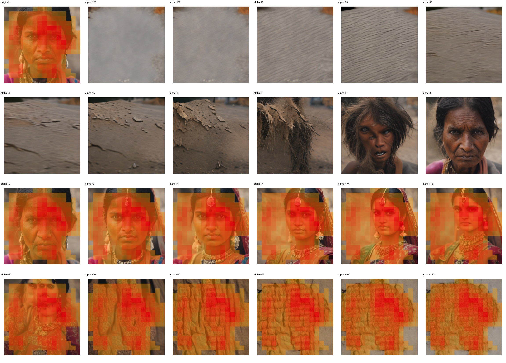

# Feature 3725 — Indian Woman

Biased dataset; original prompt and seed replay for seeds 0–19. Values are means across 20 source images. The table reports the mean post-re-encoded activation of feature 3725, the active spatial fraction, mean RGB pixel MAE versus the original image (0–255 scale), and coefficient change magnitudes for each alpha.

## Activation graph

## Mean metrics by alpha

| Alpha | Mean post-reencoded feature 3725 activation | Active spatial fraction | Mean pixel change (MAE) | Mean absolute coefficient change | Mean absolute scaled coefficient |
|---:|---:|---:|---:|---:|---:|
| -120 | 0.000 | 0.000 | 57.148 | 2420.303 | 2400.300 |
| -100 | 0.000 | 0.000 | 53.801 | 2020.253 | 2000.250 |
| -75 | 0.000 | 0.000 | 48.361 | 1520.190 | 1500.188 |
| -50 | 0.000 | 0.000 | 44.868 | 1020.128 | 1000.125 |
| -30 | 0.000 | 0.000 | 41.376 | 620.078 | 600.075 |
| -20 | 0.000 | 0.000 | 39.779 | 420.053 | 400.050 |
| -15 | 0.000 | 0.000 | 38.878 | 320.040 | 300.038 |
| -10 | 0.000 | 0.000 | 38.002 | 220.028 | 200.025 |
| -7 | 0.000 | 0.000 | 40.346 | 160.020 | 140.018 |
| -5 | 0.000 | 0.000 | 39.097 | 120.015 | 100.013 |
| -3 | 0.000 | 0.000 | 29.663 | 80.010 | 60.008 |
| +0 | 0.000 | 0.000 | 12.225 | 20.003 | 0.000 |
| +3 | 56.437 | 0.795 | 19.273 | 40.005 | 60.008 |
| +5 | 92.872 | 0.795 | 28.087 | 80.010 | 100.013 |
| +7 | 129.307 | 0.795 | 33.231 | 120.015 | 140.018 |
| +10 | 183.959 | 0.795 | 36.672 | 180.023 | 200.025 |
| +15 | 275.047 | 0.795 | 36.507 | 280.035 | 300.038 |
| +20 | 366.133 | 0.795 | 38.249 | 380.048 | 400.050 |
| +30 | 548.308 | 0.795 | 42.878 | 580.073 | 600.075 |
| +50 | 912.657 | 0.795 | 40.655 | 980.123 | 1000.125 |
| +75 | 1368.093 | 0.795 | 38.559 | 1480.185 | 1500.188 |
| +100 | 1823.528 | 0.795 | 37.790 | 1980.248 | 2000.250 |
| +120 | 2187.877 | 0.795 | 37.788 | 2380.298 | 2400.300 |

## Per-seed grids

Each 4×6 sheet contains the original followed by the 23 alpha variants in ascending alpha order, from −120 through +120.

### Plain images

[All 20 plain-image grids](seed_sheets/)

### Signed coefficient overlays

[All 20 signed coefficient grids](signed_coefficient_overlays/)

### Post-re-encoded activation overlays

[All 20 post-activation grids](post_activation_overlays/)

### Intervention-footprint overlays

[All 20 intervention-footprint grids](intervention_footprint_overlays/)

Zero is transparent. Negative coefficient colors progress green through blue to purple; positive colors progress yellow through orange to red. Each map tile is normalized individually for visibility. The original and alpha-zero tiles show the pre-intervention feature map so its location remains visible.
