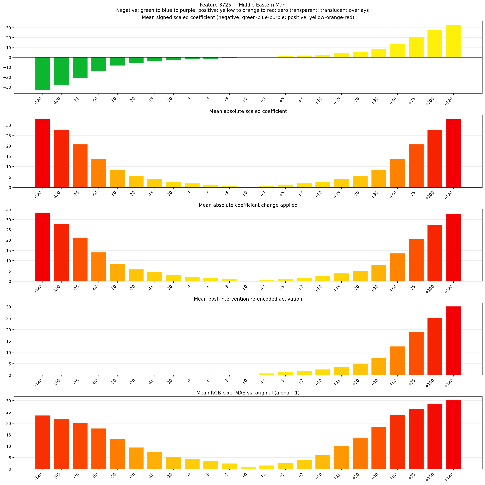
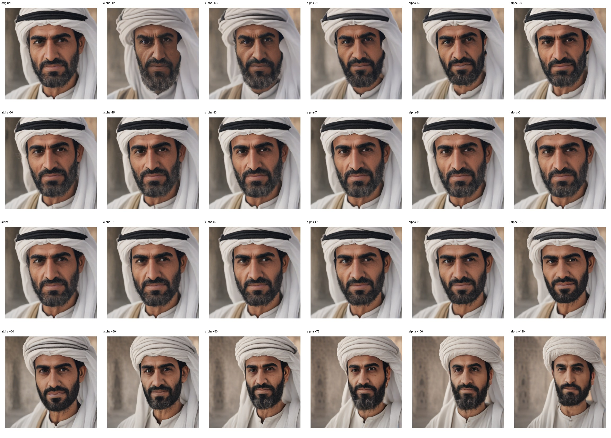
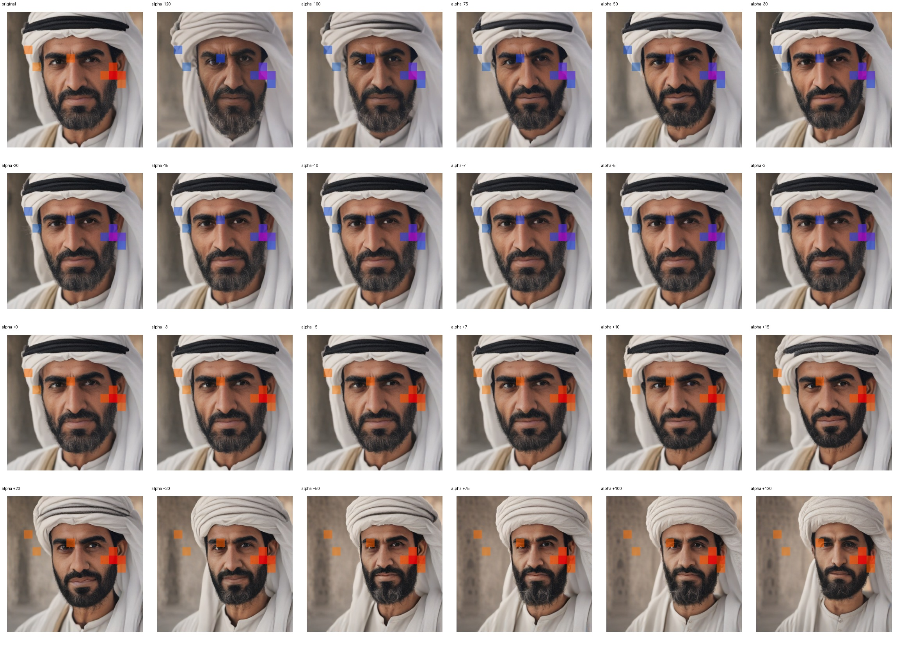
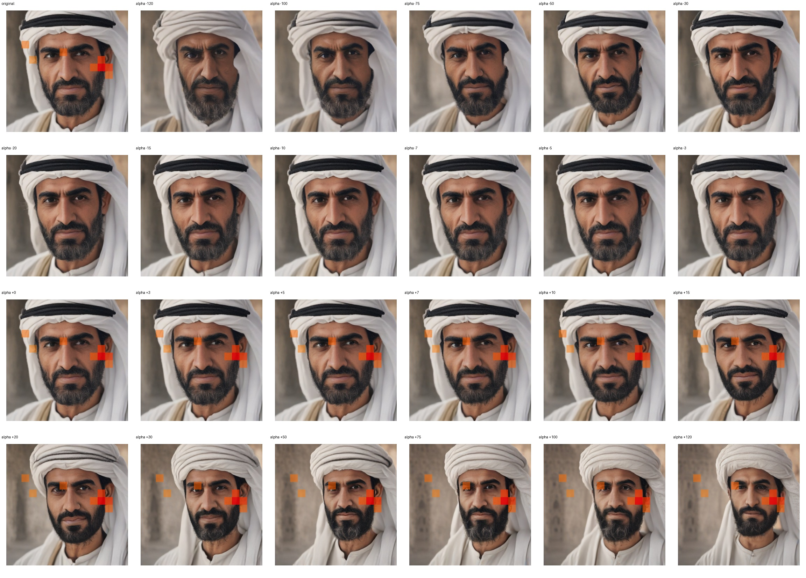

# Feature 3725 — Middle Eastern Man

Biased dataset; original prompt and seed replay for seeds 0–19. Values are means across 20 source images. The table reports the mean post-re-encoded activation of feature 3725, the active spatial fraction, mean RGB pixel MAE versus the original image (0–255 scale), and coefficient change magnitudes for each alpha.

## Activation graph

## Mean metrics by alpha

| Alpha | Mean post-reencoded feature 3725 activation | Active spatial fraction | Mean pixel change (MAE) | Mean absolute coefficient change | Mean absolute scaled coefficient |
|---:|---:|---:|---:|---:|---:|
| -120 | 0.000 | 0.000 | 23.500 | 33.458 | 33.181 |
| -100 | 0.000 | 0.000 | 21.838 | 27.928 | 27.651 |
| -75 | 0.000 | 0.000 | 20.208 | 21.015 | 20.738 |
| -50 | 0.000 | 0.000 | 17.833 | 14.102 | 13.826 |
| -30 | 0.000 | 0.000 | 13.111 | 8.572 | 8.295 |
| -20 | 0.000 | 0.000 | 9.462 | 5.807 | 5.530 |
| -15 | 0.000 | 0.000 | 7.432 | 4.424 | 4.148 |
| -10 | 0.000 | 0.000 | 5.488 | 3.042 | 2.765 |
| -7 | 0.000 | 0.000 | 4.269 | 2.212 | 1.936 |
| -5 | 0.000 | 0.000 | 3.410 | 1.659 | 1.383 |
| -3 | 0.000 | 0.000 | 2.499 | 1.106 | 0.830 |
| +0 | 0.000 | 0.000 | 0.941 | 0.277 | 0.000 |
| +3 | 0.780 | 0.027 | 1.596 | 0.553 | 0.830 |
| +5 | 1.284 | 0.027 | 2.826 | 1.106 | 1.383 |
| +7 | 1.788 | 0.027 | 4.115 | 1.659 | 1.936 |
| +10 | 2.543 | 0.027 | 6.198 | 2.489 | 2.765 |
| +15 | 3.802 | 0.027 | 9.968 | 3.871 | 4.148 |
| +20 | 5.061 | 0.027 | 13.513 | 5.254 | 5.530 |
| +30 | 7.580 | 0.027 | 18.506 | 8.019 | 8.295 |
| +50 | 12.616 | 0.027 | 23.679 | 13.549 | 13.826 |
| +75 | 18.912 | 0.027 | 26.506 | 20.462 | 20.738 |
| +100 | 25.208 | 0.027 | 28.456 | 27.375 | 27.651 |
| +120 | 30.245 | 0.027 | 30.171 | 32.905 | 33.181 |

## Per-seed grids

Each 4×6 sheet contains the original followed by the 23 alpha variants in ascending alpha order, from −120 through +120.

### Plain images

[All 20 plain-image grids](seed_sheets/)

### Signed coefficient overlays

[All 20 signed coefficient grids](signed_coefficient_overlays/)

### Post-re-encoded activation overlays

[All 20 post-activation grids](post_activation_overlays/)

### Intervention-footprint overlays

[All 20 intervention-footprint grids](intervention_footprint_overlays/)

Zero is transparent. Negative coefficient colors progress green through blue to purple; positive colors progress yellow through orange to red. Each map tile is normalized individually for visibility. The original and alpha-zero tiles show the pre-intervention feature map so its location remains visible.
